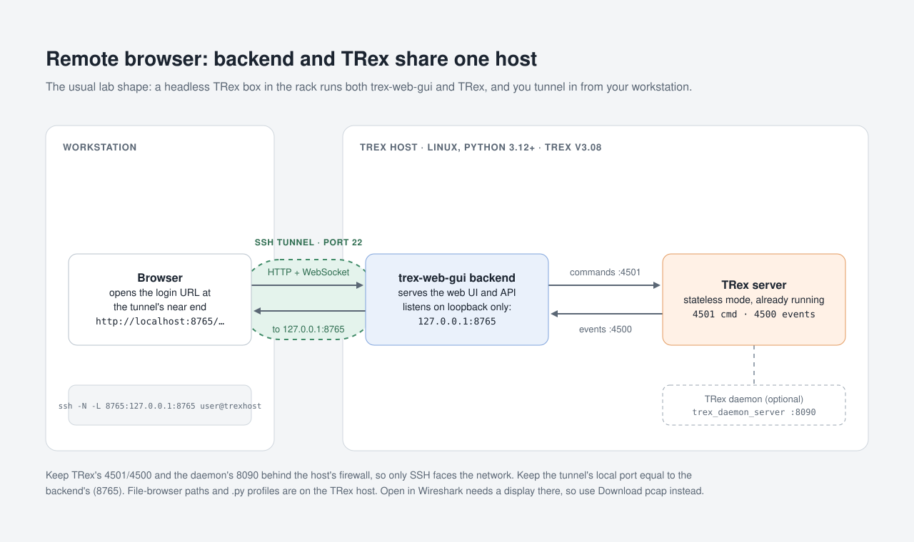
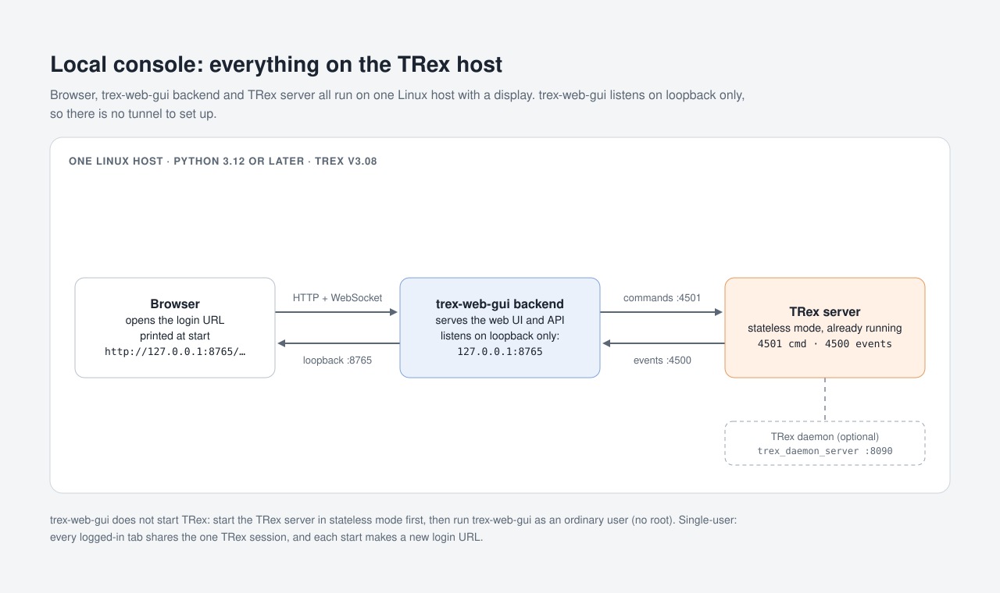
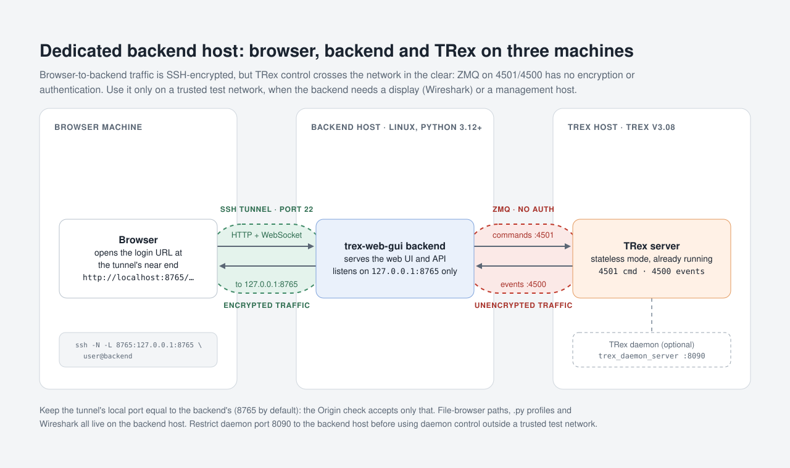

# trex-web-gui

trex-web-gui is a web interface for controlling and observing a [Cisco TRex](https://github.com/cisco-system-traffic-generator/trex-core)
traffic generator. It brings traffic control, statistics, packet capture, profile editing, passive monitoring and
control of the TRex emulation server (EMU) into one application, replacing the separate `trex-stateless-gui`,
`trex-packet-editor` and `trex-qt-gui` tools.

<!-- Product screenshot: added after the full re-shoot. -->

[Getting started](#getting-started) · [Install](#install) · [First launch](#first-launch) ·
[Access](#access-single-user-localhost-only) · [Command-line options](#command-line-options) ·
[Documentation](#documentation)

## What you can do

- **Control**: connect to a TRex server, acquire ports, assign profiles, start and stop traffic and configure ports
  ([guide](docs/gui-guide.md#3-control-page)).
- **Dashboard**: global, per-port, per-stream and latency statistics with charts
  ([guide](docs/gui-guide.md#6-dashboard)).
- **Capture**: watch packets live, record them on the server and save them as pcap
  ([guide](docs/gui-guide.md#8-capture)).
- **Editor**: build and edit stream profiles and packets offline
  ([guide](docs/gui-guide.md#9-editor), [packet editor](docs/gui-guide.md#10-packet-editor)).
- **EMU**: load an EMU profile and read its namespaces, clients and counters ([guide](docs/gui-guide.md#11a-emu)).
- **Monitor**: watch what a TRex server publishes, independent of the control connection
  ([guide](docs/gui-guide.md#11-monitor)).
- **TRex daemon**: through TRex's optional daemon (`trex_daemon_server`), write a TRex config, start and stop TRex,
  run stateful profiles and read its logs ([guide](docs/gui-guide.md#12-trex-daemon-dialog)).

## Getting started

### What you need

Traffic control targets TRex v3.08 in stateless (STL) mode, STL API 5.1. The passive Monitor also shows what stateful
(`-f`) runs publish.

trex-web-gui is a single-user application. The backend listens on loopback only, and every logged-in browser tab shares
its one TRex session. Each start makes a new login URL.

The browser, the backend and the TRex server can be on three different machines:

- **The backend host** runs trex-web-gui. It needs Linux, with Python 3.12 or later (tested on 3.12–3.14). `uv`
  fetches one if the host has none.
  - Paths in the file browser are on the backend host, `.py` profiles run there as code (as the user who started
    trex-web-gui), and Wireshark opens there.
  - Optional: Wireshark (the Capture page's **Open in Wireshark**, which needs a display there).
- **The TRex server** is a TRex v3.08 in stateless mode, already running
  ([Starting the TRex server](#starting-the-trex-server)).
  - The backend host must be able to reach its command and event ports, 4501 and 4500 by default.
  - Optional, on the TRex host: the TRex daemon (`trex_daemon_server`) for the daemon dialog.
- **The browser** is a current browser, on the backend host or on another machine through an SSH tunnel
  ([Access](#access-single-user-localhost-only)).

Three common layouts, from one host to three:

1. **Local console.** Everything on the TRex host, which needs a display for the browser. No tunnel. TRex still
   listens on 4501, 4500 and the daemon's 8090 on every interface, so on a shared network block them with the
   host's firewall.

2. **Remote browser,** the usual lab shape. The backend runs on the TRex host, and a browser on your workstation
   reaches it through an SSH tunnel. Only SSH needs to face the network.

   

3. **Dedicated backend host.** The backend runs on a third machine, for example one with a display for Wireshark.
   It must reach the TRex server's ports 4501 and 4500 over the network, and that ZeroMQ (ZMQ) traffic has no encryption
   or authentication, so use this layout only on a trusted test network.

<details><summary>Other layouts: one host, three hosts</summary>





</details>

trex-web-gui does not start TRex or `trex-console`. It takes `trex-console`'s place as a client of a TRex server that is
already running in stateless mode, on its command and event ports (`--server`). Only the **TRex daemon…** dialog
starts one, through `trex_daemon_server`. trex-web-gui needs no root: run it as an ordinary user. `.py` profiles run as
code as that user ([Where things are on the backend host](#where-things-are-on-the-backend-host)), so running
trex-web-gui as root would run them as root.

Restrict access to the TRex daemon before using daemon control outside a trusted test network
([Daemon exposure](#daemon-exposure)). [`SECURITY.md`](SECURITY.md) says what protects the backend and what does
not.

### Install

trex-web-gui is not on PyPI. One command installs the latest release with [`uv`](https://docs.astral.sh/uv/).

**Install uv first** if `uv --version` finds none. uv's standalone installer needs no `sudo`:

```sh
curl -LsSf https://astral.sh/uv/install.sh | sh
```

- It puts `uv` in `~/.local/bin` and adds that directory to your shell profile.
- Open a new terminal afterwards, so the new `PATH` takes effect.
- [uv's installation page](https://docs.astral.sh/uv/getting-started/installation/) lists the other ways to install
  it, such as a package manager or `pipx install uv`.

Then install trex-web-gui:

```sh
curl -fsSL https://github.com/CRinATL/trex-web-gui/releases/latest/download/install.sh | sh
```

On a terminal the script:

- prints the wheel's sha256 and the release page;
- downloads the wheel;
- checks it against that sha256;
- stops on a prompt.

Compare the sha256 with the one the release page lists next to the wheel, then press Enter to install. Without a
terminal there is no pause: it installs at once and says so. `TREX_WEB_GUI_YES=1` skips the pause for an unattended
install: put it before `sh`, as in `curl -fsSL … | TREX_WEB_GUI_YES=1 sh`. The install ends with
`Installed 1 executable: trex-web-gui`.

**To upgrade**, stop the running backend, then run the same command. It replaces the installed version.

The script ends by printing how to start the backend: `trex-web-gui`. When `~/.local/bin` is not on your `PATH`, it
does two more things:

- It gives the command's full path instead.
- It adds the directory to your shell profile with `uv tool update-shell`. To have it print the steps instead and
  leave your profile alone, put `TREX_WEB_GUI_NO_MODIFY_PATH=1` before `sh`. A re-run whose profile already names
  the directory says so instead of asking uv again.

The terminal you installed from keeps its old `PATH`
([The `trex-web-gui` command and `PATH`](docs/install.md#the-trex-web-gui-command-and-path)).

<a id="offline-host"></a>Pinned or older versions, [offline hosts](docs/install.md#offline-host) and the install internals are in [`docs/install.md`](docs/install.md).

Next: [First launch](#first-launch).

### First launch

After the install, on the machine that can reach the TRex server ([Install](#install)):

1. Start the backend (on the backend host):

   ```sh
   trex-web-gui
   ```

2. **Open the login URL it prints**, `Open: http://127.0.0.1:8765/api/auth/login?token=...`, in a browser on that
   host. Each start makes a new URL.
   - **From another machine** (your workstation), run there the SSH tunnel command the backend prints, and open the
     URL the backend prints for the other end
     ([Access: single user, localhost only](#access-single-user-localhost-only)).
   - A wall display uses the same tunnel ([Monitor and wall displays](#monitor-and-wall-displays)).
3. **Connect to TRex.** In the GUI, press **Connect…**, enter the TRex server, and connect. TRex must be running in
   stateless mode ([Starting the TRex server](#starting-the-trex-server)). `trex-web-gui --server HOST`, run on the
   backend host, prefills the dialog. [Command-line options](#command-line-options) lists every option.
4. Acquire the ports you will use, assign a traffic profile, and start traffic. Watch it on the **Dashboard**. Stop
   the traffic and release the ports when you are done.
5. **Ctrl+C in the backend's terminal stops the backend.**

For a worked example, with the test topology and how to confirm the frames arrive, follow
[`docs/howto-first-stream.md`](docs/howto-first-stream.md). **How to use the GUI, page by page:
[`docs/gui-guide.md`](docs/gui-guide.md).**

If the backend does not start:

- **`command not found`** means `~/.local/bin` is not on your `PATH`. Run `~/.local/bin/trex-web-gui` for now, and
  see [The `trex-web-gui` command and `PATH`](docs/install.md#the-trex-web-gui-command-and-path).
- **`ssh <host> trex-web-gui` answers `command not found`** even when a login finds it. A command given to `ssh`
  runs in a shell that is neither a login shell nor interactive, and Ubuntu's `~/.bashrc` stops early for such a
  shell, so no startup file adds the directory. Log in and start it there, or give the full path:
  `ssh <host> '~/.local/bin/trex-web-gui'`.

### Run it as a service

On the backend host, fetch [`docs/trex-web-gui.service`](docs/trex-web-gui.service) into your user units and start
it:

```sh
mkdir -p ~/.config/systemd/user
curl -fLo ~/.config/systemd/user/trex-web-gui.service https://raw.githubusercontent.com/CRinATL/trex-web-gui/main/docs/trex-web-gui.service
systemctl --user daemon-reload
systemctl --user enable --now trex-web-gui
```

Read the login URL with `journalctl --user -u trex-web-gui`. A user unit has no display, and Wireshark needs one: see
the comments in the unit.

## Starting the TRex server

On the TRex host, start TRex in interactive stateless mode (`-i`) from its install directory (here
`/opt/trex/v3.08`), as root:

```sh
cd /opt/trex/v3.08
sudo ./t-rex-64 -i --cfg /etc/trex_cfg.yaml
```

- **`-i` is the mode trex-web-gui controls.** TRex v3.08's `--help` describes it as "Run TRex in 'stateless'
  mode". Do not add `--astf`: advanced stateful (ASTF) is a different mode, and trex-web-gui does not control it. Do not
  start TRex with `-f <profile>` either: that is a stateful run, which has no command port, so only the Monitor works
  beside it ([Monitor and wall displays](#monitor-and-wall-displays)).
- **`--cfg`** names the platform configuration: the ports, cores and addresses. TRex reads `/etc/trex_cfg.yaml`
  when the option is left out. To create one, run `sudo ./dpdk_setup_ports.py -i` in the same directory: it asks
  about each interface.
- **Ports.** TRex takes commands on port 4501 and publishes events on 4500 unless its configuration sets
  `zmq_rpc_port` / `zmq_pub_port`. Those are the ports trex-web-gui uses when you give only a host. Otherwise give
  both, as `--server HOST:SYNC:ASYNC` or in the Connect dialog. The backend host must be able to reach both ports.
- **`--no-scapy-server`** is optional. It stops TRex starting its own Scapy server, which trex-web-gui never uses: the
  packet editor builds packets with the backend's own copy of the TRex client.
- **The command stays in the foreground** and shows TRex's own console. To leave it running after you log out, run
  it detached instead:

  ```sh
  sudo sh -c 'cd /opt/trex/v3.08 && setsid nohup ./t-rex-64 -i --cfg /etc/trex_cfg.yaml >/tmp/trex.log 2>&1 </dev/null &'
  ```

  Stop it with `sudo pkill -INT -x _t-rex-64`.

If the TRex daemon (`trex_daemon_server`) runs on the TRex host, the **TRex daemon…** dialog can start TRex instead.
It starts it in stateless mode, adding `-i` itself ([Daemon exposure](#daemon-exposure)).

## Access: single user, localhost only

The backend binds `127.0.0.1` and checks the `Host` and `Origin` headers. Each launch makes an access token and prints a
login URL, `Open: http://127.0.0.1:8765/api/auth/login?token=...`. Open that URL: it sets a session cookie, and without
it every `/api` route but `/api/auth/{login,status,logout}` answers 401 and the WebSocket closes, so the page shows only
"Not authorised". The token lives as long as the process, so a restart needs the new URL.

To use the GUI from another machine, tunnel the port over SSH. The banner prints the exact command,
`ssh -N -L 8765:127.0.0.1:8765 <user>@<host>`, and then the URL to open on that machine, `localhost` already in
it. Keep the local port the same as the backend's (`--port`, 8765 by default), because the `Origin` check accepts only
the serving port.

Anyone who has the token can drive the GUI. [`SECURITY.md`](SECURITY.md) says how it is protected and where it can
leak. What to do about it:

- **`TREX_WEB_GUI_TOKEN`** sets the token instead: 16 or more characters from `A-Za-z0-9_-`, or the backend exits
  with status 2. Do not pass it inline (`TREX_WEB_GUI_TOKEN=... trex-web-gui`): the value lands in your shell
  history.
- **The banner carries the token.** Run as a service, it lands in the journal. Treat the journal like the terminal.
- **The cookie is the token**, and a browser sends a cookie to every server on the same host, whatever the port. Open
  other local web apps under the other name: `http://localhost:<port>` when the GUI is at `127.0.0.1`, and
  `http://127.0.0.1:<port>` when you reach the GUI through a tunnel at `localhost`.

## Command-line options

Installed with `install.sh` or `uv tool install`:

```sh
trex-web-gui [options]
```

`trex-web-gui --help` lists the options. From a source checkout, see [CONTRIBUTING's Getting
started](CONTRIBUTING.md#getting-started).

| Option | What it does |
|---|---|
| `--port PORT` | The port to serve on, on `127.0.0.1` (default 8765). There is no option to listen elsewhere; a tunnel must use the same local port. |
| `--data-dir DIR` | Where the GUI keeps its own files (below). Default `$XDG_DATA_HOME/trex-web-gui`, else `~/.local/share/trex-web-gui`. |
| `--server HOST[:SYNC[:ASYNC]]` | The TRex server the Connect dialog prefills, with its command and event ports (an omitted ASYNC is SYNC-1; an IPv6 host with ports is written `[::1]:4601:4600`). |
| `--daemon-port PORT` | The TRex daemon port the daemon dialog prefills, on the `--server` host (default 8090). |
| `--monitor HOST[:PORT]` | Connects the Monitor to this TRex publish (PUB) socket at start-up (default port 4500). Independent of `--monitor-only`; `--server` does not apply to it. |
| `--monitor-only` | Serves the Monitor alone; see [Monitor and wall displays](#monitor-and-wall-displays). |

Ctrl+C closes the TRex session before the backend exits, which can take several seconds against a server that does not
answer. A second Ctrl+C is ignored and says so. Ctrl+\ quits at once, but the ports may stay acquired.

### Where things are on the backend host

Profiles for the Control page's Traffic tab are paths on the backend host, browsed with **Browse…**. `.py` profiles run
as code there when inspected or assigned.

Everything the GUI writes goes under the data directory:

- `settings.toml` (preferences and saved connections);
- `port_labels.toml` (port names);
- `test_setups/`;
- the Editor's profile library in `profiles/` (or the **Profile library directory** setting);
- your packet templates in `templates/` (or **Templates directory**);
- saved captures in `captures/`;
- files uploaded from a browser in `uploads/` (kept an hour).

The Settings page's **About** section shows the directory in use, and **Back up and restore** moves the settings,
saved connections, port names and test setups between backends as one JSON file.

## Monitor and wall displays

`trex-web-gui --monitor-only [--monitor HOST[:PORT]]` serves the Monitor alone: the top bar offers only
**Monitor** and **Settings** (the theme), and the backend answers 409 to every request that changes state and to the
capture, Editor (`/api/studio`), daemon, profile and file-browser routes. `--monitor` connects it to a TRex PUB socket at start-up. A
`--monitor-only` backend is still bound to `127.0.0.1`, so a wall screen on another machine reaches it through the same
SSH tunnel ([Access: single user, localhost only](#access-single-user-localhost-only)). The Monitor opens no remote
procedure call (RPC) connection and changes nothing on the server, so it also works beside a stateful (`-f`) run,
which has no command port.

## Daemon exposure

The **TRex daemon…** dialog starts and stops TRex through the TRex daemon (`trex_daemon_server`, port 8090). That daemon
is not part of trex-web-gui, and it has no authentication: it runs as root and binds `0.0.0.0` by default. Anyone who
can reach port 8090 can have code run as root, whatever trex-web-gui does, and trex-web-gui's own checks are not a
boundary against that ([`SECURITY.md`](SECURITY.md#upstream-not-trex-web-gui) has the mechanism).

Restrict port
8090 before you use daemon control outside a trusted test network: firewall it to the GUI host, or start the daemon with
`--trex-host 127.0.0.1` and reach it through an SSH tunnel. The project's own test VM is already safe: QEMU forwards its
daemon port on `127.0.0.1` only (`vm/launch.sh`).

## EMU

The **EMU** page drives the TRex emulation server (`trex-emu`, RPC port 4510) beside the stateless session: it shows
its namespaces, their clients and counters, and loads or removes an EMU profile.

- **Starting TRex with EMU.** On the project's test guest, `./t-rex-64 -i --emu` was enough. Upstream's tutorial
  uses `./t-rex-64 -i --software --emu`, and the TRex server refuses `--emu` where its DPDK mode needs a drop RX
  queue, asking for `--software`, so hardware NICs may need that flag. You can also add `--emu` to the extra
  arguments of the **TRex daemon…** dialog.
- **Port prerequisite.** None on the AF_PACKET test guest. On hardware NICs, EMU may need the TRex port in filtered
  service mode with mask 29 (DHCP, MDNS, NO_TCP_UDP, TRANSPORT): the Control page's service control can set it, and
  there is no EMU preset.
- **Connecting.** Open the **EMU** page, give the host and port (4510), and press **Connect**. The page's guide is
  [`docs/gui-guide.md`](docs/gui-guide.md#11a-emu); [`docs/howto-emu.md`](docs/howto-emu.md) walks through loading
  a stock EMU profile, reading its namespaces, clients and counters, and removing it.

### EMU exposure

EMU's RPC port (4510) has no authentication and no owner: anyone who can reach it can read and change every
namespace and client, whatever trex-web-gui does. Firewall it to the GUI host, or reach it through an SSH tunnel.
Within trex-web-gui:

- A profile load replaces everything on the EMU server, so it asks for a confirmation, and for a second
  acknowledgement when the server holds namespaces this app did not add.
- The shipped `trex-emu` v3.08 crashes (the server is gone until it is restarted) when a namespace that has the
  `ipfix` or `tdl` plugin at namespace level is removed, and when a client with `mdns` is added to a namespace that
  lacks `mdns` (measured with empty plugin configs). trex-web-gui refuses to load such a profile, and asks for an acknowledgement before it
  removes such a namespace it did not add. `ipfix` on a client, as in the stock `simple_ipfix.py`, loads and removes
  cleanly.
- A load that fails part-way (a 400 or 502) leaves a partial profile on the server; the page says so, and the profile can
  be loaded again.

## Documentation

- Send your first stream: [`docs/howto-first-stream.md`](docs/howto-first-stream.md), a walk-through that sends a first
  stream and watches it arrive.
- Load an EMU profile: [`docs/howto-emu.md`](docs/howto-emu.md), a walk-through of the EMU page with a stock EMU
  profile.
- Use the GUI, page by page: [`docs/gui-guide.md`](docs/gui-guide.md), the user's guide to every page, dialog, menu and
  shortcut.
- Install another way: [`docs/install.md`](docs/install.md), other ways to install, offline hosts, where the install
  puts things.
- See every screen: [`docs/gui-inventory/README.md`](docs/gui-inventory/README.md), every screen, with the screenshots
  in `docs/gui-inventory/screens/`.
- Automate with the API: [`docs/api.md`](docs/api.md), the REST and WebSocket reference, every HTTP route with its
  parameters, request body and response codes, and the WebSocket's message types. trex-web-gui serves no OpenAPI page
  itself (the token boundary), so the file is generated by `make api-docs`.
- What changed: [Release notes](https://github.com/CRinATL/trex-web-gui/releases), what changed in each release.
- Build from source and contribute: [`CONTRIBUTING.md`](CONTRIBUTING.md), building from a checkout, the checks, the
  conventions, the repository layout.
- Security: [`SECURITY.md`](SECURITY.md), the security model and how to report a problem.

## Help and contact

- Questions, bugs and suggestions: [GitHub issues](https://github.com/CRinATL/trex-web-gui/issues). trex-web-gui has one
  maintainer, who answers on a best-effort basis.
- Questions about TRex itself: upstream, at [trex-core](https://github.com/cisco-system-traffic-generator/trex-core).
- A security problem: privately, as [`SECURITY.md`](SECURITY.md) says, not in a public issue.

### Troubleshooting

| Symptom | Where it is explained |
|---|---|
| `command not found` | [First launch](#first-launch) and [the command and its path](docs/install.md#the-trex-web-gui-command-and-path) |
| The page shows **Not authorised** | [Access: single user, localhost only](#access-single-user-localhost-only) |
| Connect fails with "Cannot reach the TRex server" | [Starting the TRex server](#starting-the-trex-server) |
| Tx counts rise but Rx stays at zero | [`docs/howto-first-stream.md`](docs/howto-first-stream.md): "Without the loop the Rx check at the end of each part shows nothing" |

### Probe a server for a bug report

When a TRex server behaves differently from what the GUI expects (a port that refuses an attribute, counters that
fail to read, virtual-function ports), the probe collects what each port lists and supports into one JSON file to
attach to an issue. It is one file, not part of the install: download it on the TRex host, read it, and run it with
the Python trex-web-gui is installed under (any release):

```sh
curl -fLO https://raw.githubusercontent.com/CRinATL/trex-web-gui/main/scripts/trex_probe.py
"$(uv tool dir)/trex-web-gui/bin/python" trex_probe.py --out trex-probe.json
```

By default it only reads: it acquires no port and changes nothing. `--write 2,3` also tries promiscuous, multicast,
LED, flow control, service mode and a short capture on those ports, puts each back (the LED is left off, as its
state cannot be read) and releases them; it touches only a port that is idle and owned by nobody else (release it in
the GUI first). `--traffic 0:2` sends three bursts of 1000 packets from port 0 and counts them on port 2.
`--try-link` adds a link down and up to `--write`; on a physical port that takes its virtual functions down too.
`--help` lists the rest.

MAC, IP and PCI addresses, host, user and interface names are replaced by tokens (`mac-1`, `host-1`); read the file
before you share it, as the scrubber replaces only what it recognises.

Licence: GPL-2.0-or-later ([`LICENSE`](LICENSE), [`NOTICE`](NOTICE)).
