# trex-web-gui GUI inventory

## Scope

**Re-shot for v1.0.0 (2026-10-30).** Every screen was shot again on the renamed application (`1.0.0rc5`; About,
[57](screens/57-settings-about.png), was retaken on `1.0.0`) against the same guest, replacing the pre-release shots of
2026-10-21 to 10-26. New: [115](screens/115-traffic-profile-note.png), a floating ⓘ note. The backend runs under the
neutral user name `demo` ([`vm/shoot_serve.py`](../../vm/shoot_serve.py)), which the Control tab's **Owner** chip
shows. Events times carry the time zone of the machine that shot them.

This inventory shows **the GUI after the layout rework** (the 2026-10-22
layout rework), captured on 2026-10-22 against the TRex v3.08 test guest (`vm/launch.sh
trex_ready`, STL mode, ports 0 and 1 looped back to each other, live traffic on both) in headless Chrome at a
1400x900 viewport with device scale factor 2, so every PNG is 2800x1800 pixels. The exceptions are the two shots
at a 540 px tall window ([82](screens/82-manage-setups-540px.png) and
[84](screens/84-import-preview-540px.png), 2800x1080) and the three small status-line crops
(`85` to `87`). It replaces the inventory made before the rework, which the rework was written from. It describes
what the screens are now; the design is recorded in the development records (private).

**Re-shot for P4a (2026-10-24).** Every screen was shot again from the P4a (profiles) work against the same
guest, which adds the Studio page ([5](#5-studio-page), shots `88` to `94`) and its links from Control and Settings, and
removes the Studio placeholder (old `51`). The script stages its own profiles in a scratch directory under `/var/tmp` and
points Browse and the Workspace directory there, so no screen lists the home directory of the person running it; that
scratch path shows in [22](screens/22-browse-dialog.png), [54](screens/54-settings-files.png),
[57](screens/57-settings-about.png), the Traffic tab's profile path and the Studio shots.

**Re-shot for P5 (2026-10-24).** Every screen was shot again from the P5 (Monitor and daemon) work against the same guest (the
Control page's toolbar gained **TRex daemon…**, so every Control shot changed). New: the Monitor page ([5.7](#57-monitor), `52`
retaken and `95`-`99`), the TRex daemon dialog ([5.8](#58-trex-daemon-dialog), `100`-`104`) and the stateful run's two Control
surfaces ([5.9](#59-a-stateful-run), `105`, `106`). The new steps change the guest: `daemon` runs `vm/daemon.sh start` and `vm/mode.sh stop`
(a stateful run needs the snapshot's TRex gone) and always `vm/daemon.sh stop` after; `monitor_stateful` serves the recorded
stateful frames (`tests/fixtures/p5/pub-stateful.jsonl`) from `tests/fake/fake_trex.py --pub-replay` on ports 18500/18501, because
the guest runs no stateful TRex while the Control session is up. Those three shots (`97`-`99`) therefore show recorded values, not the guest's.

**Added for P4b (2026-10-25).** The packet editor ([5.6a](#56a-packet-editor-p4b), shots `107`-`114`) is a page of its own
(`/studio/packet`) and is embedded in a stream's Packet tab. The Studio shots before `107` were not retaken for it.

**How the shots were made.** `vm/shoot_inventory.py` (committed with this inventory; the tool behind the first
re-shoot never was). `vm/demo.sh up` brings up the guest; the script then starts its own
`trex-web-gui serve --data-dir <scratch>` on port 8766, through `vm/shoot_serve.py` (a neutral data dir, so no saved connections or settings of the
person running it appear) and drives headless Chrome over the DevTools protocol with real mouse and keyboard
events. `vm/demo.sh down` afterwards. Rerun it to refresh every screenshot; the step list in the script is the
order below.

**What is gone since the earlier inventory.** The About dialog (old `03-about-dialog.png`) and the Name port dialog (old
`11-name-port-dialog.png`) no longer exist (the numbers 03 and 11 now belong to the Connect dialog and Start all): About is the last section of Settings ([57](screens/57-settings-about.png)), and a port's name is a field in
its Control tab ([13](screens/13-port-control-top.png)). Monitor is a real page since P5 and has its link back (the old placeholder shot `52` is retaken as [52](screens/52-monitor-disconnected.png), the page disconnected). Studio is a real page since P4a and has its link back. The
Events log is no longer in the Control page's left column: it is its own page ([2.15](#215-events-page)). The Connect
and Disconnect buttons left the Control toolbar for the status bar. The shots `01`-`75` of the old inventory are
replaced by `01`-`87` (`88`-`94` added by P4a, `95`-`106` by P5); the numbers were reassigned, and the files are listed in section 9.

**Themes.** Every screenshot is in the **Light** theme, except [59](screens/59-dashboard-dark.png) (Dark) and
[60](screens/60-dashboard-high-contrast.png) (High contrast). Headless Chrome prefers a light colour scheme, so
**System** looks like Light here.

Screenshots are full-viewport. Where a page is taller than the viewport, it scrolls inside `<main>` (the top bar and
status bar stay put). A dialog or menu is shown open over its page. Values in the screenshots (rates, counters,
times) are whatever the guest produced at that moment.

## Contents

1. [Shell](#1-shell)
   - [1.1 Not authorised page](#11-not-authorised-page)
   - [1.2 Top bar](#12-top-bar)
   - [1.3 Status bar](#13-status-bar)
   - [1.4 Keyboard shortcuts](#14-keyboard-shortcuts)
2. [Control page](#2-control-page)
   - [2.1 Disconnected](#21-disconnected)
   - [2.2 Connect dialog](#22-connect-dialog)
   - [2.3 Connected, root selected](#23-connected-root-selected)
   - [2.4 Toolbar](#24-toolbar)
   - [2.5 Devices tree](#25-devices-tree)
   - [2.6 Context menus](#26-context-menus)
   - [2.7 Start all dialog](#27-start-all-dialog)
   - [2.8 Port panel](#28-port-panel)
   - [2.9 Control tab](#29-control-tab)
   - [2.10 Config tab](#210-config-tab)
   - [2.11 Tools tab](#211-tools-tab)
   - [2.12 Traffic tab](#212-traffic-tab)
   - [2.13 Browse for a profile dialog](#213-browse-for-a-profile-dialog)
   - [2.14 Counters tab](#214-counters-tab)
   - [2.15 Events page](#215-events-page)
   - [2.16 Connection lost](#216-connection-lost)
   - [2.17 Saved test setups](#217-saved-test-setups)
3. [Dashboard page](#3-dashboard-page)
4. [Capture page](#4-capture-page)
5. [Studio page](#5-studio-page)
   - [5.1 Library](#51-library)
   - [5.2 Profile editor and stream table](#52-profile-editor-and-stream-table)
   - [5.3 Properties tab](#53-properties-tab)
   - [5.4 Packet tab](#54-packet-tab)
   - [5.5 Import dialog and the pcap options](#55-import-dialog-and-the-pcap-options)
   - [5.6 Simulate dialog](#56-simulate-dialog)
   - [5.6a Packet editor (P4b)](#56a-packet-editor-p4b)
   - [5.7 Monitor](#57-monitor)
   - [5.8 TRex daemon dialog](#58-trex-daemon-dialog)
   - [5.9 A stateful run](#59-a-stateful-run)
6. [Settings page](#6-settings-page)
7. [Not reached](#7-not-reached)
8. [Checks against the spec](#8-checks-against-the-spec)
9. [Screenshot list](#9-screenshot-list)

---

## 1. Shell

Source: `frontend/src/App.tsx`, `frontend/src/components/StatusBar.tsx`, `frontend/src/keys.ts`.

### 1.1 Not authorised page

- **How to open:** any URL of the app in a browser that has no session cookie (a fresh profile).
- **Purpose:** replaces the whole shell when the browser is not logged in; nothing else on the page would work.
- **Contents:** heading "Not authorised" and one sentence: open the URL printed by `trex-web-gui serve` on the backend host
  (through a tunnel, the same URL with `localhost`). No top bar, no status bar, no controls.
- **Logging in:** the printed URL is `/api/auth/login?token=…`; it sets the cookie and answers 303 to `/`, which the app routes to `/control`.

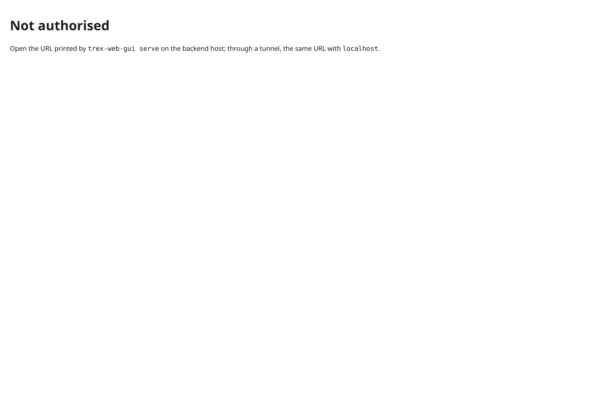

### 1.2 Top bar

- **Always shown** (when authorised), on every page; see any screenshot below.
- **Contents:** the app name "trex-web-gui" (bold, not a link); the nav links **Control**, **Dashboard**, **Capture**,
  **Studio**, **Monitor**, **Events**, **Settings** (the current one is underlined). Nothing at the right: the About button is gone.
- **Events badge:** a red count beside **Events** of the errors and warnings that arrived since the Events page was last
  open (visible in [58](screens/58-settings-changed-on-server.png) and [77](screens/77-manage-setups-run-failed-start.png));
  opening the page clears it.
- `/` redirects to `/control`. The Control, Capture and Studio pages stay mounted while hidden (their state survives
  page switches), and so does the packet editor page (`/studio/packet`) once it has been visited. **Monitor** ([5.7](#57-monitor))
  is a link between **Studio** and **Events**.

### 1.3 Status bar

A one-line footer (`role="status"`) at the bottom of every page, coloured by state, with the actions of that state at
its right (all three controls fit at 1400 px):

| State | Text | Colour | Actions | Screenshot |
|---|---|---|---|---|
| Disconnected | `Disconnected` | grey | **Connect…** | [02](screens/02-control-disconnected.png) |
| Connecting | `Connecting…` | orange | **Disconnect** | [05](screens/05-connect-connecting.png) |
| Connected | `Connected to 127.0.0.1:4501 · TRex v3.08 · 2 ports · you own 0, 1` | green | **Disconnect** | [08](screens/08-control-root-connected.png) |
| Connection lost | `Connection lost: <reason>` | red | **See Events** (a link), **Reconnect**, **Connect…** | [31](screens/31-control-connection-lost.png), [42](screens/42-dash-connection-lost.png) |
| Disconnected after a failed connect or Reconnect | `Disconnected: <error>` | grey | the same three as Connection lost (**Reconnect** only when the session still has its parameters) | [32](screens/32-statusbar-reconnect-failed.png) |
| Backend offline | `Backend offline, reconnecting…` | (offline class) | **Connect…** (disabled) | [83](screens/83-statusbar-backend-offline.png) |

- **Connect…** opens the Connect dialog over the current page ([2.2](#22-connect-dialog)); **Reconnect** connects with the
  parameters of the lost session, with no dialog.
- A failed **Disconnect** or **Reconnect** shows its message in red between the text and the buttons until the next
  attempt or the next change of state.
- **A failed Reconnect** (the guest was paused so that it could not answer): the backend moves the session from lost to
  disconnected and keeps the error, so the bar reads `Disconnected: <error>` and offers the same three controls as the lost
  state ([32](screens/32-statusbar-reconnect-failed.png)). A plain disconnect (the user's own, or none yet) carries no error
  and offers **Connect…** only. This was parked as `layout-rework-14-3` after the first re-shoot found the bar had lost
  **Reconnect**, and fixed in the fix round.
- The backend-offline state was reached by stopping the server with the page open (the page keeps its last content).

### 1.4 Keyboard shortcuts

- **Ctrl+Shift+C** opens the Connect dialog over the current page, from any page (it no longer navigates to Control).
- **Ctrl+Shift+P** goes to Settings.
- Escape closes every dialog; arrow keys, Home and End move within the devices tree, every tab strip (the port panel,
  Dashboard, Capture, Events, Settings, Tools, the daemon dialog's tabs, a stream's detail tabs and the Monitor
  Inspector's list of published names) and the context menu. Shift+F10 or the ContextMenu key opens the context
  menu on a tree row.
- Other keys live with their screens: the stream table's Ctrl+Z, Ctrl+Y, Ctrl+C, Ctrl+V, Del, Alt+↑/↓ and F2
  ([5.2](#52-profile-editor-and-stream-table)); the packet editor's Ctrl+Z, Ctrl+Y (or Ctrl+R) and Ctrl+D, and Ctrl+O and
  Ctrl+S on its page ([5.6a](#56a-packet-editor-p4b)); the arrow keys on the capture packet table, the Test setups list
  and the Studio library list.

## 2. Control page

Route `/control`. Source: `frontend/src/pages/ControlPage.tsx` plus the components named below.

Layout, top to bottom: heading "Control"; the toolbar; an alert line (only when there is an error); then two columns:
the left column holds the **devices tree only**; the right column holds the selected item's heading and panel.

### 2.1 Disconnected

- Toolbar: every button disabled except **Setups ▾** and **TRex daemon…**; the "Port —" group is in place, greyed.
- Tree: a single root row `TRex-` (no host yet). Right column: "Not connected. Use Connect… in the status bar
  (Ctrl+Shift+C) or click **Connect…**", the last a button.

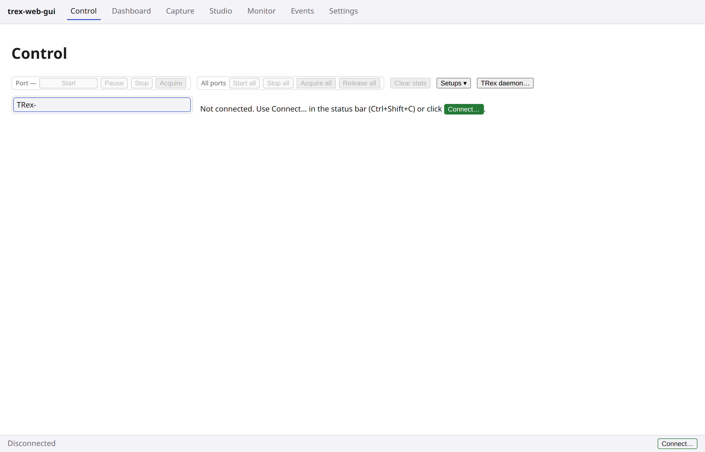

### 2.2 Connect dialog

Source: `frontend/src/components/ConnectDialog.tsx`.

- **How to open:** **Connect…** in the status bar, or Ctrl+Shift+C. It opens over whatever page is showing.
- **Purpose:** connect the backend's single session to a TRex server.
- **Contents (one aligned form, labels in one right-aligned column):**
  - **Saved** select (`—` plus each saved connection); when one is picked, a **Delete** button appears beside it, which
    turns into **Confirm delete** on the first click.
  - **Host** (focused; defaults to the backend's server hint, `127.0.0.1`) and the **Read-only (observer)** checkbox, a
    per-connect choice, not saved with the connection.
  - An **Advanced** fold with **Command port** (4501), **Event port** (4500) and **Timeout (s)** (3). While it is shut, a
    muted line shows the values (`Advanced · ports 4501 / 4500, timeout 3 s`). It opens by itself when the prefilled or
    picked values differ from the defaults. The ⓘ beside Command port says the ports are set on the TRex server by
    `zmq_rpc_port` and `zmq_pub_port` in its `trex_cfg.yaml`.
  - Error line(s); a note when the settings file could not be read.
  - Footer: **Save as…** at the left, **Cancel** and **Connect** at the right.
- **Behaviour:** validation runs before sending (host required; ports 1–65535; timeout 0.5–60 s). While connecting,
  Cancel is disabled and Connect reads **Connecting…**; the dialog stays open until the result arrives and closes on
  success. **Save as…** opens an inline **Name** row with **Save** and **Cancel** (no `window.prompt`) and saves host,
  ports and timeout to the settings file.

Initial state, Advanced shut:

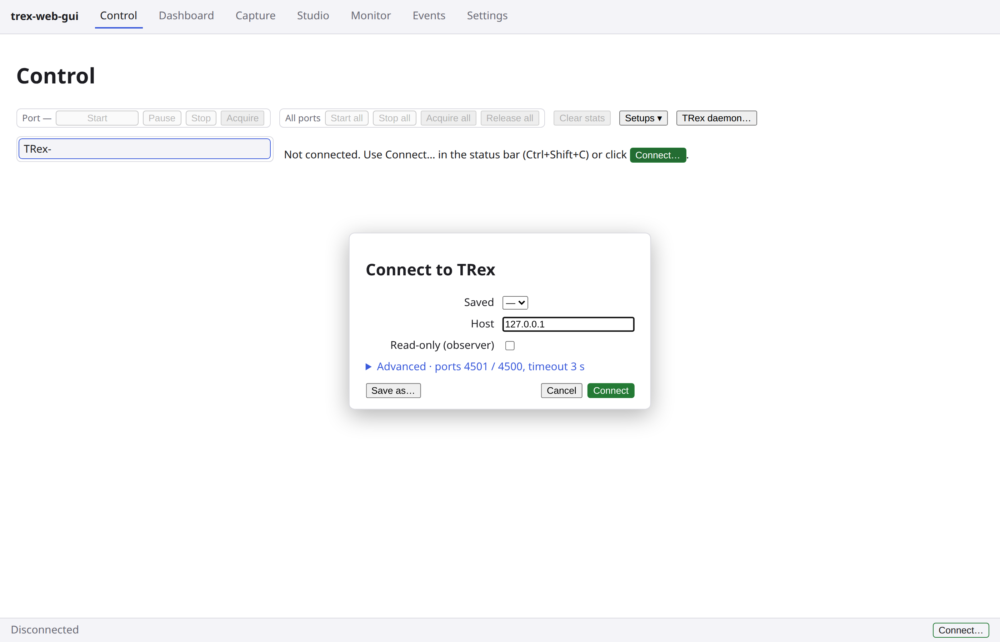

Advanced open:

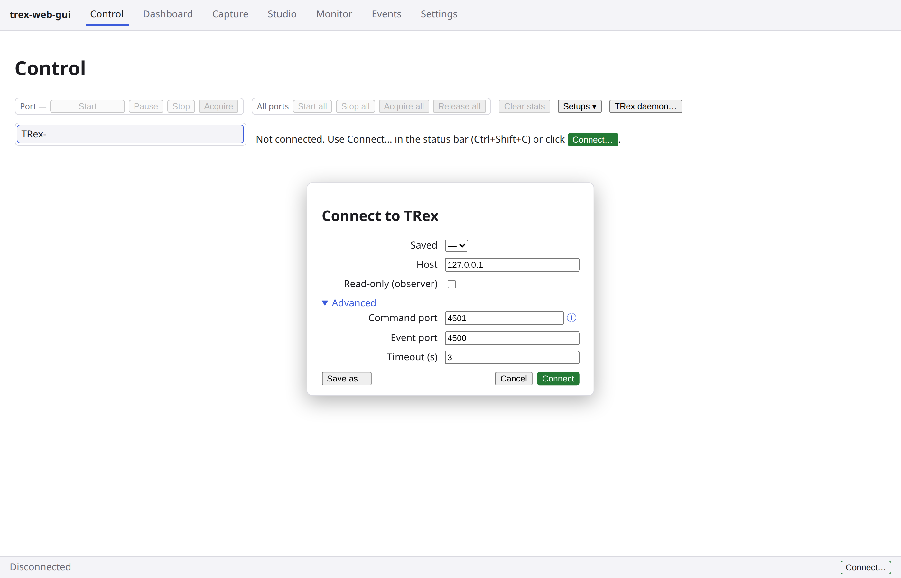

While connecting (an unreachable host with a 20 s timeout; the status bar reads Connecting… and offers Disconnect):

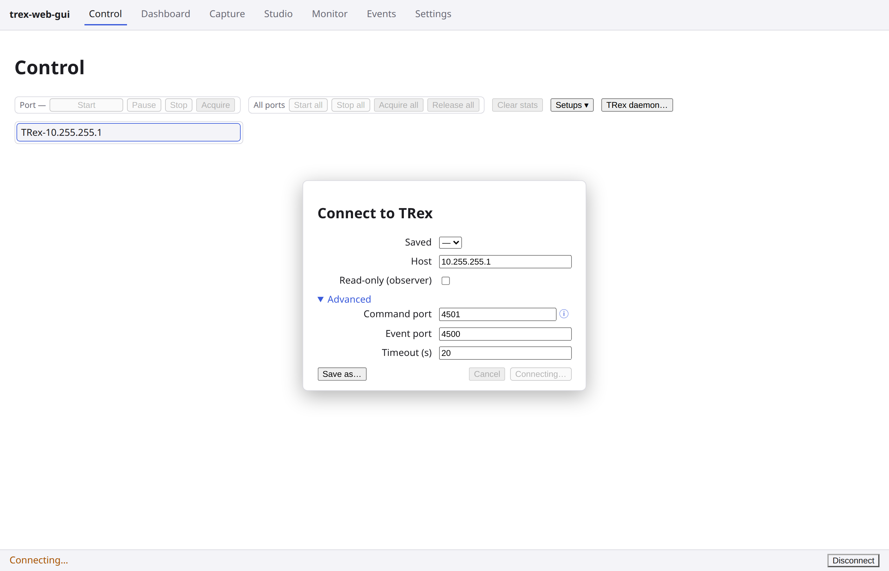

After a failed connect (the error stays in the dialog; the status bar reads `Disconnected: <error>` and offers **See Events**,
**Reconnect** and **Connect…**, and the Events link gains a count):

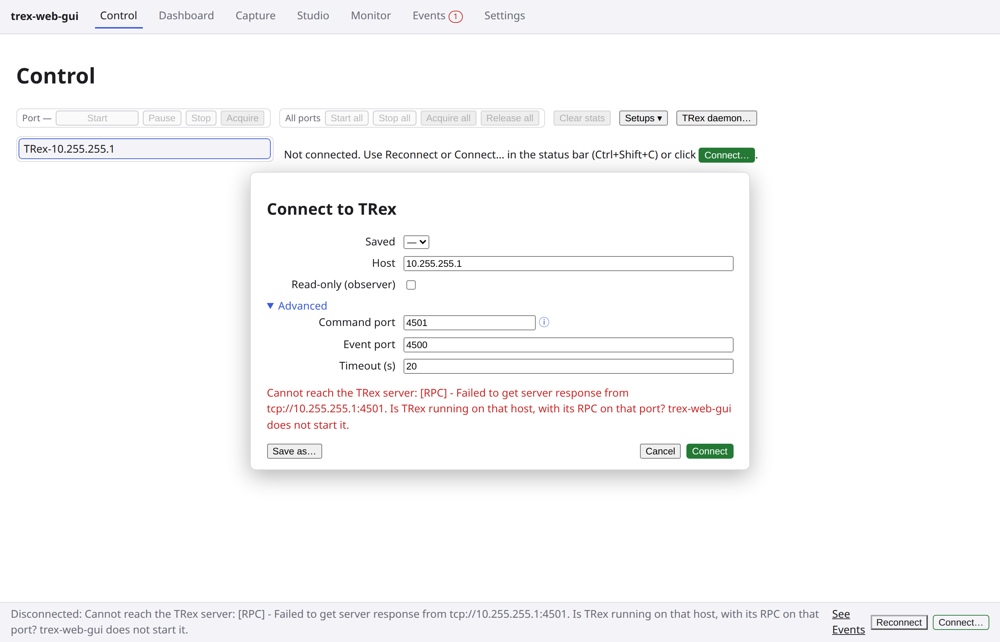

After **Save as…** (the Saved select now shows the new entry and a **Delete** button; saving clears the earlier error):

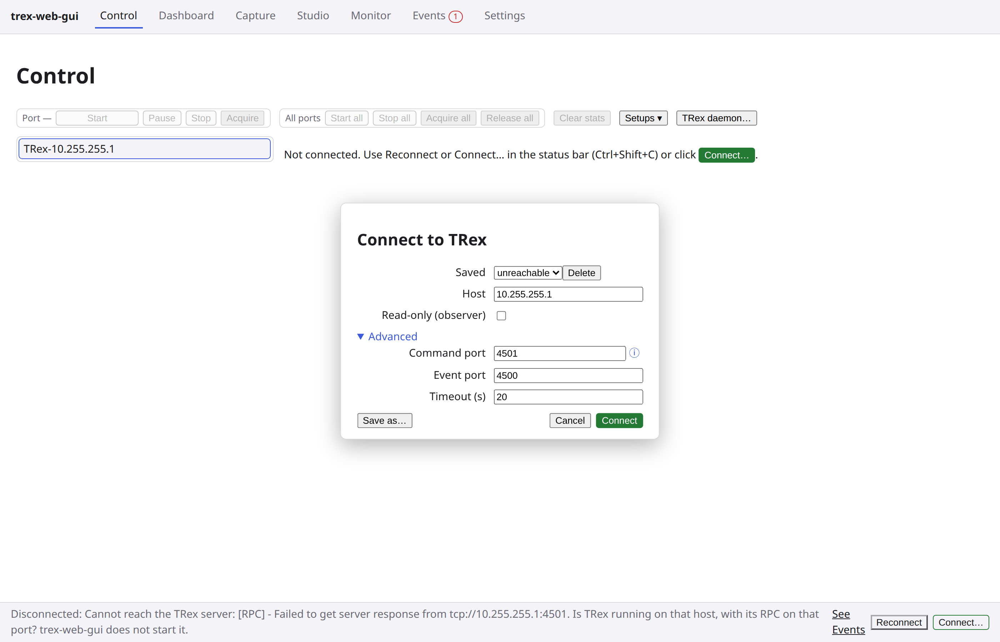

### 2.3 Connected, root selected

Source: `frontend/src/components/PortPanel.tsx` (`SystemInfo`).

- **How to open:** connect; the root row of the tree is selected by default (and again after **Start all**).
- **Purpose:** what the server is.
- **Contents:** a key/value table (**Version**, **Host**, **CPU**, **Ports**), a ports table, and the note about the
  interface lookup. The toolbar's "Port —" group is greyed at the root.

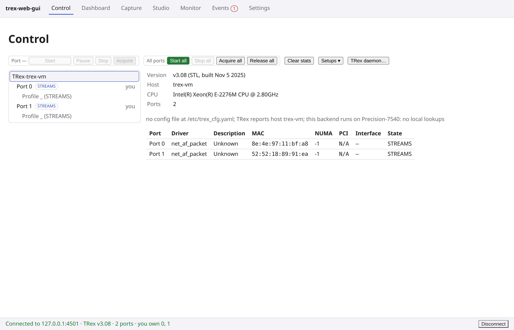

### 2.4 Toolbar

Source: `frontend/src/components/Toolbar.tsx`, `frontend/src/portActions.ts`.

Labelled groups, always in this order. The enabled rules come from `actionsFor` (every port action is also disabled in a
read-only session and whenever the session is not `connected`):

| Group | Button | Acts on | Enabled when |
|---|---|---|---|
| **Port N** (`Port —` at the root, greyed) | **Start** | selected port | you own it and its default profile is in STREAMS. It really starts the port with the port's Traffic form (multiplier, duration, force; the tooltip shows what it will send). A bad form opens the Traffic tab with the message. |
| | **Pause** / **Resume** | selected port | Pause: default profile in TX; the label becomes Resume when it is PAUSE. |
| | **Stop** | selected port | you own it and it is TX, PCAP_TX or PAUSE. |
| | **Acquire** / **Release** | selected port | Acquire: not owned by you; Release: you own it. |
| **All ports** | **Start all** | all owned ports | any owned port has its default profile in STREAMS. Opens the [Start all dialog](#27-start-all-dialog). |
| | **Stop all** | owned running ports | any owned port is running. |
| | **Acquire all**, **Release all** | all ports / your ports | there are ports / you own one. |
| (ungrouped) | **Clear stats** | the browser's stats baselines | session connected. |
| | **Setups ▾** | the saved test setups ([2.17](#217-saved-test-setups)) | always enabled; its menu has **Save current…** (needs a session, connecting included) and **Manage setups…**. |
| | **TRex daemon…** | the [daemon dialog](#58-trex-daemon-dialog) | always enabled, disconnected too (the daemon starts a TRex before anyone connects). Last in the row. |

Start, Pause and Stop are coloured by what they do (go green, hold amber, stop red); while a port sends, its Start is lit as
**● Transmitting** (paused: **❚❚ Paused**) and disabled, so the state never rests on colour alone.
Connect…, Disconnect and the old Dashboard button are no longer here. Toolbar Pause and Stop also cancel a pending live
update of the Traffic tab. Examples: disconnected ([02](screens/02-control-disconnected.png)); port in STREAMS selected
([12](screens/12-control-profile-selected.png)); port transmitting
([24](screens/24-port-traffic-transmitting.png)). The Setups menu:

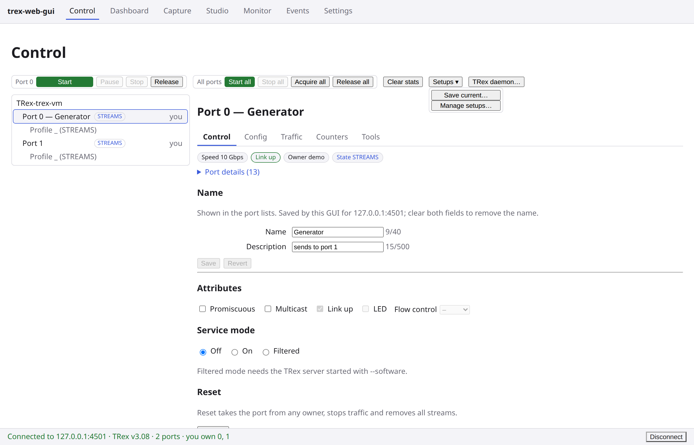

### 2.5 Devices tree

Source: `frontend/src/components/DevicesTree.tsx`.

- **Purpose:** choose what the right column shows, and what the toolbar and context menu act on.
- **Rows:** the root `TRex-<host>`; one row per port, `Port N` or `Port N — <name>` when named, with a state badge
  (IDLE, STREAMS, TX, …), the owner at the right (`you`, another user's name, or `—`) and an orange **SVC** badge when
  service mode is on or filtered; under each port, one row per profile, `Profile <id> (<state>)` (only the default
  profile `_` is controllable). The profile row selects the same port panel
  ([12](screens/12-control-profile-selected.png)).
- Click selects; right-click selects and opens the context menu.

### 2.6 Context menus

Source: `frontend/src/components/ContextMenu.tsx`, `frontend/src/portActions.ts`.

- **How to open:** right-click a tree row (or Shift+F10 / the ContextMenu key on a focused row). The context menus stay
  (spec §5.2): they hold items that exist nowhere else.
- **Root menu:** **Acquire all**, **Force acquire all**, **Release all**, **Re-acquire my ports**, **Start all**, **Stop all**.

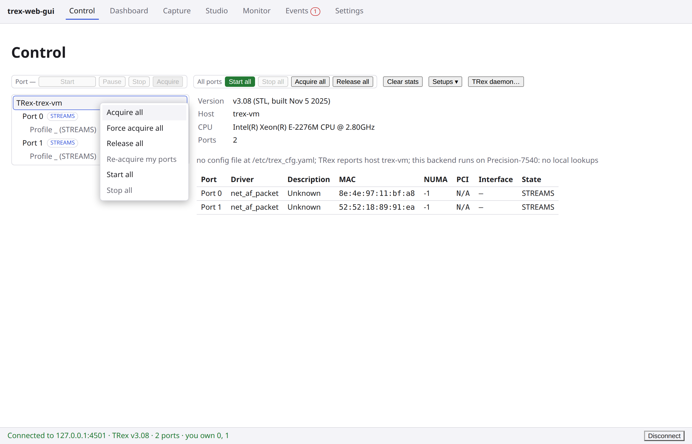

- **Port menu:** **Acquire**, **Force acquire**, **Release**, **Enable service mode** / **Disable service mode**,
  **Assign profile…** (Traffic tab, profile path), **Start…** (Traffic tab, multiplier; it reads "Start (assign a profile first)" while the port is IDLE), **Stop**, **Pause**, **Resume**,
  **Update…**, **Reset** (red; the first click turns the item into "Click again to confirm", lapsing after 5 s; with captures on the server it
  reads "Capture <ids> will be removed from the server (<n> unsaved packets). Click again to confirm"),
  **Name…** (opens the port's Control tab with the Name field focused). Disabled items stay listed, greyed.

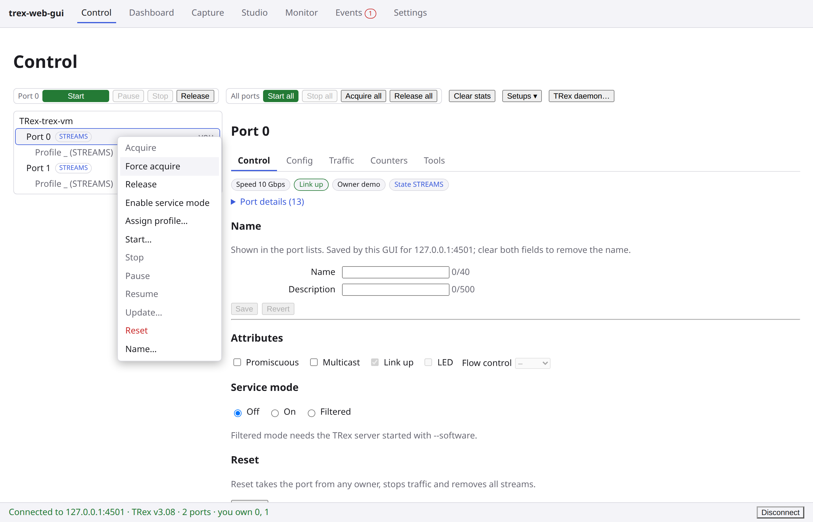

### 2.7 Start all dialog

Source: `frontend/src/pages/ControlPage.tsx` (`StartAllDialog`).

- **How to open:** toolbar **Start all** or the root menu's **Start all**. It also moves the tree selection to the root.
- **Purpose:** confirm starting every owned port whose default profile is in STREAMS, at ×1 of each profile's own rate.
- **Contents:** title "Start all ports", "Start ports 0, 1 at ×1 of each profile's rate?" and "Each port's Traffic tab settings (rate, duration, Force) are not
  used.", footer with
  **Cancel** at the left of **Start all** (focused).

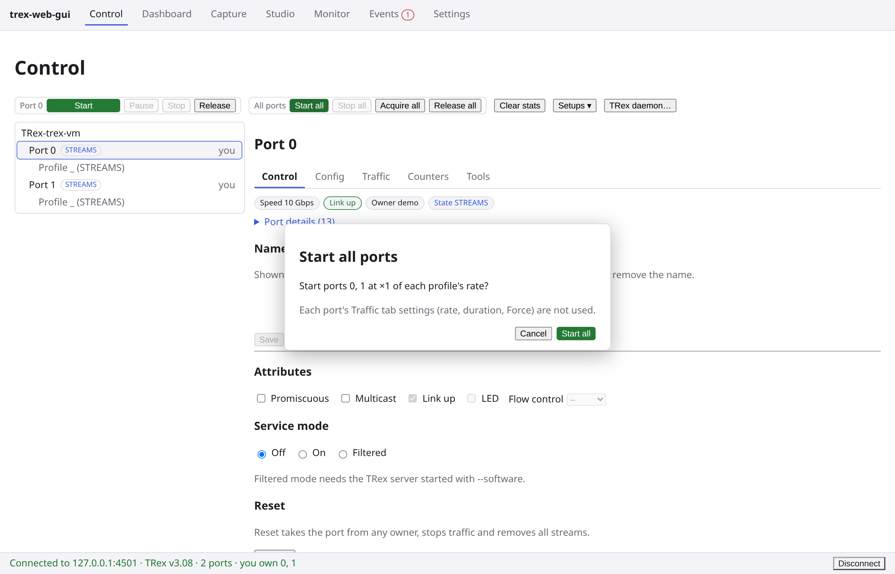

### 2.8 Port panel

Source: `frontend/src/components/PortPanel.tsx`.

- **How to open:** select a port or profile row.
- **Contents:** heading `Port N` / `Port N — <name>`; a tab strip **Control**, **Config**, **Traffic**, **Counters**,
  **Tools** (the same underline style as every tab strip). Control is the default tab. Start, Assign and Update requests
  from the menu switch to Traffic. Each port's Traffic form is kept per port in a store, so selecting another port and
  coming back finds it as it was; it survives switching tabs or pages and is **reset on a new connection** (a reconnect
  empties it, as the setups steps showed).

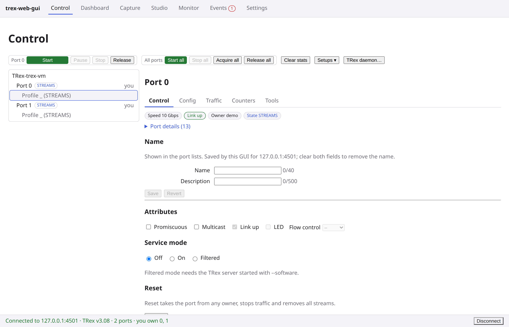

### 2.9 Control tab

Source: `frontend/src/components/PortControlTab.tsx`, `frontend/src/components/PortNameField.tsx`.

- **Purpose:** what the port is, its name, its attributes, service mode and reset.
- **Contents:**
  - A **status line** of chips: **Speed**, **Link**, **Owner**, **State** (the State chip is coloured like the tree's badge,
    and always carries its text; [85](screens/85-chips-idle.png), [86](screens/86-chips-tx.png),
    [87](screens/87-chips-pause.png) show IDLE, TX and PAUSE; STREAMS is in [13](screens/13-port-control-top.png)).
  - A **Port details (13)** fold, closed by default, with the read-only rows: Driver, Description, MAC, PCI, Interface,
    Card, Bound driver, NUMA, RX filter mode, VLAN tags, Capture port, Grat ARP, RX queueing. (Speed, Link, Owner and State
    are the chips; Service, Promiscuous, Multicast and Flow control are controls below, so they are not repeated.)
  - **Name** block: **Name** (limit 40) and **Description** (limit 500) fields as rows of one aligned form, each with a live count beside it, and one action bar with **Save** and **Revert**,
    in place of the old Name dialog. A port with no name starts from the confirmed kernel interface name if there is one.
  - **Attributes:** checkboxes **Promiscuous**, **Multicast**, **Link up**, **LED**, and a **Flow control** select. Each
    applies at once; disabled with a tooltip when not connected, read-only, not yours, or unsupported by the driver (on
    this guest Link up, LED and Flow control are unsupported). Link down on a transmitting port first shows a warning.
  - **Service mode:** radios **Off**, **On**, **Filtered**; Filtered reveals the mask checkboxes (**No TCP/UDP**, **BGP**, **DHCP**, **Transport**, **mDNS**, **All**) and
    **Apply filter**; the tab notes that Filtered mode needs the TRex server started with `--software`.
  - **Reset:** explanation and a red **Reset…**, apart at the bottom; the first click asks "Click again to confirm reset".
- The tab is taller than 900 px; it scrolls inside `<main>`.

Top of the tab:

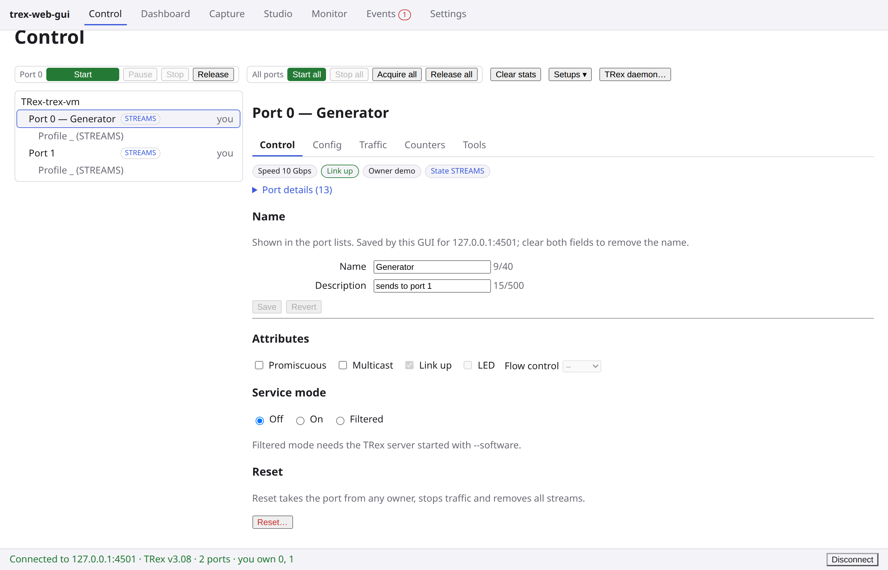

With Port details open:

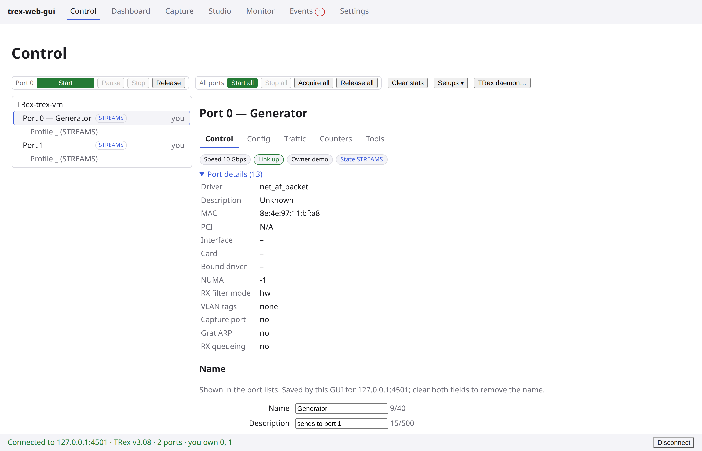

Scrolled to the bottom, Filtered chosen (mask shown) and Reset awaiting confirmation:

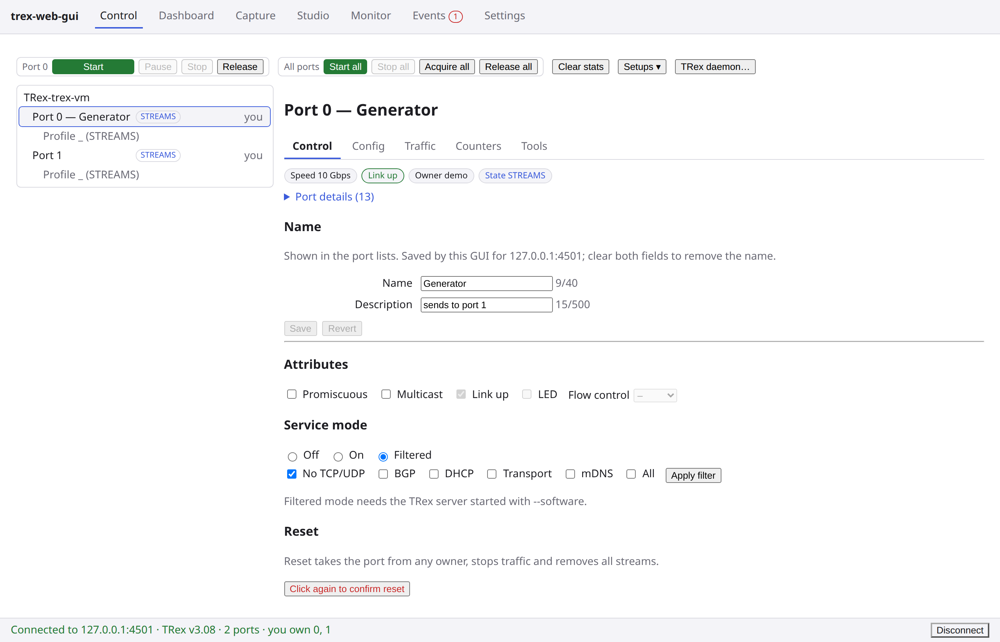

### 2.10 Config tab

Source: `frontend/src/components/PortConfigTab.tsx`.

- **Purpose:** the port's L2/L3 layer, VLANs and IPv6. (Ping and the IPv6 scan moved to the Tools tab.)
- **Contents:**
  - **Mode and VLAN:** radios **L2** / **L3**; **Outer VLAN**, **Inner VLAN**; **Source MAC** (read-only, "set in the
    server config"); **Destination MAC**, below Source MAC: an input in L2 mode, the ARP-resolved MAC read-only in L3.
  - **Addresses:** **Source IPv4** and **Destination IPv4** (with the ARP result, "resolved"); the IPv6 radios **Off** /
    **Auto** / **Address** and **IPv6 source**, greyed with the reason on the legacy stack.
  - **Apply** and **Revert**, and a note while there are unapplied changes. Validation messages and the result ("Applied",
    or "L3 set, ARP unresolved: …") show below. If the server changes the config while the form is edited, a "Changed on
    the server — Reload" line appears.
  - Everything is disabled with a tooltip when the port's commands are blocked.

Top of the tab (this guest's port 0 is L3 1.1.1.1 → 2.2.2.2 with ARP resolved):

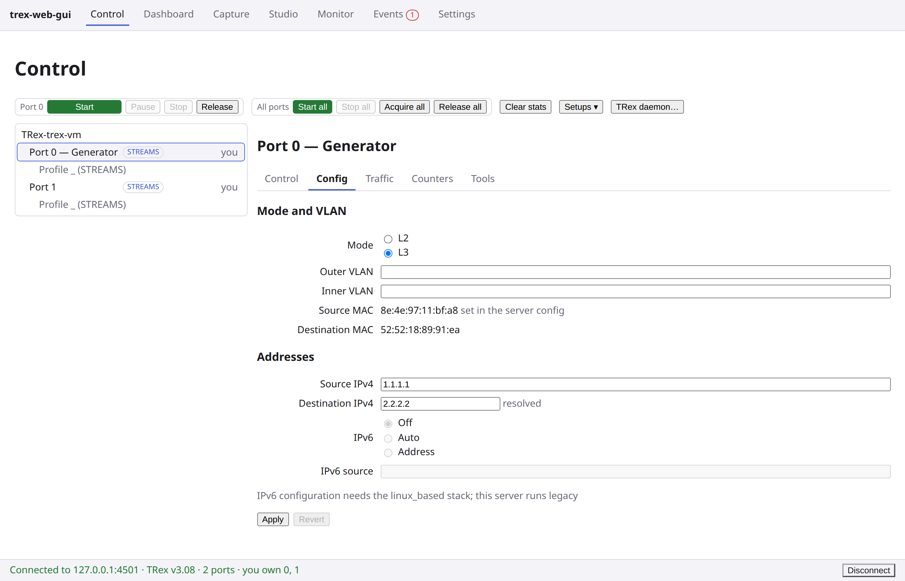

The form with **L2** chosen (not applied; Destination MAC becomes an input):

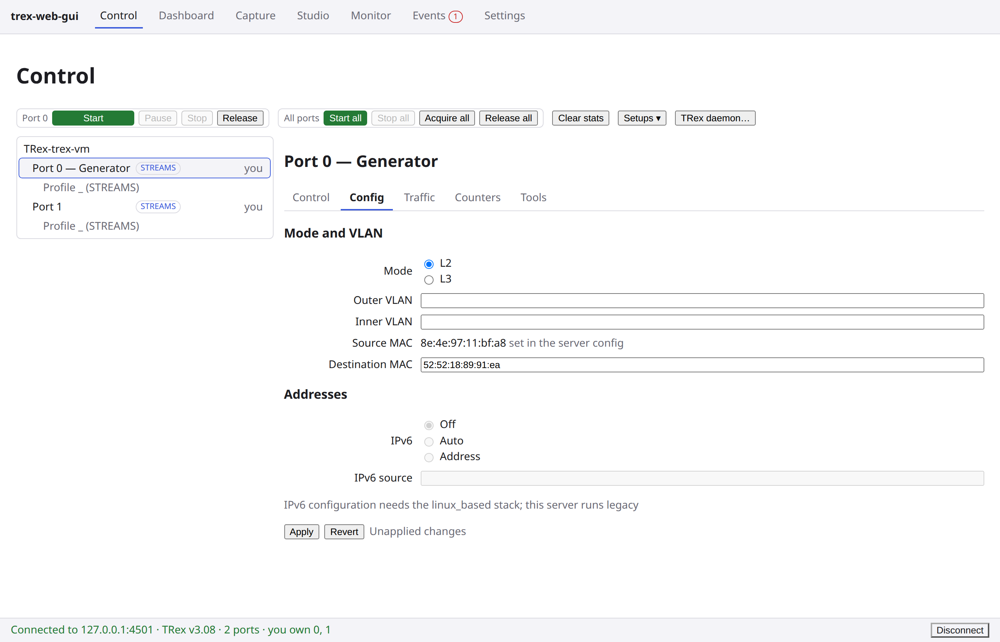

### 2.11 Tools tab

Source: `frontend/src/components/PortToolsTab.tsx`, `frontend/src/components/PingPanel.tsx`,
`frontend/src/components/NeighbourTable.tsx`.

- **Purpose:** things you run on the port and read the result of. A side list with a vertical divider, one tool shown.
- **Ping:** **Destination** (one field, IPv4 or IPv6; the backend tells them apart), **Count** (1–10, default 5), **Size** (64–9216,
  default 64), **Ping**, an IPv4 ping is refused until the Config tab's L3 ARP is resolved ("ARP resolution required: configure L3 IPv4 first."),
  and a note that Ping and Scan put the port in service mode while they run; the reply lines of the newest run
  and a "N sent, N received" summary.
- **IPv6 neighbours:** **Scan** and **Clear**; a legacy-stack note; a table **Type**, **MAC**, **IPv6** with per-row
  buttons **Set as L2 destination**, **Copy MAC**, **Copy IPv6**.

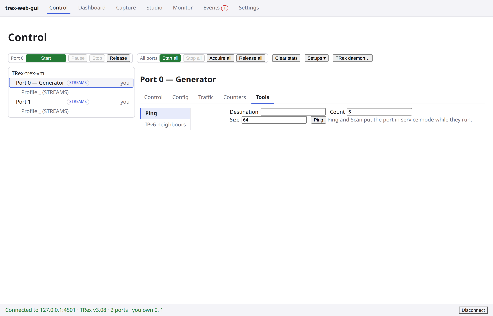

After a 3-packet ping:

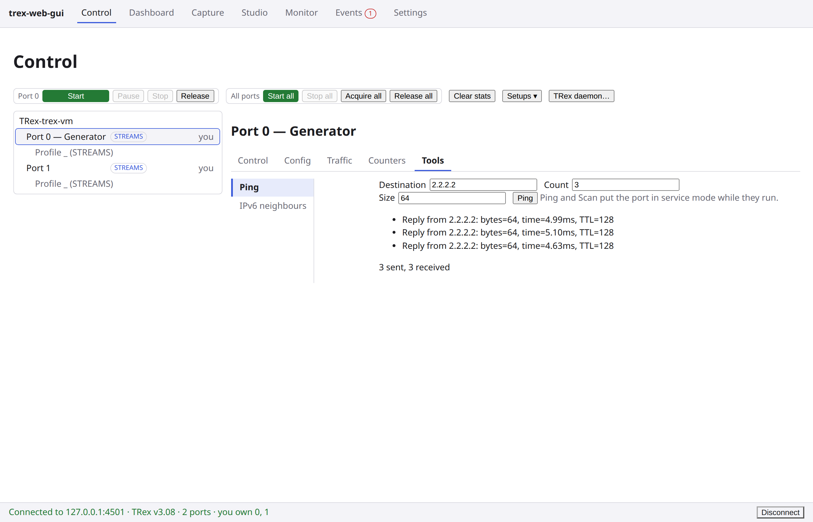

IPv6 neighbours after a scan (the guest's one host):

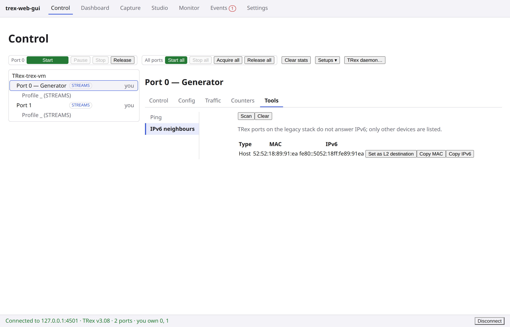

### 2.12 Traffic tab

Source: `frontend/src/components/TrafficTab.tsx`, `frontend/src/components/ProfilePicker.tsx`,
`frontend/src/components/rate.ts`, `frontend/src/traffic.ts`, `frontend/src/components/studio/LibraryPickDialog.tsx`,
`frontend/src/components/studio/libraryPick.ts`.

- **Purpose:** choose and inspect a profile, assign it to the port, and start or re-rate it.
- **Contents, one form then its information:**
  - **Profile:** **Profile path** (a path on the backend host; Enter inspects), **Browse…**, **Library…** (P4a),
    **Inspect**, and an ⓘ with the two help sentences, naming the trex-web-gui host (paths are on `<host>`, the computer running
    trex-web-gui serve, not the browser's; `.py` profiles run as code on `<host>`); the note floats under the ⓘ. After Inspect:
    a tunables form built from the profile's argparse arguments plus **Extra arguments**. `.yaml`, `.yml` and `.json`
    profiles inspect by themselves when picked in Browse (TRex reads them as data); a `.py` only fills the path, and Inspect
    stays explicit. Under the path, **New in Studio…** (an inline Name field, then **Create**) and **Copy to Studio** (the
    inspected profile, with its tunables for a `.py`) each make a library entry and open it in [Studio](#5-studio-page)
    (A3.6's New and Duplicate).
  - **What it holds:** the streams table (**#**, **Name**, **Enabled**, **Mode**, **Rate**, **Packet**, **Length**, **VM**),
    the **Show rate at ×1** button, "At ×1: max …, L2 …, …% line utilisation", and a collapsed **Full validate response**.
  - **Rate:** **Multiplier**, one typed box (a bare number or `×` is a factor; `%` adds a slider; pps, bps, bps L1 with
    k/M/G, the scale only with a unit) with a live reading beside it, **Duration (s)** (empty = no limit), **Force**. On a
    transmitting port a typed multiplier is applied on Enter or a click elsewhere in the page, never by switching apps.
  - **One action bar:** **Assign** (red **Stop and assign** when the port is running), **Start**, and, while the port
    transmits, the live **Update** countdown "Applying <mult> in N s · **Apply now** **Cancel**". Pause and Stop are in the
    toolbar only. "Inspect a profile first." shows when nothing is inspected.

Before a profile is chosen in the path box (port 1): **On the port** already lists what port 1 holds, so Start is enabled:

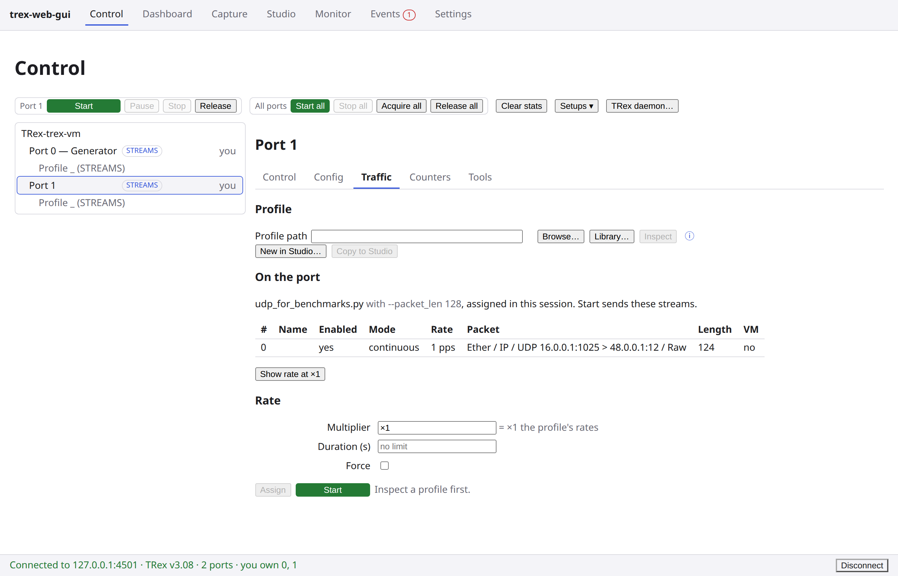

After Inspect, with tunables (`udp_for_benchmarks.py`), Show rate and Assign, 5 kpps set:

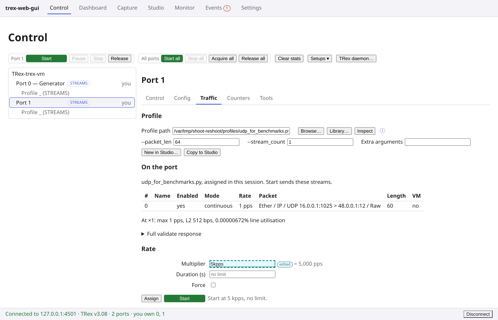

The ⓘ beside Inspect (**About profile paths**) opens a floating note, laid over the page rather than inside the path row
(RC1-34): the paths are on the backend host (named), not the browser's computer, nothing is uploaded, and `.py` profiles
run as code there:

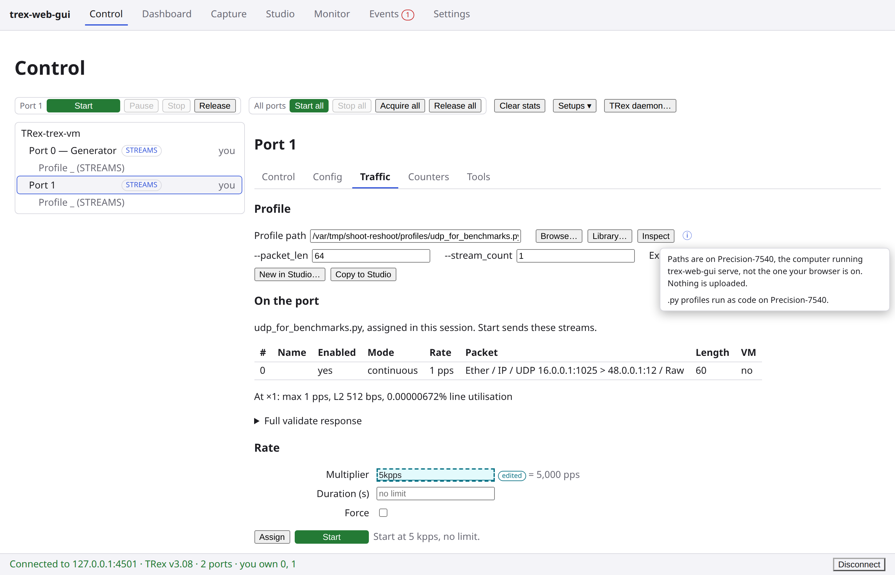

While transmitting (Assign reads **Stop and assign**; Start, here and in the toolbar, is lit as **● Transmitting** and
disabled):

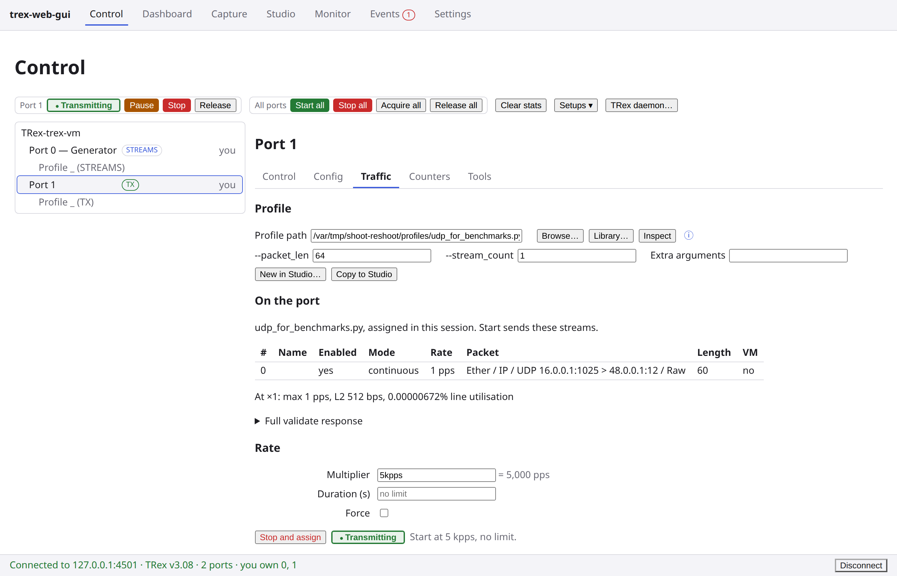

The live-update countdown after changing the multiplier while transmitting:

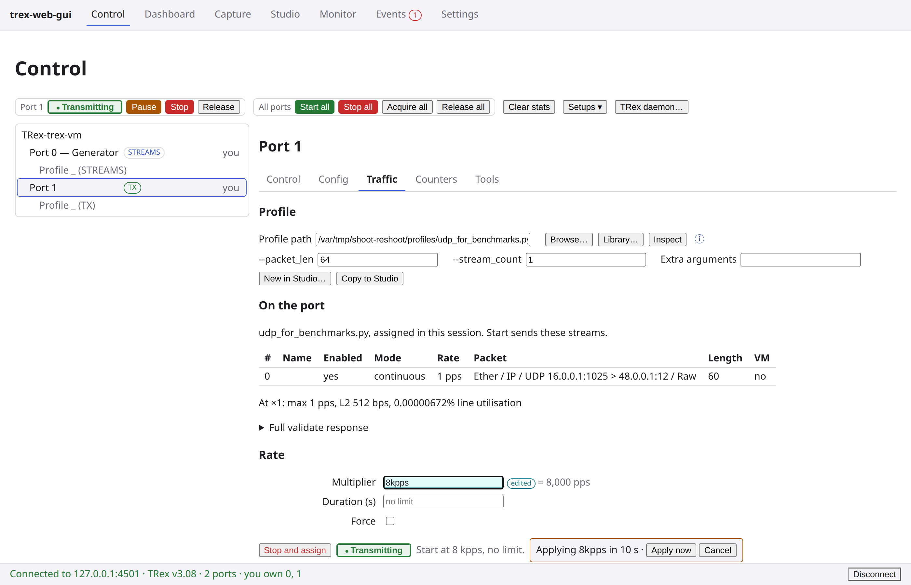

**Pick from the library dialog** (**Library…**): one button per library entry with its stream count; an entry that cannot be
assigned (a load error, or a `.py` whose source is missing) is disabled and says why. A `.py` entry carries the note
"<source path>: Assigns the .py source with these tunables; editor changes to this entry are not sent." and picking it fills
the path and the stored tunables without inspecting; any other entry fills the path with the library's JSON file and
inspects it at once, as Browse does for a data file. Footer: **Cancel**.

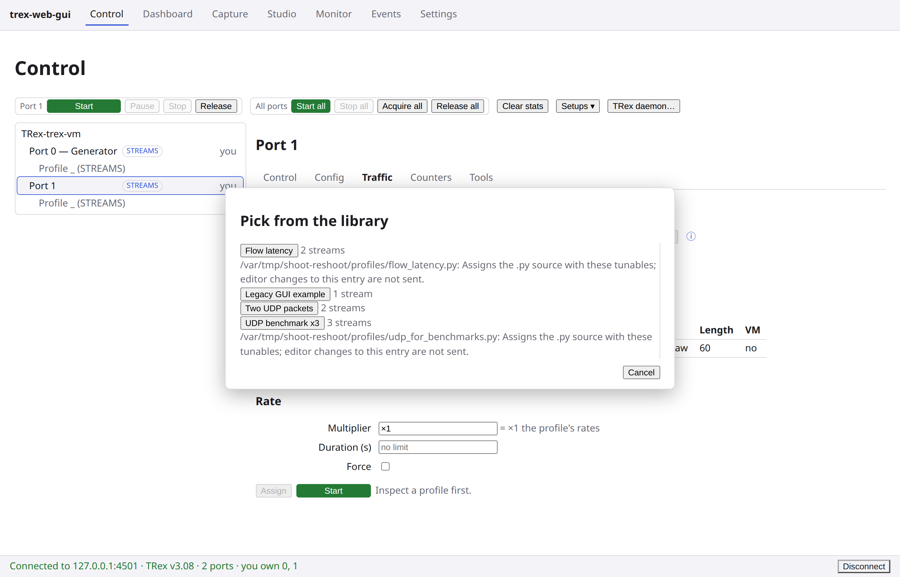

### 2.13 Browse for a profile dialog

Source: `frontend/src/components/BrowseDialog.tsx` (also used by the Studio import dialog, the packet editor's pcap picker
and the stateful run's upload).

- **How to open:** **Browse…** in the Traffic tab.
- **Purpose:** pick a profile file on the backend host.
- **Contents:** title; the current directory path; **Up**; a **Filter** box; a list of buttons, directories with a trailing `/`, files with
  their size; notes when the list is truncated or empty; footer with **Cancel**. Clicking a directory lists it; clicking a
  file fills the path field and closes (and inspects it when it is a data file). It opens at the last directory used.

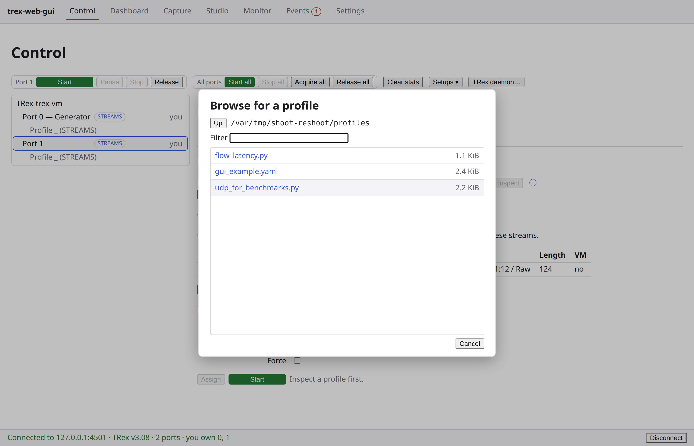

### 2.14 Counters tab

Source: `frontend/src/components/XstatsTab.tsx`, `frontend/src/xstatsStore.ts`.

- **Purpose:** the port's extended counters (xstats).
- **Contents:** **Not empty** (checked by default), **Filter** (substring) and **Reset counters** (browser-only baseline);
  a "Counters are not updating" marker when the poll fails; a help paragraph; a table with the **Pin** checkbox at the
  **left** of each row, then **Counter** and **Value (since Reset counters)**. Pinned counters stay at the top regardless
  of the filter. Polled every 0.5 s only while this tab is shown, the page is visible and the session is connected.

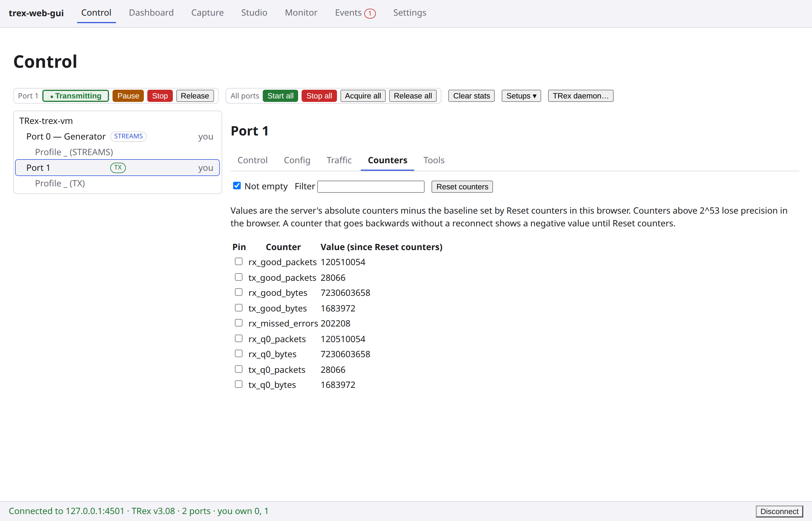

With `tx_q0_packets` pinned and the filter `q0`:

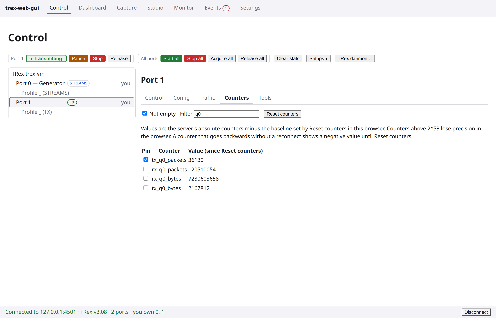

### 2.15 Events page

Source: `frontend/src/pages/EventsPage.tsx`, `frontend/src/components/LogView.tsx`, `frontend/src/components/RpcConsole.tsx`,
`frontend/src/eventsChannel.ts`.

- **Where:** top bar **Events**, route `/events`. Two views, **Events** and **RPC**, switched by tabs at the top.
- **Events view:**
  - A bar: one filter chip per kind with its count (**All**, **Errors**, **Warnings**, **Server events**, **Info**,
    **Ping**; the pressed one carries a check mark), a **Filter text** field, **Copy**, **Save log…** (a `.txt` download),
    **Pop out ↗** (a separate window kept in sync over `BroadcastChannel`; hidden where that is missing) and a red
    **Clear** after a divider. Copy and Save log take what the filters show.
  - A status line: "N entries · kept across reconnects" and "Following new entries" (or a **Jump to newest** button once
    scrolled up).
  - A table **Time** (its header names the browser's time zone, e.g. "Time (EDT, UTC-04:00)"), **Kind**, **Message**, errors and warnings coloured. At each connect and each end a **divider row**
    (MARK) shows "Connected to host:port", "Disconnected" or "Connection lost: reason"; it is never filtered out.
  - The log is kept across disconnects and reconnects (up to 2000 entries, oldest dropped) and lives in the browser: a page
    reload loses it.
- **RPC view:** the raw JSON-RPC console that used to sit under the Control page: **Capture** checkbox (session-wide, off
  by default), **Include polling**, a **Filter** field, **Copy**, then one line per message, `→` request and `←` response.

The page after a full session (the Connection lost and Connected dividers are at the bottom):

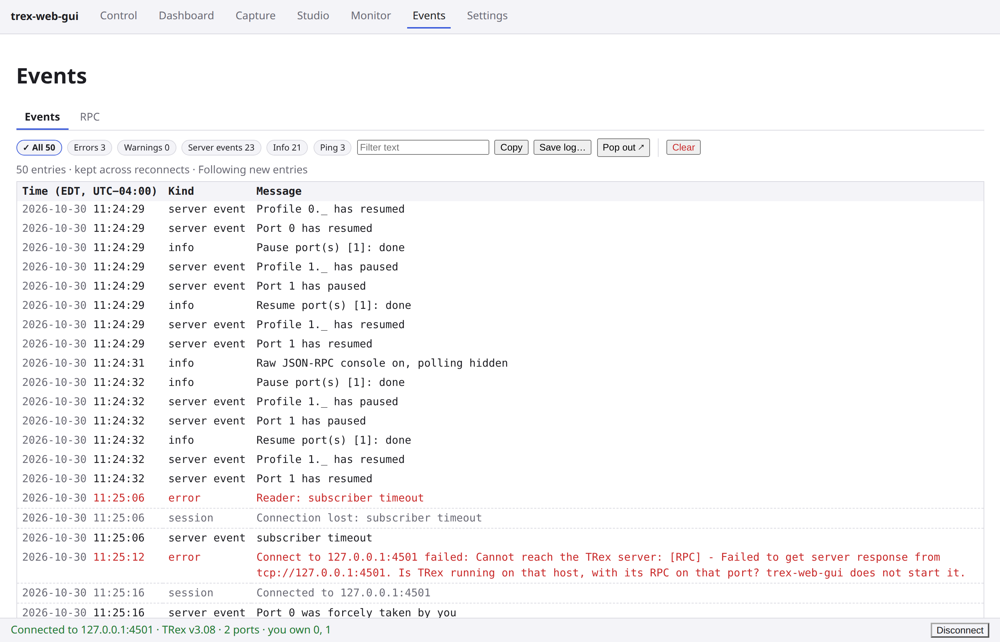

Early in the session, the chips, filter field and actions:

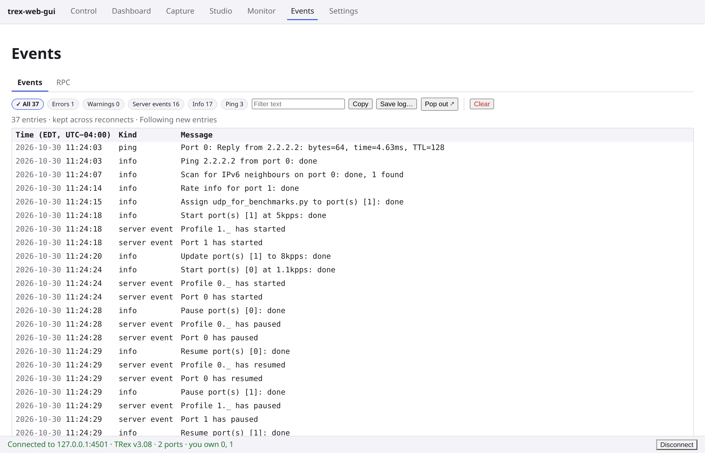

Filtered to **Server events**:

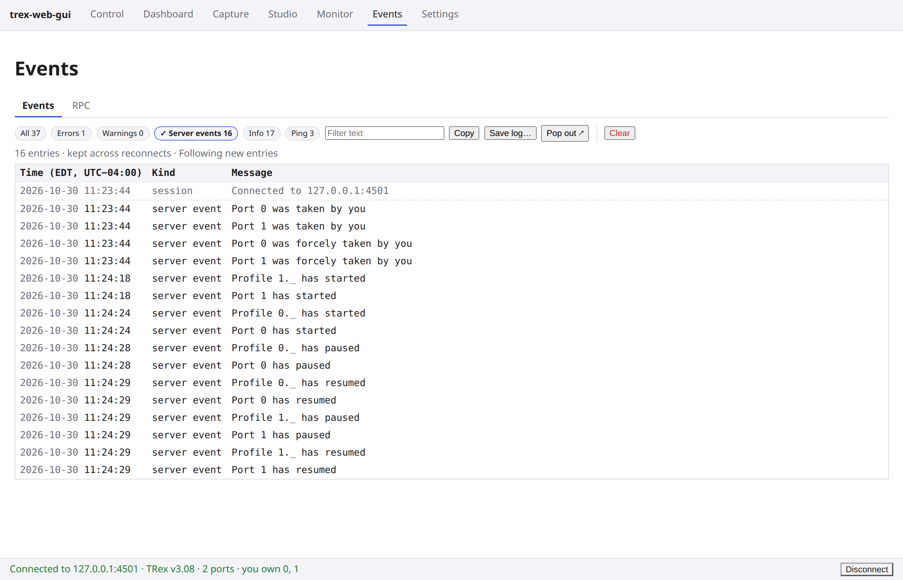

The RPC view with Capture on, after a Pause and a Resume:

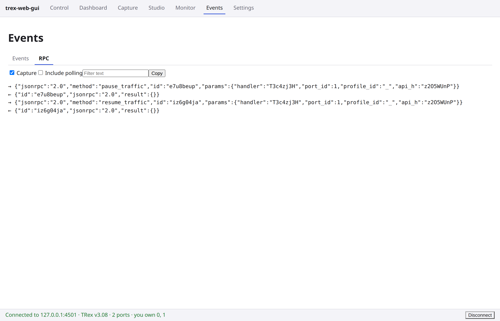

### 2.16 Connection lost

- **How reached:** the guest was paused (QEMU `stop`) until the backend reported `subscriber timeout`, about half a minute here.
- **What changes:** the toolbar's port and group buttons are disabled; the page text reads "Connection lost; Reconnect is
  in the status bar."; the tree and panel keep the last known state (ports still shown as TX); the status bar turns red and
  offers **See Events**, **Reconnect** and **Connect…** ([1.3](#13-status-bar)).

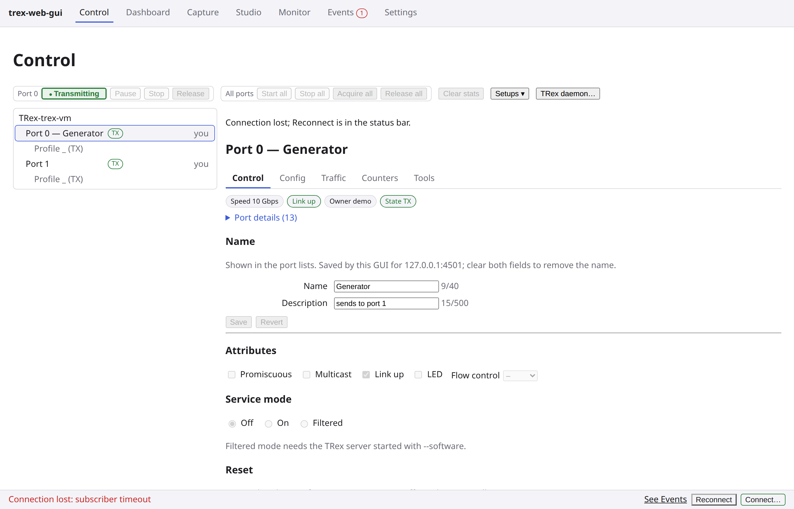

A **Reconnect** against the still-paused guest fails; the bar reads `Disconnected: <error>` and keeps **See Events**, **Reconnect** and
**Connect…**. The right column shows only the page's disconnected text, "Not connected. Use Reconnect or Connect… in the status bar
(Ctrl+Shift+C) or click **Connect…**",
with no stale "Port 0 / Port 0 is not available." under it (the tree is reduced to its root row; `layout-rework-14-7`, fixed):

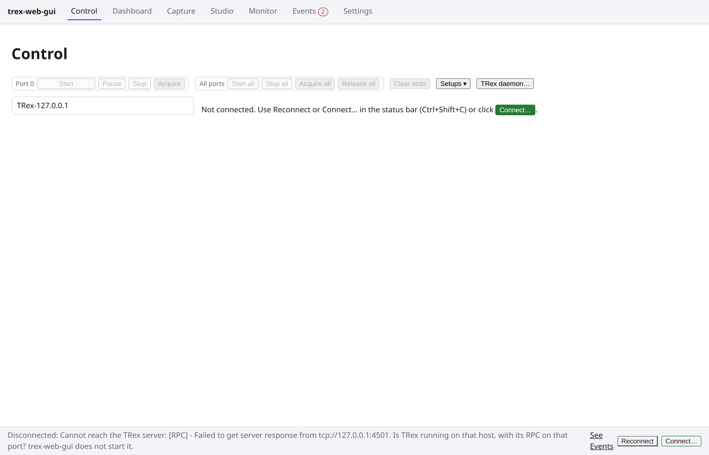

### 2.17 Saved test setups

Source: `frontend/src/components/setups/SetupsMenu.tsx`, `frontend/src/components/setups/SaveSetupDialog.tsx`,
`frontend/src/components/setups/SetupDialog.tsx`, `frontend/src/setups.ts`, `frontend/src/setupSession.ts`; the dialogs are
owned by `frontend/src/pages/ControlPage.tsx`.

- **Purpose:** keep the Traffic tab forms of one or more ports as a named setup on the backend (in the data directory), and
  later put them back (**Load**) and apply them to the guest (**Run**). Setups are stored per backend, not per browser, and
  are part of the settings export ([6](#6-settings-page)).
- **Setups ▾ menu:** the last toolbar button; a small panel with **Save current…** (disabled unless connected) and **Manage
  setups…** (always enabled).

Disconnected, **Save current…** greyed:

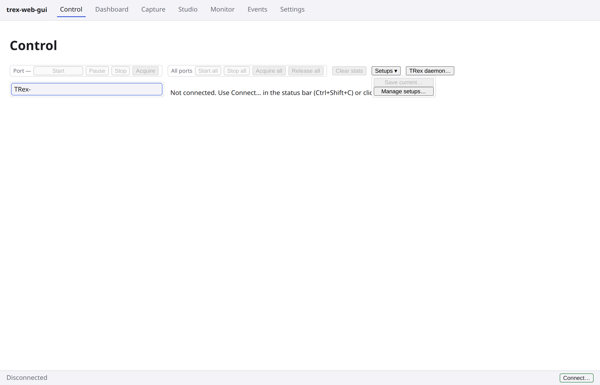

(The connected menu is [65](screens/65-setups-menu.png).)

#### Save current setup dialog

- **Contents (an aligned form):** title "Save current setup"; **Name** (focused) and **Server** (starts as the connected
  `host:sync port`; empty saves the setup as valid for any server); a **Ports** fieldset with one checkbox per port whose
  Traffic form has a profile path (a port whose multiplier or duration the server would refuse shows as a red line with no
  checkbox; with no port at all: "No port has a profile in its Traffic tab yet."); the checkboxes **include port
  configuration (L2/L3/VLAN/IPv6)**, **stop a transmitting port before assigning**, **include dashboard layout**; footer
  **Cancel** at the left of **Save** (it becomes **Overwrite**, with "A setup with this name already exists", when the name's
  slug is taken).

No port has a profile yet:

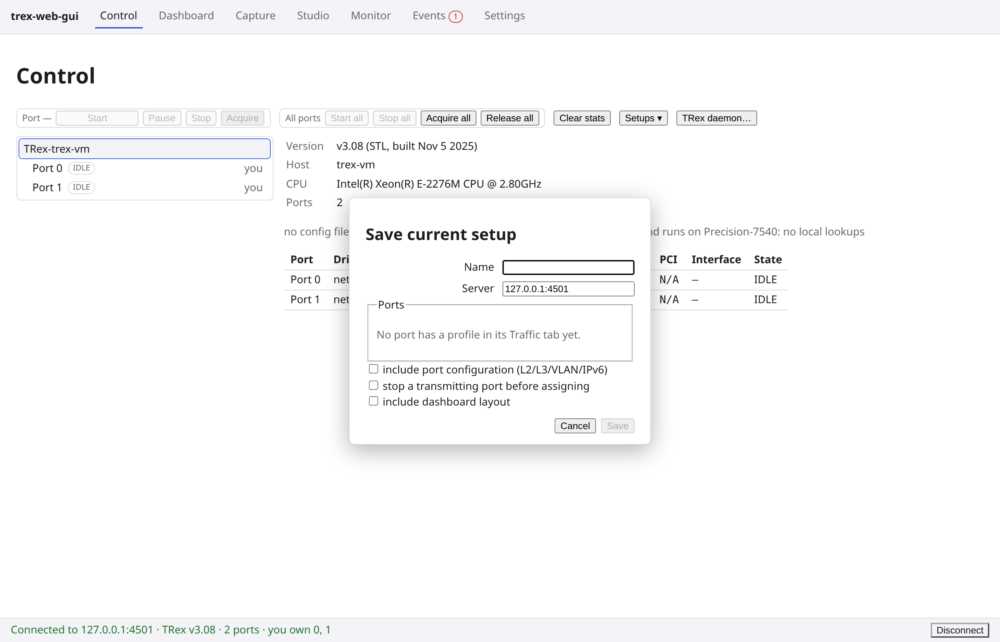

Two ports with profiles (port configuration and dashboard layout ticked):

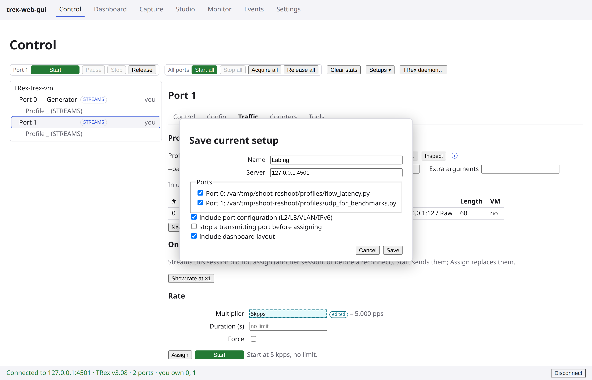

Port 1's multiplier emptied: the port is named with the reason and not offered:

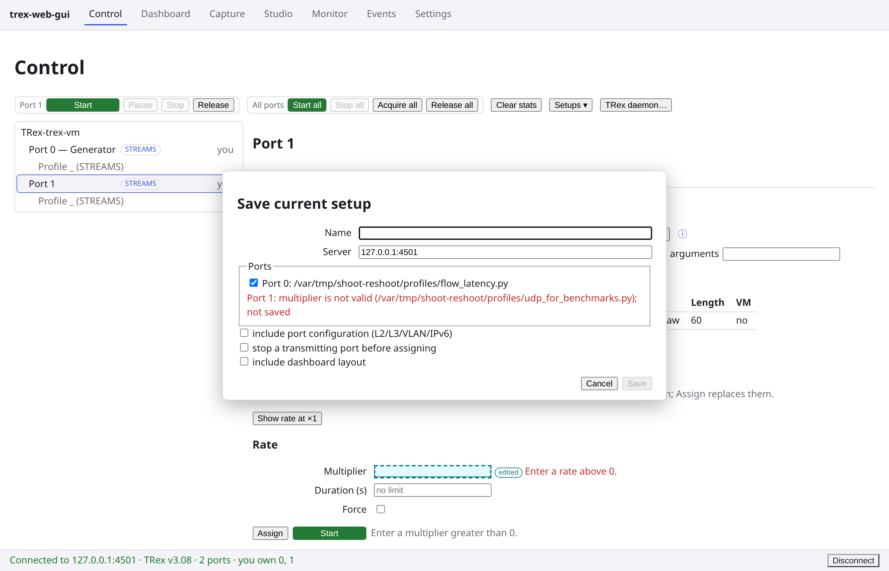

An existing name (typed with other letter case) asks before replacing:

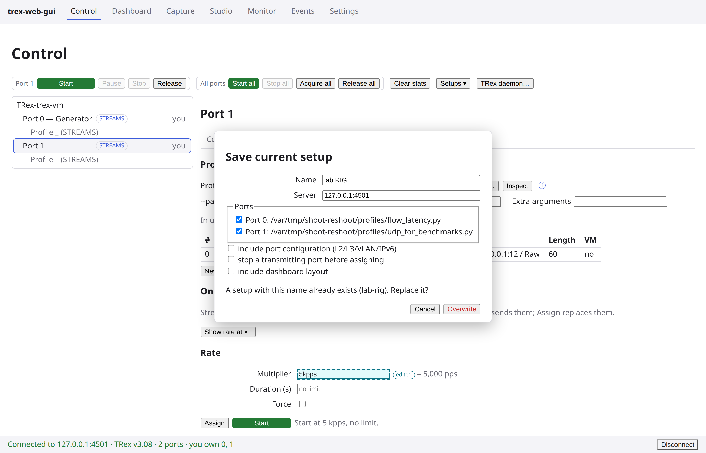

#### Test setups dialog

- **How to open:** Setups ▾, **Manage setups…** (works disconnected). A master-detail dialog of fixed height (the smaller of
  36 rem and 85% of the window).
- **Contents:**
  - Title "Test setups". Left, a scrolling list: each entry shows the name, `server · N ports`, and "loaded" (with "N edits"
    when there are Traffic-tab edits since Load). A setup file that could not be read is a disabled entry with the error.
  - Right, the chosen setup: its name with **Rename**, **Duplicate** and **Delete** at the top (a delete asks inline,
    "Delete setup X? **Confirm delete** **Cancel**"; rename and duplicate open a "New name" line); "Saved for host:port ·
    updated …"; the **ports table** (**Port**, **Profile**, **Rate**, **On Run**, **Status**: `not loaded`, `ready`, then
    `acquired`, `stopped`, `layer applied`, `profile assigned`, `started` or `failed at <step>: …`, on the failed port); then, in a bar that stays at the bottom of the pane, **Load**, **Run** and the Run result
    (a failed Run reads "Run stopped at port N: failed at <step>: <message>."), with **Stop
    started ports** when a Run stopped partway.
  - With Traffic-tab edits since Load: the edits sentence and the list of changed fields, **Run as saved** and **Save and
    Run**. A server mismatch shows as a red line; **Force-acquire port N and continue** appears after a refused acquire.
  - Empty state: "No saved setups. Use Setups ▾ → Save current… on the Control page." Disconnected: Load and Run greyed
    with "Connect first".
  - Footer: **Close**.
- **Enable rules** are as before: **Load** needs a connected session; **Run** needs a good Load, a connected, not read-only
  session and no Run in progress; Rename, Duplicate and Delete work whenever nothing is busy.
- **Load** inspects the profile of every port of the setup (this runs `.py` profiles on the backend host) and fills the Traffic
  forms. **Run** applies the loaded snapshot in phases (acquire every port, stop the ones marked to stop first, apply every
  kept port configuration, assign every profile, then start) and stops at the first error without rolling back.

No setups saved (disconnected):

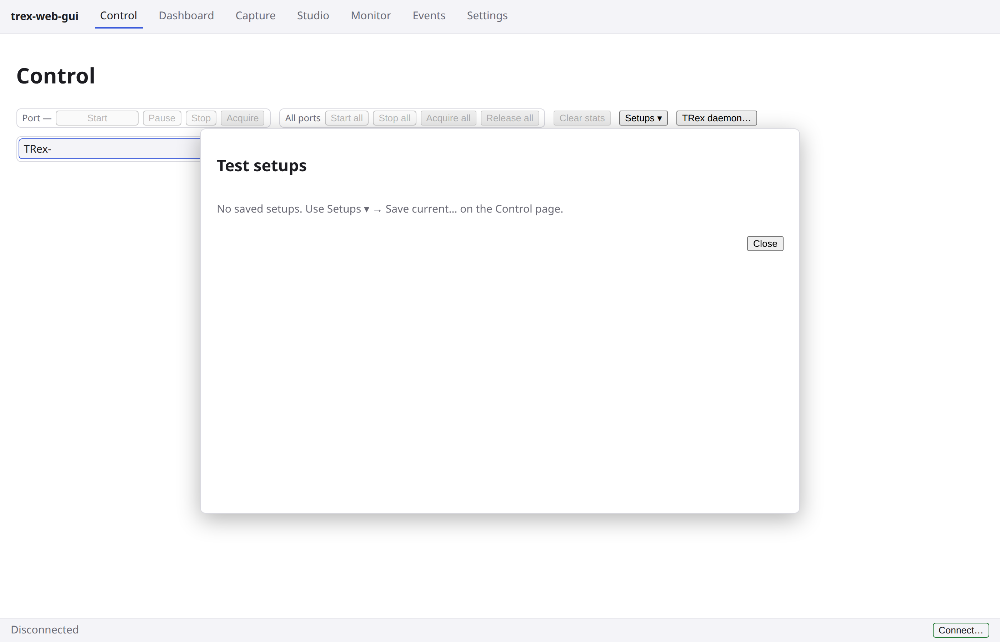

Four setups, nothing loaded (Run is greyed with "Load first"; "Other lab" was saved for another server):

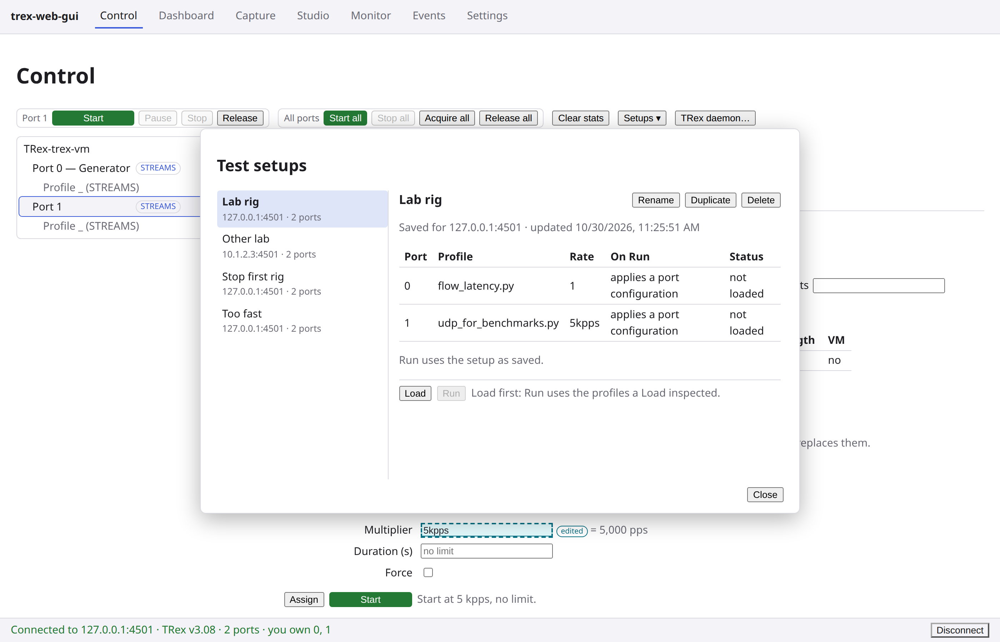

After **Load** (both ports `ready`; the Traffic forms are now filled):

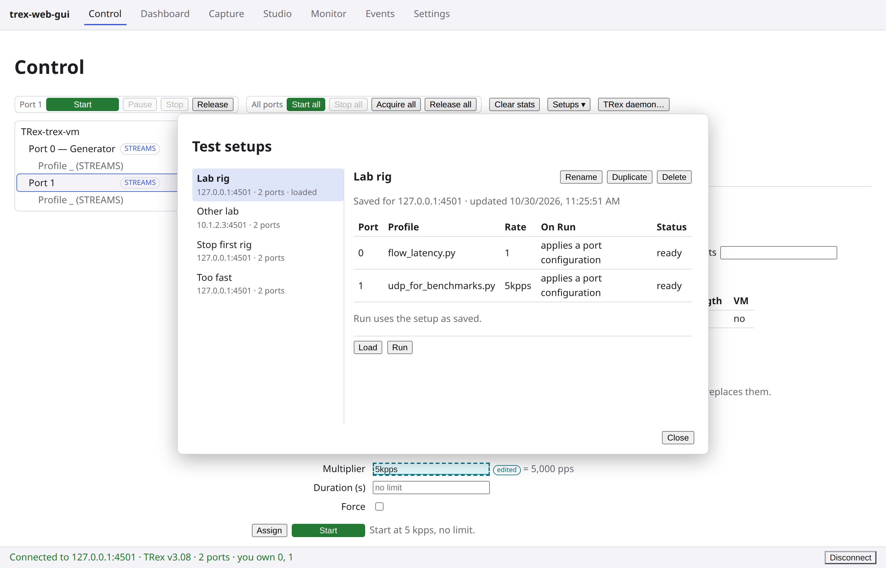

After a rate change in the Traffic tab (port 1 from 5 kpps to 8 kpps), the dialog reopened: the edits sentence, **Run as saved**
and **Save and Run**:

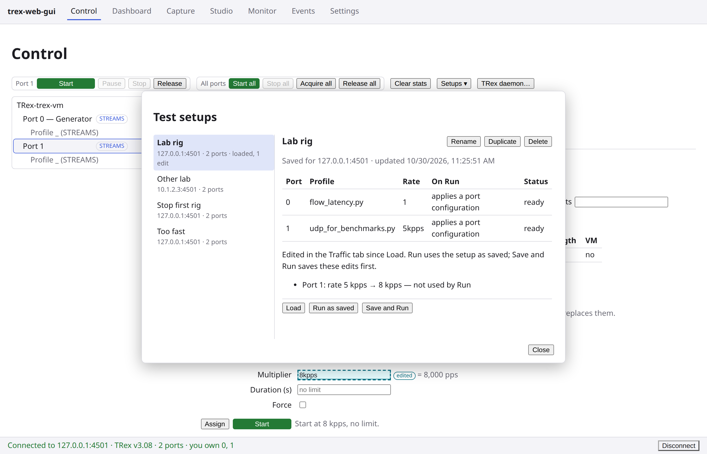

A Run that failed at its first phase, **layer** (both ports were transmitting and the setup does not stop a transmitting port first,
so the port configuration is refused before the assign; the failed port's row scrolls itself
into view above the sticky bar, and the shot is not scrolled):

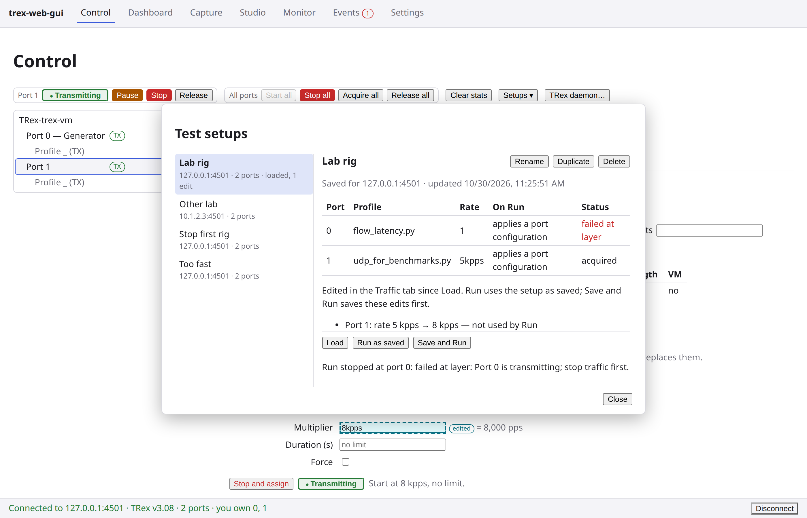

A Run that finished (the setup stops, assigns and starts both ports):

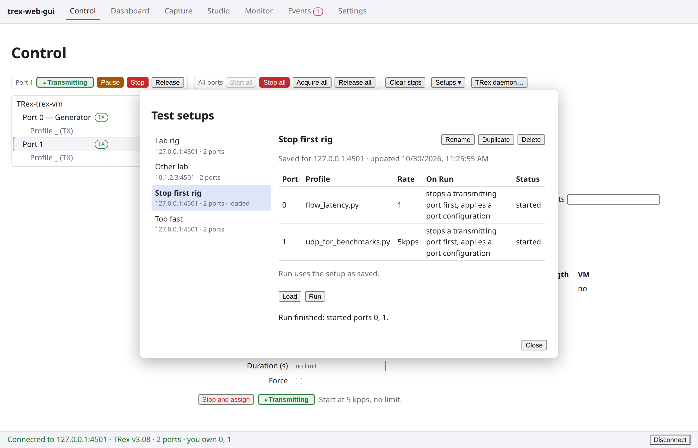

A Run that failed at **start** (the setup asks 100 Gbps of port 1, which TRex refuses on a 10 Gbps port; port 0 had started, so
**Stop started ports** is offered; the failed row is in view without scrolling):

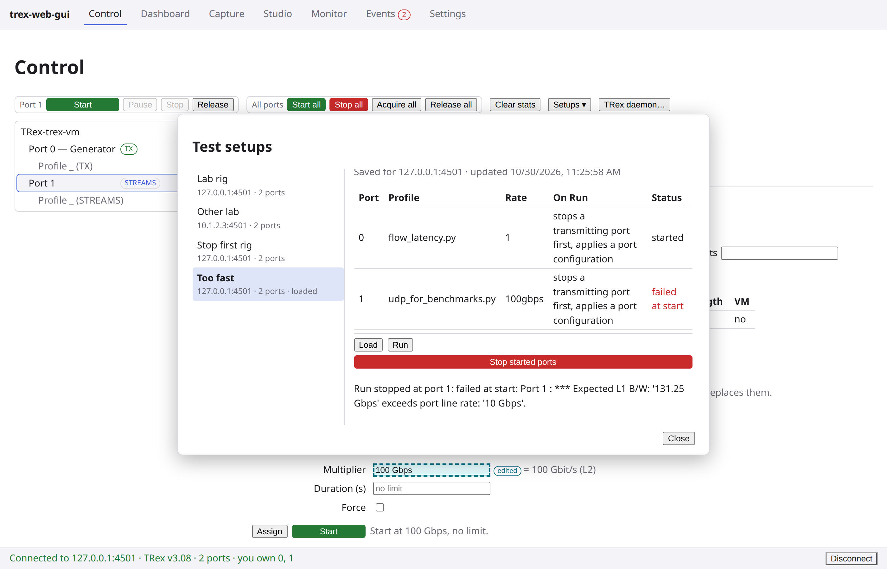

After **Stop started ports** (port 0 `stopped`, the failure stays, the button is gone):

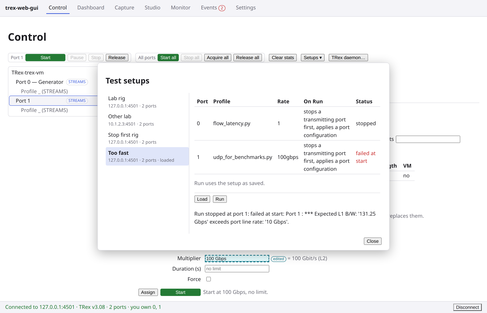

Duplicate chosen (the New name line):

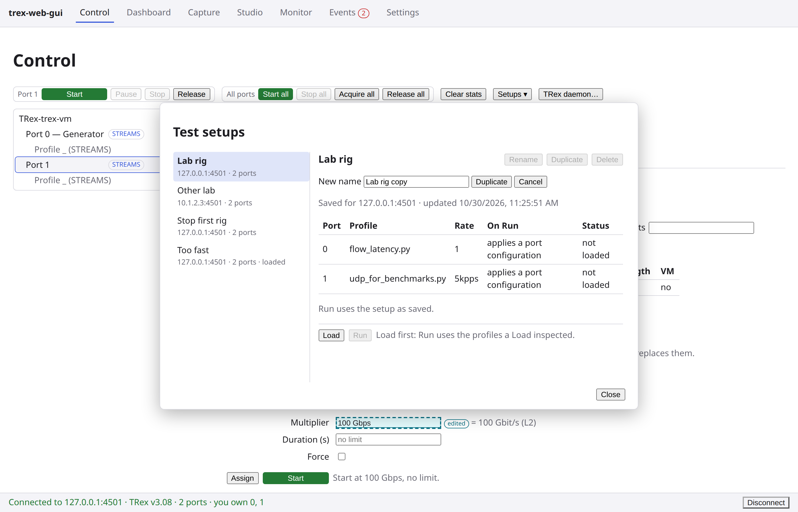

Delete chosen:

A setup saved for another server, loaded (the red mismatch line; the Load still succeeds):

The same dialog in a 1400x540 window: the dialog shrinks, the list and the detail pane scroll, and the Load and Run row and
**Close** stay on screen:

## 3. Dashboard page

Route `/dashboard`. Source: `frontend/src/pages/DashboardPage.tsx`, `frontend/src/useStale.ts`.

- **Frame:** heading; a tab strip **Overview**, **Streams**, **Latency**, **Utilization** (the same style as the port panel's),
  with **Clear stats** at the right end of the strip (the same action as the Control toolbar's; disabled when not connected).
  All panels stay mounted, so charts keep their history across tabs; the tab, interval and layout survive leaving the page and
  reset on a new connection.
- Each tab judges its own read: when no message has arrived for 3 × the stats interval, an orange banner "<Statistics | Stream
  stats | Latency stats | Utilization stats> are not updating" shows at the top of that panel and the panel is greyed. When the
  connection is lost an orange "Connection lost: values are the last received" banner shows under the heading (both are in
  [42](screens/42-dash-connection-lost.png)).

Disconnected (tiles show `–` apart from **Active ports** at 0, the ports table has only Total, charts have no data):

### 3.1 Overview tab

Source: `frontend/src/components/GlobalTiles.tsx`, `frontend/src/components/PortsTable.tsx`,
`frontend/src/components/StatsChart.tsx`, `frontend/src/components/TimeChart.tsx`, `frontend/src/chartSeries.ts`.

- **Tiles**, grouped in one row: **Tx** (Tx L2, Tx L1, PPS, Queue full), **Rx** (Rx L2, Drop rate (Tx − Rx): TRex's Tx minus Rx
  over all ports, its tooltip says a one-way test reads as dropped), **System** (CPU, Rx CPU, Active ports, Streams). **CPU** and **Rx CPU** turn red, with the word `high`, from 85 %. A "Service mode is on" bar shows under the
  page heading, on every Dashboard tab, when any port is in service mode.
- **Ports table**, left: **Show** select (All / My) and a **Show bytes** button; columns Metric, one per port (by name),
  Total; the rate rows first (Tx/Rx L1 bps, Tx/Rx L2 bps, Tx/Rx pps, with ▲/▼ trend marks), then "Counters: since connect,
  Reset or Clear" (packets, errors; the bytes rows are folded behind Show bytes).
- **Charts**, right: **Interval** (60, 90, 120, 300 s) and **Layout** (1, 2 or 4 charts) selects above the charts; each
  chart's title is its series select (`Chart N series`: Tx pps, Rx pps, Tx bps L2/L1, Rx bps L2/L1) and a legend line below
  (`latest <value>`, or the hovered time and value); a **Y axis** Fit / From 0 control beside Layout.
  Defaults: 60 s, 2 charts, Tx pps and Rx pps. The whole tab fits at 1400x900.

Port 0 sends 1.1 kpps and port 1 8 kpps (the dip in the charts is a Pause/Resume):

Layout set to 4 charts:

### 3.2 Streams tab

Source: `frontend/src/components/StreamsTable.tsx`, `frontend/src/components/PgidChart.tsx`,
`frontend/src/components/PgidSelector.tsx`, `frontend/src/pgidStats.ts`.

- **Purpose:** per-stream (PG ID) flow statistics.
- **Contents:** a table grouped as Rates / Counters since the stream was added, or Clear; columns **Chart** (checkbox), **PG
  ID** (with a ▸/▾ toggle for per-port rows), **Type**, Tx/Rx pps, Tx/Rx bps L1/L2, Tx/Rx pkts, bytes, **Loss**, **Loss/s**;
  a pager when there are many; global **rx_err** / **tx_err**; a chart "Streams: <metric>" with **Metric** and **Interval**
  selects, a **Y axis** Fit / From 0 control and a ✓/✗ chip per stream under it, to the right. At 1400 px the table is wider
  than its column: it scrolls sideways inside the column (the Loss columns are cut at its edge in the shot) and never paints
  over the chart. Needs streams with flow stats (here `flow_latency.py` on port 0: PG 5 flow, PG 7 latency).

### 3.3 Latency tab

Source: `frontend/src/components/LatencyTable.tsx`, `frontend/src/components/LatencyHistogram.tsx`,
`frontend/src/latencyBuckets.ts`.

- **Purpose:** latency of the latency streams.
- **Contents:** a table **Chart**, **PG ID**, **Max (µs)**, **Server max (µs)**, **Avg (µs)**, **Last (µs)** … **Last-9 (µs)**,
  **Jitter (µs)**, **Errors** (it too scrolls sideways inside its column); **Latency histogram** (bars per latency range with
  counts, then **PG ID** and **Bars** selects, then the error counters Dropped, Duplicates, Out of order, Seq too high, Seq
  too low as a list); a chart "Latency: <metric> (µs)" with **Metric** and **Interval** selects, a **Y axis**
  control and ✓/✗ chips.

Scrolled to the end of the page:

### 3.4 Utilization tab

Source: `frontend/src/components/CpuTable.tsx`, `frontend/src/components/MbufTable.tsx`, `frontend/src/utilStats.ts`,
`frontend/src/utilTables.ts`.

- **Contents:** a CPU table **Core**, **Ports**, **Avg (%)**, **Latest (%)**; a "CPU utilization over time" chart (✓/✗ chips,
  a **Y axis** control); an mbuf table with a column per buffer size and RAM (MB). "No utilization data yet." before the first sample.

### 3.5 Stale and connection-lost banners

The guest was paused for about 5.5 s while the Dashboard was open; the session is still connected:

Paused long enough for the session to be lost (both banners; the status bar offers See Events, Reconnect and Connect…):

### 3.6 Themes

The Theme control is the Appearance section of Settings ([6](#6-settings-page)). The two screenshots below are the Dashboard
Overview with traffic on both ports: Dark, then High contrast
(black background, brighter text, tile borders and chart gridlines than Dark). The Light theme is what every other
screenshot shows.

## 4. Capture page

Route `/capture`. Source: `frontend/src/pages/CapturePage.tsx`, `frontend/src/captureGate.ts`, `frontend/src/captureStore.ts`.
The page stays mounted while hidden, keeping its port choice, filter and rows.

### 4.1 Page frame

Heading "Capture" with an ⓘ (the intro paragraph), then a tab strip **Live**, **Recorders (n)**, **Saved files (n)**, **LLDP**.
Hidden tabs do no work: LLDP polls only while its tab is shown, the Wireshark preflight runs only while Live is shown, and the
Live form survives a tab switch.

Disconnected (no ports to choose; every Start is disabled with "not connected"):

### 4.2 Live

Source: `frontend/src/components/capture/CaptureMonitor.tsx`, `frontend/src/components/capture/PortPicker.tsx`,
`frontend/src/components/capture/PacketTable.tsx`, `frontend/src/pcapWriter.ts`.

- **Purpose:** a live capture whose packets are streamed into the browser.
- **Contents:**
  - **Tx ports** and **Rx ports** checkbox groups (one per port, each on its own row, the Tx row ending in an ⓘ with the af_packet note), then **BPF filter** and
    **Limit** (default 100; an ⓘ when large), all four in one aligned two-column form.
  - One action bar: **Start** (lit as **● Running** while the capture runs), **Stop**, **Clear** (empties the browser's rows), **Download pcap**, **Open in Wireshark** /
    **Stop Wireshark** (on the backend host; disabled with a reason when the preflight fails).
  - The reason Start is blocked, as a muted line; **Turn service mode on for ports N** when a chosen Rx port is not in service
    mode.
  - A counters line **Fetched**, **Matched**, **Server dropped**, **Browser dropped**; "N packets not shown" when applicable.
  - The packet table **No**, **Time**, **Port**, **Mode**, **Src**, **Dst**, **Type**, **Len**, **Info**, 100 rows per page with
    a **Page** select; Enter or double-click opens the packet viewer. Inputs are locked while a monitor runs.

Rx port 1 chosen, not in service mode:

Running with filter `udp`:

### 4.3 Packet viewer dialog

Source: `frontend/src/components/packet/PacketViewer.tsx`, `frontend/src/components/packet/LayerList.tsx`,
`frontend/src/components/packet/HexView.tsx`.

- **How to open:** double-click (or Enter on) a row of the packet table.
- **Contents:** title "Packet N"; a summary line; left, a collapsible layer tree (Ether, IP, UDP, Raw) whose fields show value,
  byte range and length; right, a hex and ASCII dump. Selecting a field highlights its bytes. Footer: **Copy hex** and
  **Close** (focused). The dialog scrolls internally.

### 4.4 Recorders and the Add recorder dialog

Source: `frontend/src/components/capture/Recorders.tsx`, `frontend/src/components/capture/AddRecorderDialog.tsx`.

- **Recorders tab:** **Add recorder** with an ⓘ for the slot limit and the NIC capture-path caveat (the old six-line paragraph);
  "No captures on the server." or a table of every server capture: **ID**, **Origin** (this GUI, TRex service, other; "(monitor)"
  for the monitor's own), **State**, **Mode**, **Tx**, **Rx**, **BPF**, **Packets**, **Fetched**, **Bytes**, and per-row **Stop**,
  **Save** / **Resume**, **Remove** (a second click confirms when unsaved packets would be lost). The monitor's row has no
  buttons.
- **Add recorder dialog:** title; **Tx ports** / **Rx ports** and the Tx ⓘ; **BPF filter**, **Limit** (default 1000; the shot has 200 typed in it);
  the slot-limit and block reasons; **Turn service mode on for ports N** when needed; footer **Cancel** at the left of **OK**.

A stopped recorder (ready to Save) and the LLDP monitor's row:

### 4.5 Saved files

Source: `frontend/src/components/capture/SpoolFiles.tsx`, `frontend/src/components/capture/useSpoolListing.ts`.

- **Contents:** "Saved to <dir> on the backend host"; a table **Name** (with a "partial" badge), **Size**, **Saved**,
  **Packets**, and per-row **Download** and **Delete** (second click confirms). Shown after the recorder above was saved.

### 4.6 LLDP

Source: `frontend/src/components/capture/LldpNeighbours.tsx`.

- **Purpose:** LLDP neighbours seen on chosen Rx ports. It is the monitor with a preset filter, so it is refused while another
  monitor runs.
- **Contents:** **LLDP Rx ports** checkboxes, **Start LLDP monitor**; the block reason ("LLDP monitor running; stop it on the
  Live tab", …); the firmware caveat; "Start the LLDP monitor to see neighbours." / "No LLDP neighbours seen by the current
  monitor."; when neighbours exist, a table (the guest has no LLDP speaker, so the table was not reached).

LLDP monitor running (Start lit as **● LLDP monitor running**, **Stop LLDP monitor** beside it, and "Service mode: on for port 1.
Stopping leaves service mode on; Turn service mode off appears here once stopped."):

## 5. Studio page

Route `/studio`. Source: `frontend/src/pages/StudioPage.tsx` and `frontend/src/components/studio/`. Built in P4a: the profile
library on the backend host, edited offline, exported, simulated and assigned from Control; the packet itself is edited in the
embedded packet editor (P4b, [5.6a](#56a-packet-editor-p4b)). The page stays mounted while hidden, like Control and Capture, so the selected profile and stream survive a page
switch.

Layout: heading "Studio"; at the left a side list of the library with its actions under it; at the right the editor of the
selected profile: an information line, the profile's action bar, the stream table with its own action bar, then the
**Properties** and **Packet** tabs of the one selected stream.

### 5.1 Library

Source: `frontend/src/components/studio/ProfileLibrary.tsx`, `frontend/src/components/studio/AssignToPortDialog.tsx`.

- **Purpose:** the profiles in the library directory (`<data dir>/profiles`, or Settings' **Profile library directory**). Each
  is TRex JSON plus a `.gui.json` sidecar.
- **Contents (a side list, §2's list kind):** one row per profile, its name and a muted "N streams · <source kind>" (py, yaml,
  json, pcap, or "no source"), plus "source missing" for a `.py` entry whose file is gone, or the load error. Files in the
  directory that are not loadable entries are listed after them in red, not selectable.
- **Actions:** **New…** and **Import…** for the library, then **Rename…**, **Duplicate…**, **Delete** and **Use in Control…**
  for the selected entry. New, Rename and Duplicate open an inline **Name** field with **Cancel** and the verb (Rename says how
  many saved test setups point at the old path); Delete asks "Delete profile <name>?" with **Confirm delete** and **Cancel**.
  **Use in Control…** opens a dialog with a **Port** choice: "Fills the profile field of that port's Traffic tab; nothing is
  assigned until you press Assign there.", and the rate that port's form keeps (**Cancel**, **Open Traffic tab**).

The library with three entries, a `.py` one selected (no stream selected yet):

### 5.2 Profile editor and stream table

Source: `frontend/src/components/studio/ProfileEditor.tsx`, `frontend/src/components/studio/StreamTable.tsx`,
`frontend/src/components/studio/studioWriter.ts`.

- **Information:** "Source: <kind> <path> · saved <UTC time> · N streams"; for a `.py` entry a second line, "Control assigns the
  .py source with its tunables; edits here are not sent."; "Imported for port 0; port 1's streams differ." when that applies;
  "This profile changed elsewhere. **Reload**" after a write refused as stale.
- **Profile actions (one bar):** **Add stream** (a template stream), **Import stream from pcap…** (the import dialog in
  append mode), **Export ▾** (**JSON**, **YAML**, **Python (from the frozen JSON, not the .py source)**), **Simulate**.
- **Stream actions (one bar, over the table):** **Undo**, **Redo** (Ctrl+Z; Ctrl+Y or Ctrl+Shift+Z), **Up**, **Down**, **Duplicate**, **Copy**, **Paste**, **Delete** (Delete asks
  first with **Confirm delete** / **Cancel**); each is enabled by the selection, Paste by a copied stream, Undo and Redo by the undo history. The same from the
  keyboard on the focused table: Ctrl+C, Ctrl+V, Del, Alt+↑/↓, F2 (rename), Ctrl+Z and Ctrl+Y.
- **The table:** **Enabled** (a checkbox, saved at once), **#**, **Name** (double-click or F2 renames inline; every `next`
  that named it follows), **Packet** (summary), **Length (with FCS)**, **Mode**, **Rate**, **Next**; click, Ctrl+click and
  Shift+click select. 100 rows per page with **Previous**, "rows a–b of N", **Next**. Every table action is saved at once as
  one change; there is no editor-wide Save or Revert (R5), and index-shifting changes lock the table until the page has been
  read back. A line under the table warns of an enabled stream whose Next is disabled ("S0 goes to S1, which is disabled:
  TRex refuses this profile at assign until S0's Next changes.").
- The table is framed; a row lights up under the pointer and ends in `›`, and the open row has an accent bar.
- Until one stream is open, a dashed placeholder: "Click a stream to edit its properties and packet." and "⌘-click or
  Shift-click selects several, for Copy, Duplicate and Delete." (Ctrl off a Mac); with several selected, "N streams
  selected. Click one to edit it." ([88](screens/88-studio-library.png)).

One stream selected, its Properties tab below:

### 5.3 Properties tab

Source: `frontend/src/components/studio/StreamProperties.tsx`, `frontend/src/components/studio/streamForm.ts`.

- **Purpose:** the selected stream's settings (A6.1-A6.3, A6.6), one aligned form.
- **Contents:** **Mode** (Continuous, Single burst with **Packets**, Multi-burst with **Packets per burst**, **Bursts** and **IBG (µs)**),
  **Rate** (one typed box: pps, bps, bps L1 with k/M/G, or %; a bare number is pps; a live reading beside it),
  **Enabled**, **Self start**, **Start paused** (ⓘ: experimental in TRex), **Next** (Stop or a named stream; disabled
  for a continuous stream), **Action count**, **ISG (µs)**, **Random seed** ("0 = none"), **Core** ("-1 = any"), **Source MAC
  from packet** (ⓘ), **Destination MAC** (From config file, From packet, By ARP), **Dummy stream**, **RX stats** (None, flow stats
  or latency, with **PG ID**), **Extra stats** (VXLAN and IEEE 1588 shown as imported, read-only, with an ⓘ saying why: R13),
  **Cache** (Off or N packets). There is no Name field: a stream is renamed in the table.
- **One action bar:** **Previous**, **Next** (move between streams; with unsaved edits they ask first), **Cancel**, **Save**
  (disabled until there is an edit, and while a field is invalid, with the reason).

The whole form (the page scrolled):

### 5.4 Packet tab

Source: `frontend/src/components/studio/PacketPane.tsx`.

- **Information:** the packet summary, "N bytes (N+4 with FCS)", "Field engine: N instructions".
- **One action bar:** **View packet…** (the [packet viewer](#43-packet-viewer-dialog)), **Edit packet** (opens the
  [embedded packet editor](#56a-packet-editor-p4b); disabled with no usable packet, no writer, while the table is locked or
  while it opens), **Export ▾** (this stream as **pcap**, written by the browser, or **YAML**).

### 5.5 Import dialog and the pcap options

Source: `frontend/src/components/studio/ImportDialog.tsx`, `frontend/src/components/studio/PcapWizard.tsx`.

- **How to open:** **Import…** under the library (title "Import a profile"), or **Import stream from pcap…** in the editor
  (title "Import streams from pcap", `.pcap`/`.cap` only, no Name field).
- **Contents (one `.form-grid`):** **Source** (On the backend host, From this computer; a `.py` only from the backend host,
  since the library keeps a link to it), **Path** with **Browse…** or a **File** chooser, **Kind** (from the suffix). A `.py`
  adds **Tunables** with **Inspect** ("Inspect runs the profile to read its tunables."). A pcap adds the **Pcap options**
  fieldset (ⓘ: any pcap is accepted, each packet one stream chained in file order, the last looping to the first; the
  address rewrite needs IPv4): **Name prefix**, **Timing** (one option per line: **From the pcap, sped up ×** N, or **Fixed
  gap**), **Loops**, **Rewrite source IPv4** and **Rewrite destination IPv4**, each an address and a labelled **Count**.
  Then **Name** (the new entry's).
- **Footer:** **Cancel** at the left of **Import**; at most one error line.

A pcap from the backend host, 3 loops, the source address rewritten over a count of 2:

### 5.6 Simulate dialog

Source: `frontend/src/components/studio/SimulateDialog.tsx` (the report is the backend's `studio/simulate.py`).

- **Purpose:** an offline check: the profile's round trip through the TRex client and the server's rate arithmetic, with no
  server.
- **Contents (information only):** "Round trip: identical" (or "differs", with the differences); a table **#**, **Name**,
  **Length**, **Mode**, **Rate as given**, **pps**, **bps L1**, **bps L2**, **Packets** (the first 100 streams) and a **Total**
  row; a value that cannot be known offline (a percentage of the line rate) is a dash, not 0, and a muted line says what the
  totals leave out; **Chains** (each `next` chain, its loops and its packet total); the streams nothing starts; the notes
  (the upper bound once, the loop formula, a VM that changes the length, a next to a disabled stream). Footer **Close**.

The pcap profile imported above, a two-stream loop run 3 times (6 packets; the guest sent 6):

### 5.6a Packet editor (P4b)

Source: `frontend/src/pages/PacketPage.tsx`, `frontend/src/components/packet/` (`PacketEditor.tsx`, `LayerList.tsx`, `FieldRow.tsx`,
`FieldEngine.tsx`, `HexView.tsx`, `PayloadEditor.tsx`, `PresetsDialog.tsx`, `Templates.tsx`, `PcapPicker.tsx`,
`AddToProfileDialog.tsx`), `frontend/src/components/studio/PacketPane.tsx`, `SourceDialog.tsx`.

Route `/studio/packet` (the **Packet editor** link on the Studio page): a title with the packet's name (a dot after it while
there are unsaved changes), **File ▾** (New, Open .trp…, Save, Save as template…, Open pcap…, Save as pcap, Add to profile as a
new stream…), **Templates…** and **Presets…**, then the editor: Undo, Redo, Expand all, Collapse all, the tabs **Packet** and
**Field engine**, the layer panes (a field is its name, a control for its type, the user-set dot and reset ×, and its byte
range), **Add layer…**, and the hex view under them.

- **Presets…** is a dialog with one form per preset (Flood, IP sweep, Frame-size sweep, VLAN), each ending in **Open in editor**
  ([108](screens/108-packet-presets.png)).
- **Field engine** lists the instructions (Structure), the global Cache size and one block per instruction with its parameters
  ([109](screens/109-packet-field-engine.png)).
- **Payload…** on a Raw layer opens the payload dialog: Source, then the fields of that source, **Cancel** and **Save**
  ([110](screens/110-packet-payload-editor.png)).
- **Open pcap…** takes a path on the backend host (Browse…) or a file from this computer, lists the packets (100 a page) and opens
  the one picked ([111](screens/111-packet-pcap-picker.png)).
- **Add to profile…** chooses a library profile; a `.py` profile carries a muted note that editor changes to it are not sent
  ([112](screens/112-packet-add-to-profile.png)).
- In Studio, a stream's Packet tab has **Edit packet**: the same editor with **Presets…**, **Cancel** and **Save** above it
  ([113](screens/113-studio-embedded-packet-editor.png)); a `.py` profile's information bar has **View source…**
  ([114](screens/114-studio-py-source.png)).

### 5.7 Monitor

Source: `frontend/src/pages/MonitorPage.tsx`, `frontend/src/components/monitor/` (`MonitorConnect.tsx`, `MonitorStatus.tsx`,
`MonitorPanel.tsx`, `MonitorGlobal.tsx`, `MonitorPorts.tsx`), `frontend/src/monitorStore.ts`.

Route `/monitor`, with a top-bar link after Studio: the page that watches a TRex publisher (a SUB socket the backend
holds, independent of the Control session). A connect bar (Host with the last ten used, Port, Connect, Disconnect), the
connection LED with its state in text, then collapsible **Global** (Tx, Rx, Flows and System tiles, a CPU meter, the
drop counts, three charts) and **Ports** (rates first, bytes folded away) panels, which stay hidden until the first
message. With `--monitor-only` the top bar offers only Monitor and Settings, and the LED line sits in the footer. Also
**Templates**, **Latency**, **Rx-check**, **Latency v2** and **Inspector** panels (`MonitorTemplates.tsx`, `MonitorLatency.tsx`,
`MonitorRxCheck.tsx`, `MonitorLatencyV2.tsx`, `MonitorInspector.tsx`), each shown only once its message has arrived.

Disconnected: the connect bar and the LED line only, no panel:

Connected to the guest's publisher (port 4500) while both ports transmit (stateless TRex: Global and Ports; the Inspector
panel is below Global):

The same page scrolled to Global's three charts:

Fed by `fake_trex.py --pub-replay` with the recorded stateful frames (recorded values, not the guest's): the top of the page, the
page down into Latency v2 at a 3600 px tall viewport (Templates with the three `cap2` names, Latency table and chart, Rx-check, Latency v2
histograms), and the Inspector (a list of the message names with their age, the selected message's tree, a key Filter and Copy):

### 5.8 TRex daemon dialog

Source: `frontend/src/components/daemon/DaemonDialog.tsx` (`ConfigTree.tsx`, `DaemonYamlTab.tsx`, `DaemonRunTab.tsx`,
`DaemonLogsTab.tsx`, `ConfirmDialog.tsx`).

Opened by **TRex daemon…** in the Control toolbar (enabled while disconnected too). A connect bar (Host, Port 8090, Connect,
Disconnect), the exposure warning (the daemon runs as root with no authentication), a State line, then the tabs **Config**,
**YAML**, **Run**, **Logs** (the dialog opens on **Run**) over a scrolling body, and **Close**. Each of Push, Start, Stop and Force stop asks first. Shot against
the guest's daemon (`vm/daemon.sh start`) with the snapshot's TRex still running. Config (a form over the daemon's metadata;
the fresh form says what is still required):

YAML (the config the form describes, read-only until Edit YAML, the Filename and Push…):

Run, Stateless: the configuration, the command preview and the daemon's status (Start is refused beside the snapshot's own TRex):

### 5.9 A stateful run

Source: `frontend/src/components/daemon/StfRunFields.tsx`, `DaemonRunTab.tsx`, `ConnectDialog.tsx`, `frontend/src/stfDetect.ts`.

The Run tab with Mode **Stateful run (-f)** and the stock `cap2/sfr2.yaml` picked: Source (Stock, Upload…), Profile, the
profile's templates and YAML duration, then Duration, Multiplier, Latency, Rx-check and the Monitor port:

Start asks first, with the host, the daemon port and the exact command, and says Control cannot connect to the run (the guest's TRex was
stopped and the Control session ended before this shot, since the daemon refuses a start beside it):

Mid-countdown (`-d 90`): the daemon's status with the `-f` process, the **Stateful run** block (profile, "ends in about 01:27",
Open Monitor), Start lit as **● TRex running** and disabled, and Stop enabled:

After Close, Connect… to the same host fails (the run has no command port); the dialog says so with an Open Monitor link, and the
Control page carries the same sentence in a banner:

## 6. Settings page

Route `/settings` (also Ctrl+Shift+P). Source: `frontend/src/pages/SettingsPage.tsx`,
`frontend/src/components/settings/AboutSection.tsx`, `frontend/src/components/settings/BundleImportDialog.tsx`,
`frontend/src/theme.ts`.

- **Purpose:** the browser's theme, the backend's preferences file, moving the backend's settings between machines, and what
  version this is.
- **Layout:** a side list with a vertical divider; one section shown at a time. Each section that needs one has its own **Save**
  and **Revert** (disabled until it has an edit); saving one section never saves unsaved edits in another, and a section with
  unsaved edits is marked "· unsaved" in the list.
  - **Appearance:** the Theme radios **System**, **Light**, **Dark**, **High contrast**. The choice is kept in this browser only,
    takes effect at once, and needs no Save.
  - **Files on the backend host:** **Templates directory** (the user packet templates; empty means `<data dir>/templates`), **Workspace directory** (where
    Browse opens when it has no remembered directory; empty means the backend user's home), **Profile library directory** (ⓘ: empty
    means `<data dir>/profiles`; an absolute path on the backend host; P4a), **TRex config file (on the backend host)**
    (ⓘ: read at the next connect), **Wireshark path** (ⓘ: runs on the backend host and needs a display there; a pcap download
    works anywhere), **Largest capture the packet editor opens (MiB)** (1 to 1024, default 64; P4b); **Save**, **Revert**, then "Saved" or the error.
  - **Session:** **Release my ports when trex-web-gui exits** (ⓘ: Disconnect always releases); Save, Revert.
  - **Back up and restore:** **Include theme**; **Export settings…** (downloads `trex-web-gui-settings-<UTC date and time>.json`
    with the sections preferences, connections, port_labels and test_setups, and the current theme when ticked; the download is
    not captured in a screenshot); **Import settings…** (a file chooser, then the [import preview](#62-import-settings-dialog));
    a status line for the result or a problem; a note that nothing is written until the preview has been seen.
  - **About:** the old About dialog as a section: **Version**, **TRex client pin** (upstream SHA and the number of vendor
    patches), **Supported server**, and the **Data directory (on the backend host)** in monospace.
- **Settings changed on the server — Reload** shows above the sections when another client (a second tab, an import) saved
  different settings while this form holds unsaved edits; **Reload** replaces the form with the server's values. With no
  unsaved edit the form takes the new values by itself.
- When the settings could not be loaded at all, the red error shows and the side list still lists the five sections; Appearance
  and About work, the other sections are empty.

The "Settings changed on the server" line (Workspace directory was edited here and not saved; a second tab then saved a different
Wireshark path, so the field still shows the old one until Reload):

### 6.1 Themes

See [3.6](#36-themes) for the Dark and High contrast shots.

### 6.2 Import settings dialog

Source: `frontend/src/components/settings/BundleImportDialog.tsx`.

- **How to open:** **Import settings…** in Back up and restore, then choose a settings file. The dialog shows what the file would
  do; nothing is written until **Apply**.
- **Contents:**
  - Title "Import settings", and a muted line "Exported <time> by trex-web-gui <version>. Nothing is written until you press Apply, and
    an import runs nothing by itself."
  - A table **Section**, **Mode**, **What happens**, one row per section the file has: **Preferences**, **Connections**, **Port
    labels**, **Test setups**. Each has a **Mode** select (Preferences: replace or skip, default **skip** because it holds paths
    that run later; the others: replace, merge or skip, default **merge**). A section with no differences reads "same as here,
    nothing to do". Otherwise **every item that differs is named in every mode**, with what the chosen mode does to it:
    **added**, **overwritten**, **kept** ("on this GUI, not in the file; replace would delete it") or **deleted**; items the same
    on both sides are not listed. Preferences keep their per-field change lines. Items are matched by connection name, label
    server and port, and setup slug. (The spec's optional per-item "what differs" fold was left out: it needs a backend diff.)
  - For Test setups, a **Before you Load these (N profiles, N re-pointed)** fold: the profile files a Load would inspect (which
    runs a `.py` file on the backend host), the setups that would point at another file, and the force-acquire and stop-first
    flags.
  - **Also apply theme** (unticked), only when the file carries a valid theme; a footer line about what replace deletes only when
    something is kept; "Ignored sections: …" and a red line asking to skip a section that has errors; an error block with
    "Already written: …" and "Failed: …" when an Apply fails half-way.
  - Footer: **Cancel** at the left of **Apply**. **The body scrolls inside the dialog and Apply is always visible.**
- **Result:** the dialog closes and the page shows "Imported: <the sections written>", with " (theme applied)" when the theme was
  applied, or "Import failed: …" with what was written.
- **How these screenshots were made:** the file was exported from this build, then the data was changed (one setup deleted, one
  added, the Templates directory changed), and two values in the file were edited by hand (force-acquire on one port, another
  profile path for one setup), so the preview has something to say.

Defaults (Preferences skip, the others merge):

Preferences and Test setups set to replace, Also apply theme ticked (the dialog is 530 px tall at 900):

The same dialog in a 1400x540 window: the body scrolls (the last Test setups item is below the fold) and **Apply** stays on screen:

After Apply with Preferences skipped, Test setups merged and the theme not applied (the result line reads "Imported: …"):

## 7. Not reached

- **Read-only (observer) session:** not connected that way; it disables every port action, the Config, Traffic and capture
  controls (tooltips "read-only session").
- **Another owner's ports** (owner shown by name, "acquire the port first" tooltips) and **non-default profiles**: the guest had
  none.
- **LLDP neighbours table:** the guest has no LLDP speaker.
- **Tooltips** (the `title` text, such as the Dashboard's **Drop rate (Tx − Rx)** explanation): headless Chrome does not draw
  them.
- **Dashboard > Streams with no PG ID:** "No streams with a PG ID are active." and how a stream gets one; the guest's snapshot
  keeps PG ID streams on port 0.
- **Port error alert** ("Port N reported an error; see Events"), **"Changed on the server — Reload"** in the Config tab,
  **Streams pager / "Showing the first N of M streams"**, **Wireshark running**: not triggered.
- **Saved setups, not reached:** a Run **in progress** (the phases take under a second on the guest, so no shot was caught
  between them; the old inventory's `61` is gone); the Save dialog's red "Port N: layer not included: …" note; a **Load that
  fails**; **Force-acquire port N and continue** and its confirmation (needs a port owned by another user); a Run **failed at
  acquire**, **stop** or **assign** (76 shows one failed at **layer**); setup files that could not be read; a **Rename**'s New name line (it is the Duplicate line);
  the dialog in a read-only session.
- **Settings and import, not reached:** the browser's file chooser and the downloaded file; the import dialog's error states (a
  section with errors, "Ignored sections", an invalid theme, a failed Apply); "Imported: … (theme applied)"; a file over 4 MiB or
  not a settings file; the Settings page's red load-error line. **System** theme with a dark operating system.
- **The pop-out Events window** (a second browser window): not captured.
- **Studio, not shot:** the Assign to port dialog; a library row with a load error or "source missing"; the inline Name field
  of New, Rename and Duplicate, and the Delete confirmations; the stale-write "Reload" line; the warning of an enabled stream
  whose Next is disabled; a multi-stream selection; the import dialog for a `.py` (Tunables, Inspect) or from this computer;
  a round trip that differs; Properties with a burst mode, a latency rule or an invalid field.

## 8. Checks against the spec

Each re-shot screen was checked against spec §2's rule (information, configuration and tools never mixed; a setting once; long
help behind an ⓘ; one action bar per block; aligned forms) and its §5 section. What the check found:

**Passes** (the shot that shows it): the top bar of seven links (six since P4a added Studio, seven since P5 added Monitor) and the Events badge ([58](screens/58-settings-changed-on-server.png));
the status bar in the lost state, with its text, **See Events**, **Reconnect** and **Connect…**, all on screen at 1400 px
([31](screens/31-control-connection-lost.png), [42](screens/42-dash-connection-lost.png)); the toolbar groups
([13](screens/13-port-control-top.png)); the State chip colours (IDLE grey, STREAMS blue, TX green with its border, PAUSE orange:
[85](screens/85-chips-idle.png), [86](screens/86-chips-tx.png), [87](screens/87-chips-pause.png), [13](screens/13-port-control-top.png));
the Config tab's grouping and aligned labels ([16](screens/16-port-config-top.png)); the Tools tab's side list
([19](screens/19-port-tools-ping.png)); the Dashboard fitting 1400x900 with the Streams table scrolling inside its column rather
than over the chart ([35](screens/35-dash-overview-top.png), [37](screens/37-dash-streams.png)); the Connect dialog with Advanced
open, whose labels line up across the two grids ([04](screens/04-connect-advanced.png)); the Test setups dialog keeping Load and Run on
screen at 540 px ([82](screens/82-manage-setups-540px.png)); the import dialog's body scrolling at 540 px with Apply visible
([84](screens/84-import-preview-540px.png)); the Events page with divider rows and filters ([33](screens/33-events-marks.png)); the
Settings side list ([53](screens/53-settings-appearance.png)).

**Fixed in the re-shoot and its fix round:**
- A checkbox or radio in a `.form-grid` stretched across the wide column and drew its box in the middle: the Connect dialog's
  Read-only checkbox and the Traffic tab's Force checkbox. One CSS rule now start-aligns them (`frontend/src/index.css`,
  `.form-grid input[type="checkbox"]`); the shots show the fixed state.
- A failed Reconnect left the bar without **Reconnect** (`layout-rework-14-3`): `StatusBar.tsx` now treats a disconnected session with
  an error like a lost one ([32](screens/32-statusbar-reconnect-failed.png)).
- The import preview's Preferences line carried a verb twice (`layout-rework-14-6`): the replace mode adds no prefix and the other
  modes say `skipped:` ([61](screens/61-import-preview.png)); the backticks around the field name in the backend's text remain.

**Fixed in the final fix wave 2** (`layout-rework-14-N`, all re-shot): the Name and Description fields are rows of one aligned form (N=1,
[13](screens/13-port-control-top.png)); the Capture Live and Add recorder port pickers are rows of the same form as BPF filter and
Limit, Tx and Rx each on its own row with the ⓘ at the end of the Tx row (N=2, [44](screens/44-capture-live-setup.png),
[47](screens/47-add-recorder-dialog.png)); a failed Run scrolls the failed port's row into view above the sticky bar, so shots 76 and 77
are no longer scrolled (N=4, [76](screens/76-manage-setups-run-failed-assign.png), [77](screens/77-manage-setups-run-failed-start.png));
the inline label/input pairs (Dashboard chart controls, Ping fields) have a .4 rem gap and the Traffic Duration field is as narrow as the
Multiplier (N=5, [35](screens/35-dash-overview-top.png), [37](screens/37-dash-streams.png), [19](screens/19-port-tools-ping.png),
[23](screens/23-port-traffic-inspected.png)).

**Parked in the development records (private):** the Latency tab's error counters are still a tall list ([38](screens/38-dash-latency-top.png)).

Fixed in the first final fix wave: the Test setups dialog's result line gives the failed port's reason ("Run stopped at port 1: failed at
start: ..."), and after a disconnect the right column keeps no stale "Port 0 is not available." (N=7,
[32](screens/32-statusbar-reconnect-failed.png)).

Also noted, not a mismatch: the Control tab is still taller than 900 px ([15](screens/15-port-control-bottom.png) is scrolled), and
the Capture, Dashboard and Settings pages leave most of a wide window empty, as before.

**Studio (P4a re-shoot, 2026-10-24).** Shots [88](screens/88-studio-library.png)-[94](screens/94-control-library-pick.png)
were checked against spec §2 by the controller, which found five defects, fixed in Task 12d before
this re-shoot:
- Simulate showed a total of 0 for rates it cannot know offline (a percentage of the line rate); it now shows a dash and one
  muted line on what the totals leave out ([93](screens/93-studio-simulate.png)).
- Simulate repeated the upper-bound sentence; it now says it once, in the notes ([93](screens/93-studio-simulate.png)).
- The pcap options' Timing choices shared one line with their fields; each is now its own line
  ([92](screens/92-studio-import-pcap.png)).
- The rewrite's count field had no label; it reads **Count** ([92](screens/92-studio-import-pcap.png)).
- Screens listed the home directory of the person running the shooter (Browse opened there); the shooter now stages its
  profiles in a scratch directory and points Browse and the Workspace directory at it ([22](screens/22-browse-dialog.png),
  [54](screens/54-settings-files.png)).

What holds now: the library is a side list with its own action bars ([88](screens/88-studio-library.png)); the editor separates
information (the Source line), the profile's tools (one bar) and the table with its own bar; Properties is one aligned form with
long help behind ⓘ, one action bar (Previous, Next, Cancel, Save) and no second place for the name
([90](screens/90-studio-properties.png)); the Packet tab is information then one bar ([91](screens/91-studio-packet.png)); the
import and simulate dialogs keep **Cancel** at the left of the main action, or a lone **Close**
([92](screens/92-studio-import-pcap.png), [93](screens/93-studio-simulate.png)); Studio has its top-bar link (every shot with a top bar).
Also noted, not a mismatch: Properties is taller than 900 px ([90](screens/90-studio-properties.png) is scrolled).
**Parked in the development records (private):** the Traffic tab's Profile block now has a second button row, **New in Studio…** and **Copy to
Studio**, under the path's own buttons ([21](screens/21-port-traffic-empty.png), against "one action bar
per block"); a burst in an endless loop chain shows a Packets total of 0 rather than a dash.

**P5 screens (2026-10-24), checked against spec §2** (rule 1 three kinds, rule 2 a value once, rule 3 help behind ⓘ, rule 4 one action
bar per block). Done by reading each shot; no GUI code was changed. Passes: the Monitor page is information only apart from its
connect bar ([95](screens/95-monitor-guest-global.png)), with the Disconnect/Connect pair in one bar; Inspector's Filter and Copy sit in one bar
([99](screens/99-monitor-inspector.png)); the Run tab keeps long help behind ⓘ (Extra arguments, command port) and its actions (Start, Stop) in one
bar ([105](screens/105-daemon-stf-running.png)); the Start confirmation shows the host, port and command ([104](screens/104-daemon-start-confirm.png)).
Mismatches found:
- The Monitor's CPU chart labels its y axis `0 %` on every tick when the CPU is near zero ([96](screens/96-monitor-guest-charts.png)).
- The Monitor's Host and Port are one row but Connect and Disconnect sit on a second row beneath them; the other connect forms put
  their buttons at the row's end ([52](screens/52-monitor-disconnected.png)).
- The daemon dialog's Config tab: an error ("is required") touches the button beside it in the Interfaces and Ports info boxes, and Load
  default and Load from server touch each other ([100](screens/100-daemon-config.png)).
- The daemon dialog's body scrolls inside an 80 vh box under a tall warning banner, so the Run tab's Status block and the stateful
  fields below Rx-check are below the fold at 900 px ([102](screens/102-daemon-run.png), [103](screens/103-daemon-run-stateful.png)); the
  status list (`is_running`, `running_seq`) stacks term over value instead of rows ([104](screens/104-daemon-start-confirm.png)).
- The Start confirmation opens over a Run tab that has scrolled, so the form behind it is cut mid-field
  ([104](screens/104-daemon-start-confirm.png)).
- The Rate table of Global shows "Measured / expected" of 552 % for the recorded stateful frames ([97](screens/97-monitor-stateful-top.png)); that is
  the recording's own expected rate, not a display fault.
- The Monitor's Rx-check and Latency v2 counter lists stack each term over its value instead of rows
  ([98](screens/98-monitor-stateful-all.png)); and in the Run tab's stateful block the Upload… button sits between fields
  ([103](screens/103-daemon-run-stateful.png)).
- The Start confirmation's background still lists the stopped snapshot TRex (pid 1918) in the status block
  ([104](screens/104-daemon-start-confirm.png)): the shot was taken before the status refreshed.

## 9. Screenshot list

`01` not authorised · `02` Control disconnected · `03`-`07` Connect dialog · `08` root selected · `09`, `10` context menus · `11` Start all
· `12` profile row · `13`-`15` Control tab · `16`, `17` Config · `18`-`20` Tools · `21`, `23`-`25` Traffic · `22` Browse · `26`, `27` Counters ·
`28`-`30`, `33` Events · `31`, `32` connection lost · `34`-`42` Dashboard · `43`-`50` Capture · `52` Monitor disconnected, `95`-`99` Monitor (`97`-`99` on recorded stateful frames), `100`-`104` daemon dialog, `105` stateful run, `106` Connect with a stateful run · `53`-`58` Settings ·
`59`, `60` themes · `61`-`63`, `84` import · `64`-`82` setups menu, Save and Test setups dialogs · `83` backend offline · `85`-`87` State chips · `88`-`93` Studio · `94` Control's library pick · `115` the Traffic tab's floating ⓘ note.
`51` (the Studio placeholder) is gone since P4a; `74` is unused (a Run in progress was not caught); `85` to `87` are crops of the status line.

**Packet editor (P4b, 2026-10-25).** Shots [107](screens/107-packet-standalone-template.png)-[114](screens/114-studio-py-source.png)
were taken by `vm/shoot_inventory.py` (the `packet` step) and checked against spec §2: information first, then one bar of
actions, dialogs with **Cancel** or a lone **Close** at the right of their footer. U9 (user, Chrome on KDE/Linux): Ctrl+R redoes,
Ctrl+S saves a `.trp` and Ctrl+O opens the picker, with focus in the editor and no reload or browser dialog of its own.
Not a mismatch: the template page is taller than 900 px ([107](screens/107-packet-standalone-template.png) shows its top).
