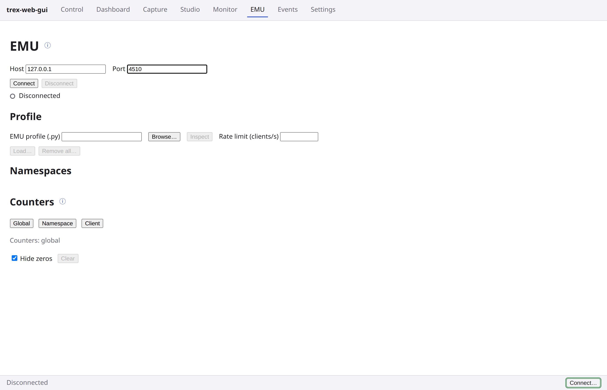
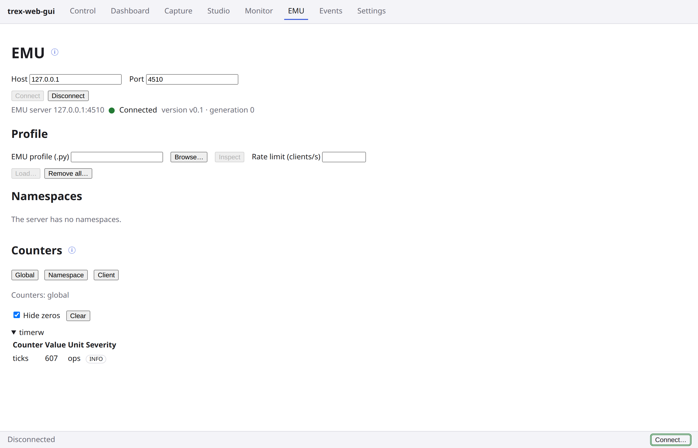
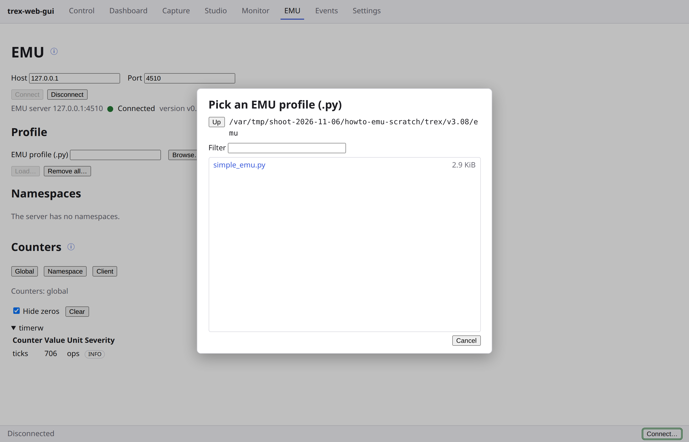
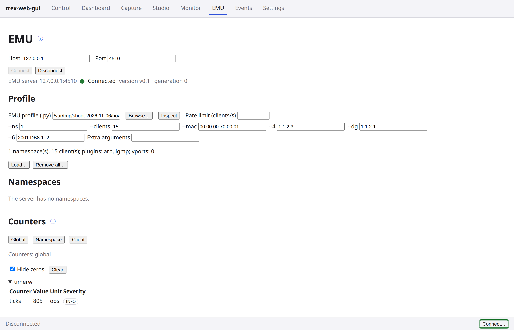
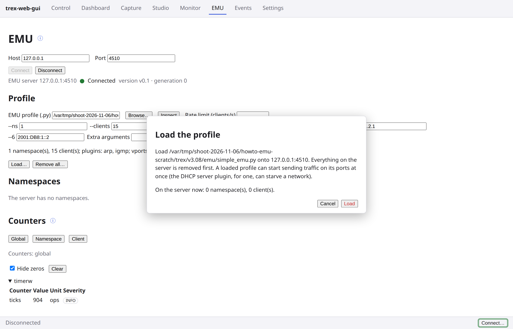
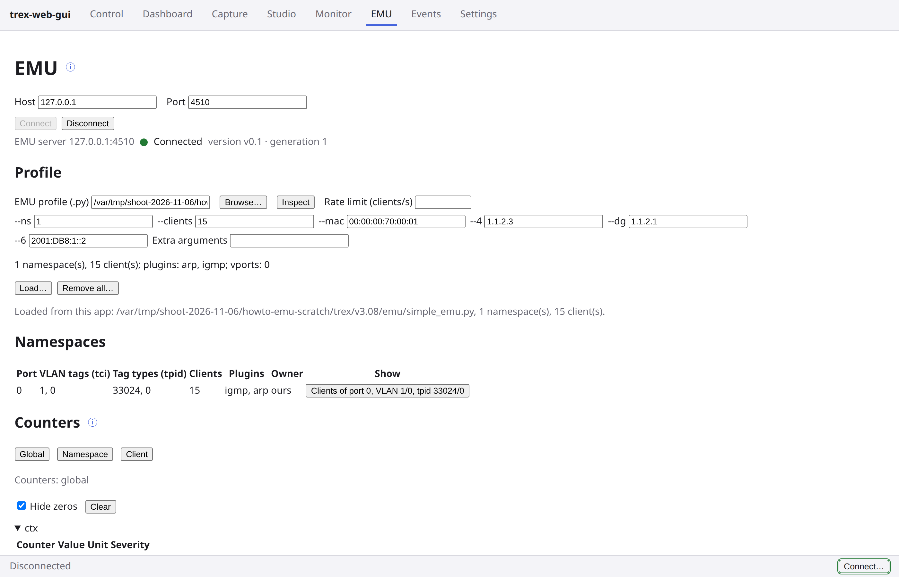
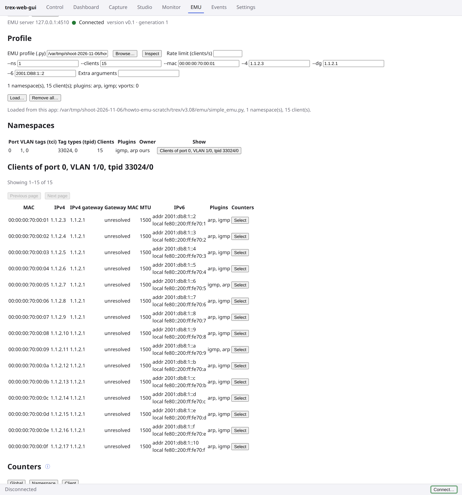
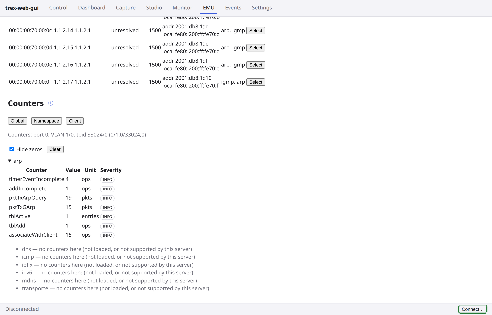
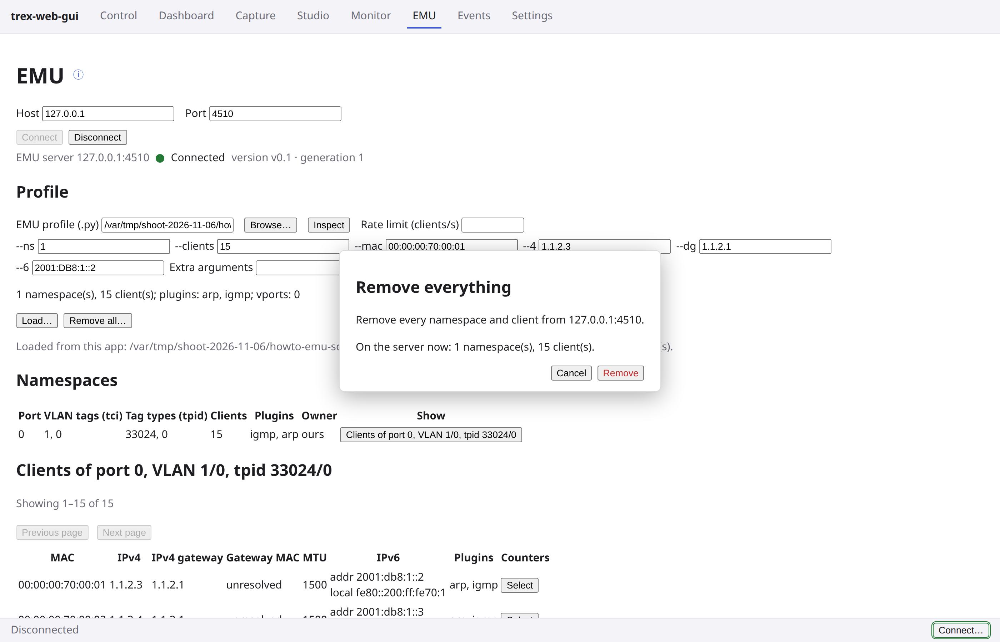
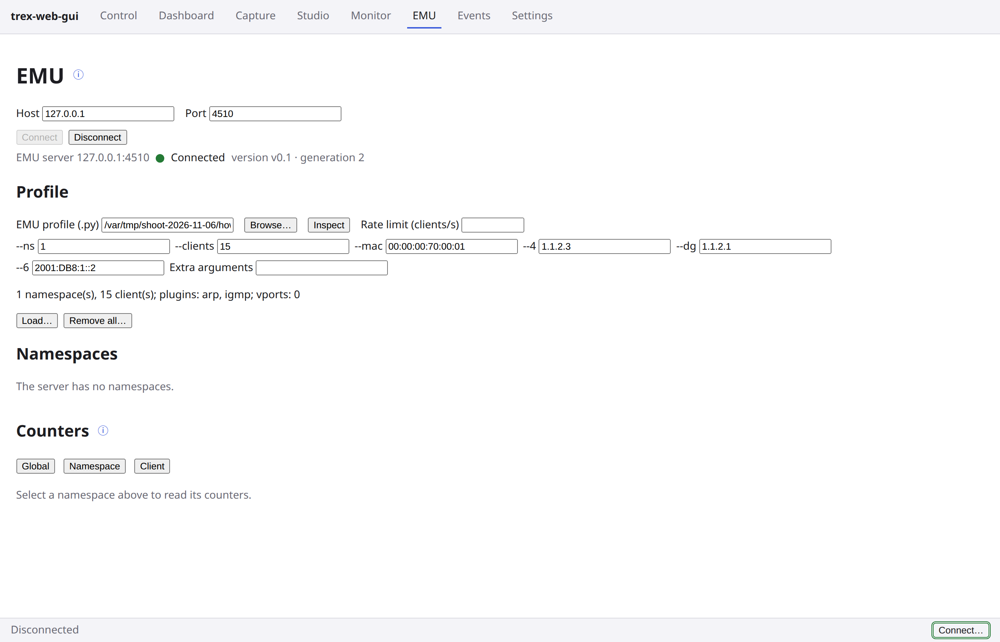

# trex-web-gui: your first EMU profile

A walk-through of the EMU page: connect to the TRex emulation server, load one of the EMU profiles TRex ships
(`simple_emu.py`: one namespace of 15 clients), read its namespaces, clients and counters, and remove it again. Every
button and message below is quoted as it appears on screen; the shots were taken by
[`vm/shoot_howto_emu.py`](../vm/shoot_howto_emu.py) against a test TRex server (v3.08, `trex-emu` v0.1) on
2026-11-06. The page's full reference is [section 11a of the GUI guide](gui-guide.md#11a-emu).

You need what [the first walk-through](howto-first-stream.md) needs (the wheel installed on the TRex server machine,
the GUI started there and opened through its SSH tunnel), with TRex started with EMU. The EMU page has its own
connection: this walk-through never connects the Control page. On the test guest (AF_PACKET ports) EMU needed
nothing else; on hardware NICs EMU may need its TRex port in filtered service mode with mask 29, which the Control
page's service control sets on an owned port (the "Port prerequisite" bullet of the
[README's EMU section](../README.md#emu)).

> **Before you start:** EMU's port (4510) has no authentication and no owner. Anyone who can reach it can read and
> change every namespace and client, and a load replaces everything on the server. Firewall it to the GUI host or
> reach it through a tunnel ([EMU exposure in the README](../README.md#emu-exposure)).

## Part 0: TRex with EMU

1. **Start TRex with `--emu`.** In TRex's directory on the server (for example `/opt/trex/v3.08`) start it in
   stateless mode with EMU: `./t-rex-64 -i --emu` (stop a TRex already running without `--emu` first). On the test
   guest TRex then started `trex-emu` itself, listening on port 4510.
   Upstream's tutorial adds `--software`, which hardware NICs may need; the README's
   [EMU section](../README.md#emu) has the details, and the **TRex daemon…** dialog takes `--emu` among its extra
   arguments. (The test guest runs `./t-rex-64 -i --iom 0 --no-scapy-server --emu --cfg /etc/trex_cfg.yaml`.)

2. **Open the EMU page.** Press **EMU** in the top bar. Type the server into **Host**: `127.0.0.1`, since the GUI
   backend runs on the TRex server (the field starts with the Control session's host when there is one, and
   remembers hosts used before). **Port** is `4510`.

   

3. **Connect.** Press **Connect**. The line under the buttons reads `EMU server 127.0.0.1:4510`, a green LED,
   `Connected`, and the server's version and generation. **Namespaces** reads `The server has no namespaces.`, and
   **Counters** shows the server's global counters (zeros hidden).

   

   The status bar at the bottom still reads `Disconnected`: it is the Control session's, and this walk-through
   never connects it.

## Part 1: load a profile

4. **Pick the profile.** Under **Profile** press **Browse…**. The dialog lists the backend host's files, starting in
   the workspace directory (**Settings**, **Files on the backend host**, **Workspace directory**; your home directory
   if unset). Go to TRex's own `emu/` directory, where TRex was unpacked (for example `/opt/trex/v3.08/emu`), and
   pick `simple_emu.py`.

   

   The shots show a scratch copy of the tree in place of `/opt/trex/v3.08`.

5. **Inspect.** Press **Inspect**. The page lists the profile's tunables, one input each (`--ns`, `--clients`,
   `--mac`, `--4`, `--dg`, `--6`, filled with the profile's defaults), an **Extra arguments** input, and what the
   profile would create: `1 namespace(s), 15 client(s); plugins: arp, igmp; vports: 0`. Leave the defaults. **Rate
   limit (clients/s)** can stay empty.

   

6. **Load.** Press **Load…**. The **Load the profile** box names the profile and the server, says that everything
   on the server is removed first and that a loaded profile can start sending traffic on its ports at once, and
   ends with what the server holds now (`On the server now: 0 namespace(s), 0 client(s).`). Press **Load**.

   

   When the server already holds namespaces this app did not add (another tool's, or an earlier session's), the box
   has a second check box to tick before **Load** removes them.

7. **The namespace.** The page says `Loaded from this app:` with the profile's path, `1 namespace(s), 15
   client(s).`, and **Namespaces** has one row: port `0`, VLAN tags `1, 0`, tag types `33024, 0` (0x8100, the
   802.1Q type), `15` clients, plugins `igmp, arp`, owner `ours` (this app added it).

   

## Part 2: read it

8. **The clients.** Press **Clients of port 0, VLAN 1/0, tpid 33024/0**. The table below lists the namespace's
   clients, 100 per page (`Showing 1–15 of 15`): MAC, IPv4, IPv4 gateway, gateway MAC, MTU, IPv6 (the address and
   the link-local one) and plugins. Each client's **Gateway MAC** reads `unresolved`: on the test guest nothing
   answers ARP for `1.1.2.1`; on a network that has that gateway it resolves.

   

9. **The counters.** Under **Counters** press **Namespace**: the selected namespace's counters, one table per
   plugin, with **Hide zeros** ticked, so a plugin whose counters are all zero (`igmp` here) shows no table. The
   `arp` table counts what the clients sent out of port 0 trying to resolve their gateway: `pktTxArpQuery` (ARP
   requests) and `pktTxGArp` (gratuitous ARPs). The list under the tables names the plugins with no counters at this
   scope, as `dns — no counters here (not loaded, or not supported by this server)`.

   

   **Global** shows the server's own counters. For one client, press **Select** on its row and then **Client**;
   with this profile every client counter is zero, so with **Hide zeros** ticked no table shows. **Clear**
   remembers the current values in this browser and shows the change since; the server's counters are never
   reset.

## Part 3: remove it

10. **Remove all.** Press **Remove all…**. The **Remove everything** box names the server and what it holds now
    (`On the server now: 1 namespace(s), 15 client(s).`). Press **Remove**.

    

11. **Empty again.** **Namespaces** reads `The server has no namespaces.`, the clients table is gone and
    **Counters** reads `Select a namespace above to read its counters.` Press **Disconnect** when done; TRex and EMU
    keep running.

    

## When something goes wrong

- **Connect fails**: TRex was not started with `--emu`, or port 4510 is not reachable from the backend host. The
  page shows the error under the buttons; a connection lost later reads `Connection lost` with its cause.
- **A load that stops part-way** says how far it got and leaves a partial profile on the server
  (`A partial profile is on the server`); load it again or press **Remove all…**.
- **A profile the page refuses to load**: the shipped `trex-emu` v3.08 crashes on some plugin combinations, and the
  page refuses those profiles ([section 11a](gui-guide.md#11a-emu) lists them). Restart TRex after a crash.
