# trex-web-gui: your first stream

A walk-through of the shortest useful job: send one UDP stream out of one port and watch it arrive on another. You do
it twice. In **Part 1** the stream comes from a profile TRex ships (`udp_1pkt_simple.py`). In **Part 2** you build your
own stream in Studio, change a field of its packet, and send that. Every button and message below is quoted as it
appears on screen; the shots were taken by [`vm/shoot_howto.py`](../vm/shoot_howto.py) against a test TRex server
(v3.08, STL API 5.1). The shots were taken on 2026-10-30.

You need the wheel installed with `uv tool install` **on the TRex server machine itself** (this walk-through's setup;
the GUI backend and TRex can also be on separate hosts; see
[Install in the README](../README.md#install)), TRex v3.08 running there in stateless mode, and a browser on another
machine.

> **This example's setup:** TRex ports 0 and 1 are cabled to each other (a loop), so what port 0 sends arrives on
> port 1. Without the loop the Rx check at the end of each part shows nothing. This is the setup of this example, not
> a requirement of the GUI: the GUI drives any port of any TRex server.

## Part 0: connect and get both ports

1. **Start the GUI on the server and open it from the other machine.** On the server run `trex-web-gui serve`. It prints
   three lines; the third is the tunnel and the login URL:

   ```
   From another machine: ssh -N -L 8765:127.0.0.1:8765 <you>@<server>, then open http://localhost:8765/api/auth/login?token=<token>
   ```

   On your other machine run the `ssh -N -L ...` command it prints and leave it running, then open the printed
   `localhost` login URL in your browser. The GUI is single-user and listens on the server's loopback only, which is
   why the tunnel is needed.

2. **Connect.** In the status bar at the bottom press **Connect…**. In the **Connect to TRex** dialog the host is `127.0.0.1`
   (the server is the machine the backend runs on); press **Connect**.

   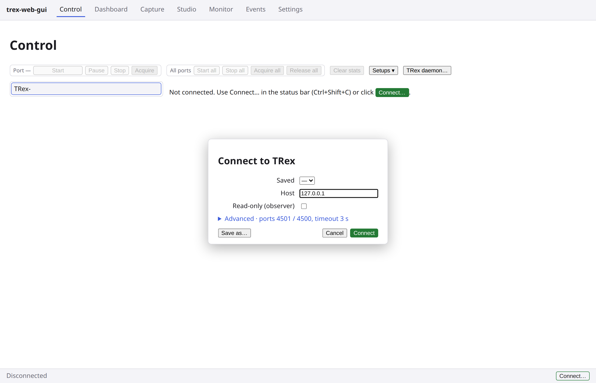

3. **Acquire both ports.** Press **Acquire all** in the toolbar (or select each port and press its **Acquire**). The
   tree shows `you` against Port 0 and Port 1, and the status bar reads `you own 0, 1`.

   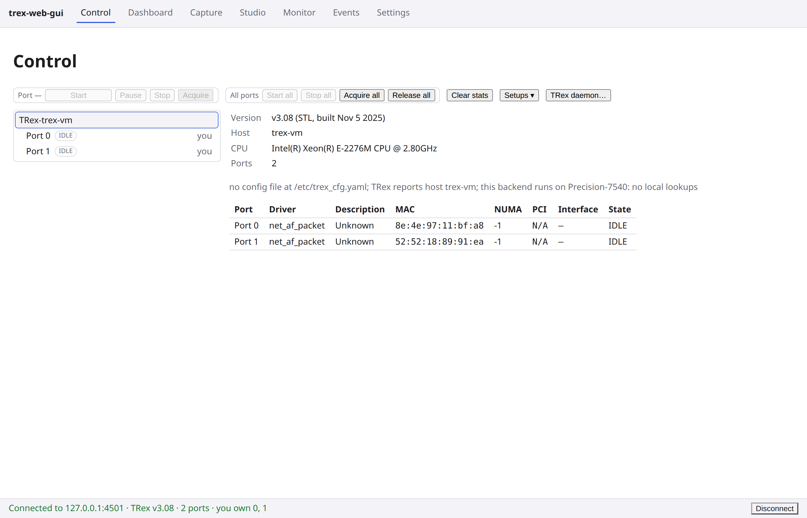

4. **Make port 1 accept port 0's packets.** A cable is not enough on a real NIC. A NIC drops unicast frames that are
   not addressed to its own MAC unless it is promiscuous, and the TRex client turns promiscuous off whenever it
   resets a port. The destination MAC port 0 transmits with comes from the server's `trex_cfg.yaml`, not from the
   cable. Two ways to make the frames match, both in the GUI; this example shows the first.

   - **Port 0's Config tab, Destination MAC.** In **L3** mode (a `trex_cfg.yaml` with `ip` and `default_gw` per port,
     TRex's usual loopback form, and the one the shots show) the **Destination MAC** is the ARP result and is
     read-only. It must read port 1's **Source MAC**, and the IPv4 state beside **Destination IPv4** must read
     `resolved`. Port 1's Config tab shows its Source MAC:

     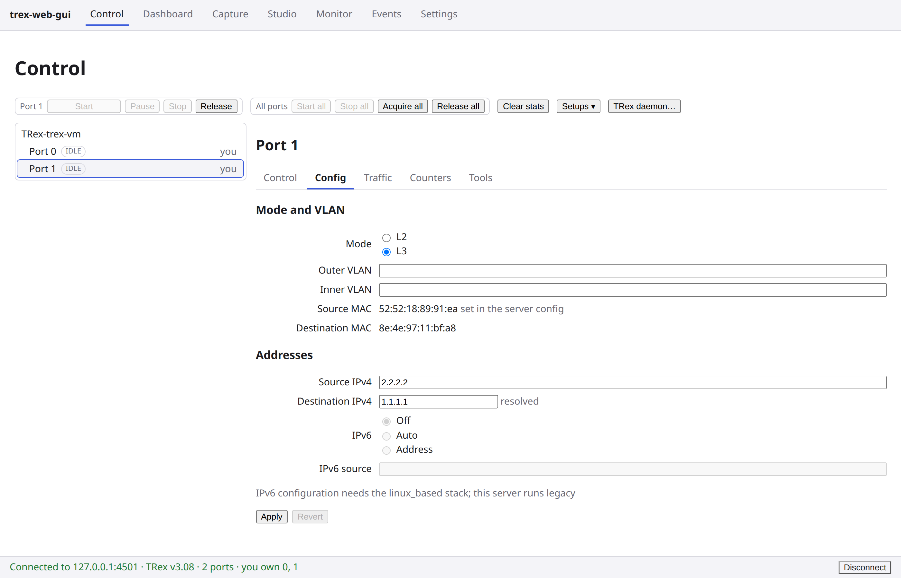

     On port 0's tab the Destination MAC is the same address:

     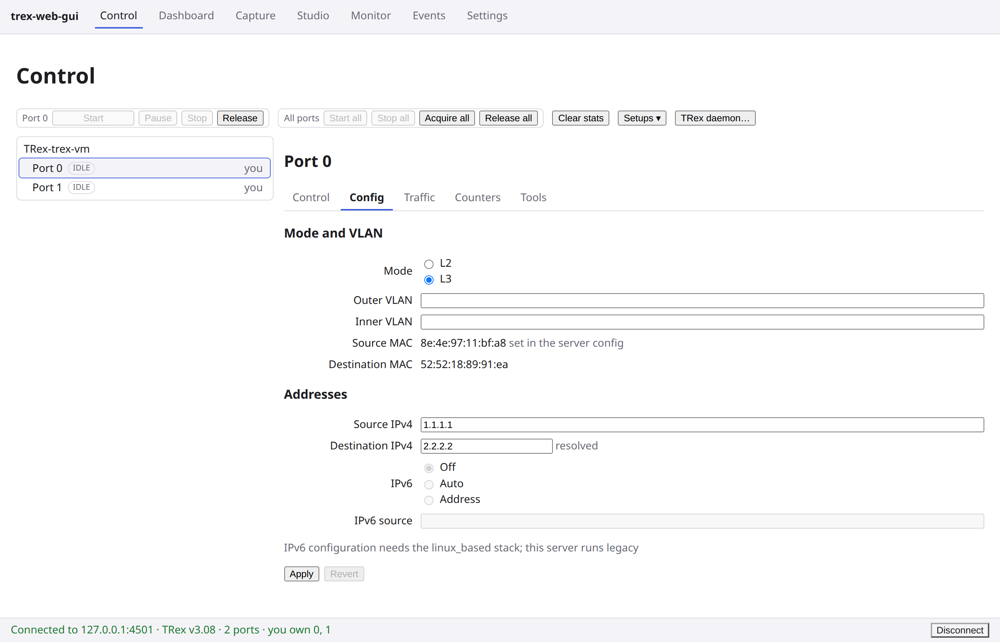

     In **L2** mode (a `trex_cfg.yaml` with `dest_mac`) **Destination MAC** is an input instead: type port 1's Source
     MAC into it and press **Apply**.
   - **Or port 1's Control tab, Attributes: tick Promiscuous.** Then port 1 takes any frame, whatever its destination.

   Which destination a stream uses: a packet whose Ethernet header is scapy's default `Ether()` is sent with the
   port's configured destination (the stream's flag is "from config file"). Both streams below are that, so the
   port's configuration wins. The packet's own address wins only if you edit the `Ether` destination of the packet,
   or set the **Destination MAC** field of the stream's **Properties** tab to From packet.

   On the test server the loop is a virtual pair that delivers every frame to the other end, so its Rx numbers would
   show even with a wrong destination; on real NICs, check this step.

## Part 1: a stock profile

5. **Pick the profile.** Select Port 0, open its **Traffic** tab and press **Browse…**. The dialog lists the server's
   files, starting in the workspace directory (**Settings**, **Files on the backend host**, **Workspace directory**,
   your home directory if unset). Go to TRex's own `stl/` directory, where TRex was unpacked (for example
   `/opt/trex/v3.08/stl`), and pick `udp_1pkt_simple.py`: one UDP stream and no tunables.

   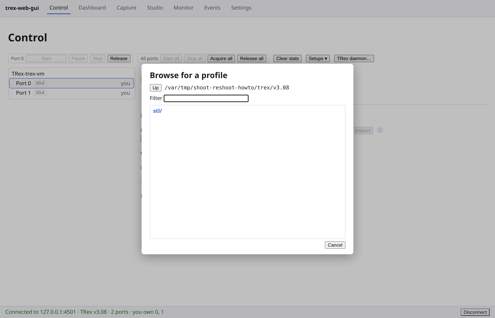

   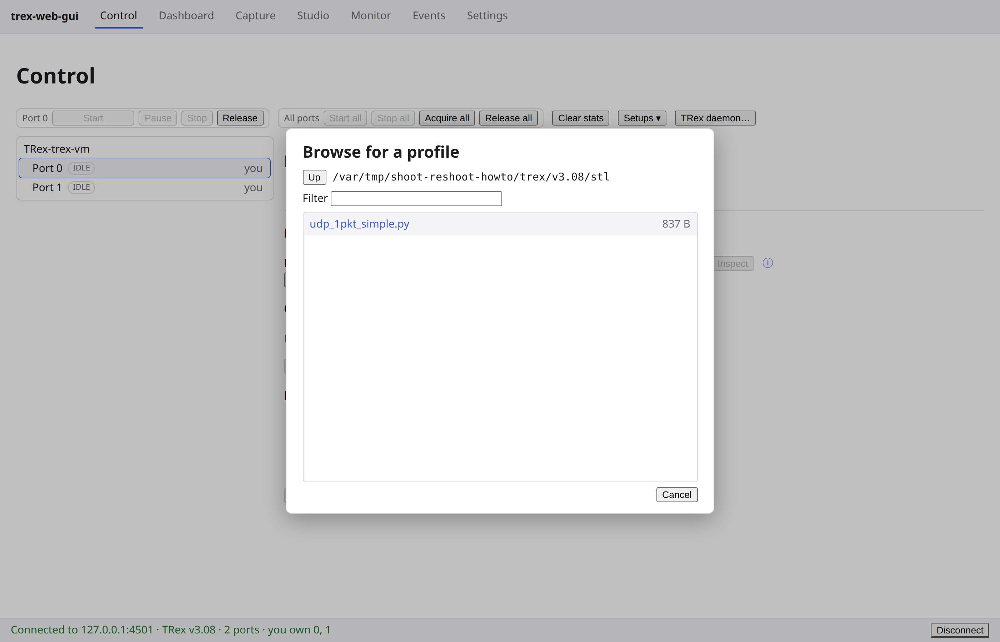

   The shots show a scratch copy of the tree in place of `/opt/trex/v3.08`.

6. **Inspect, rate, Assign.** Press **Inspect**: the stream table appears. Under **Rate** type `1kpps` into
   **Multiplier**; the reading beside it says `= 1,000 pps`. (A `k` needs a unit after it: `1k` alone is refused.)
   Press **Assign**, which puts the stream on the port. Press **Start**.

   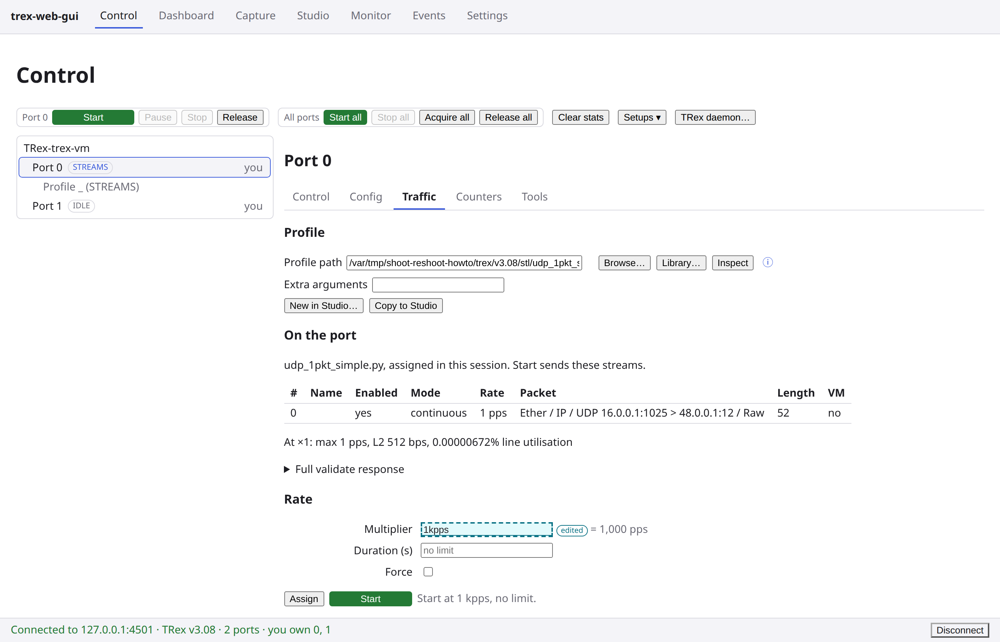

7. **Check, in this order.**
   1. Port 0's **Control** tab: the **State** chip reads `TX` (the port's badge in the tree reads `TX` too).

      

   2. The **Dashboard**, **Overview** tab, the ports table: **Tx pps** for Port 0 is about 1000 pps, and **Rx pps**
      for Port 1 follows at the same rate, because of the loop. (A port's own panel shows no rate; the pps table is
      on the Dashboard.)

      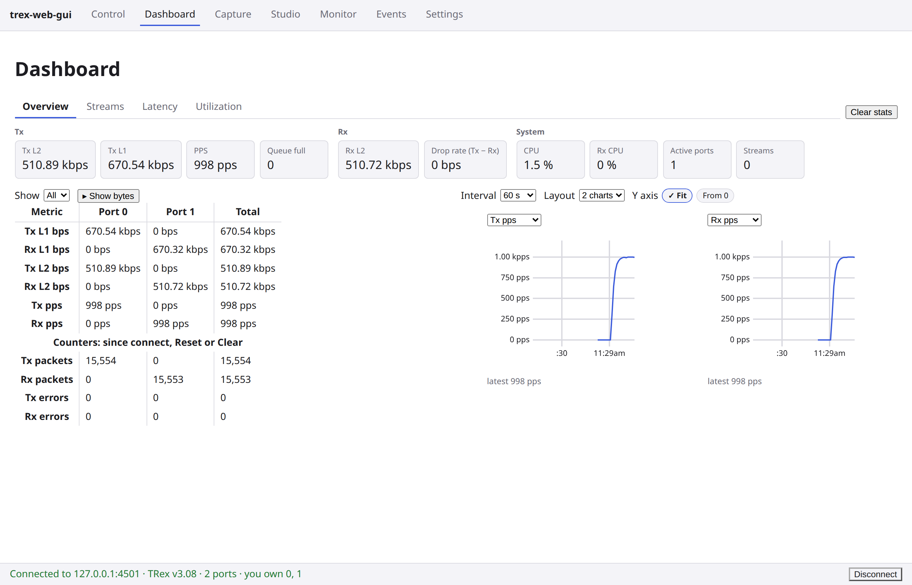

   Go back to **Control**, select Port 0 and press **Stop**. The `State` chip returns to `STREAMS`: the stream is
   still assigned, only not running.

## Part 2: your own stream in Studio

8. **A new profile with one stream.** Open **Studio**. In the library press **New…**, type a name (`My first
   stream`) and press **Create**. Press **Add stream**: it adds a continuous stream whose packet is already a single
   UDP packet, `Ether / IP / UDP`.

   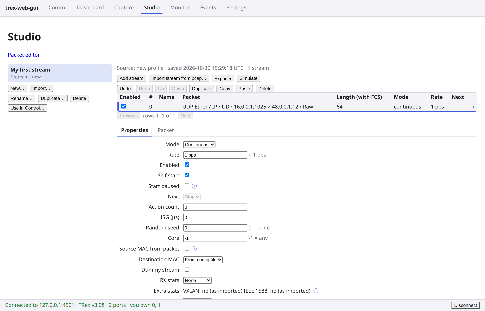

9. **Edit the packet.** Select the stream, open its **Packet** tab and press **Edit packet**. The embedded editor opens
   with **Presets…**, **Cancel** and **Save**. Press **Expand all** and read the three layers: `Ether`, `IP`, `UDP`
   (and the payload, `Raw`). Leave `Ether` alone. Its **Destination** reads `00:00:00:01:00:00`, scapy's placeholder,
   and is not what is sent: the stream's **Destination MAC** (on its **Properties** tab) is `From config file`, so
   port 0 sends to the address of step 4. Editing this field would switch the stream to From packet.

   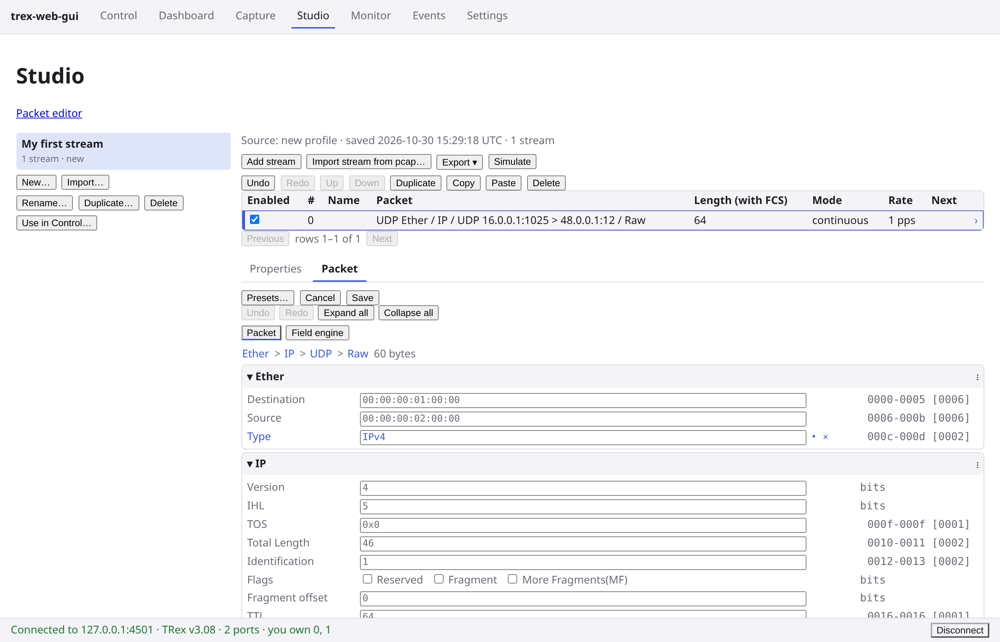

   Change the UDP **dport** field to `5000`, so the stream is yours and **Save** has a change to save, then press
   **Save**.

   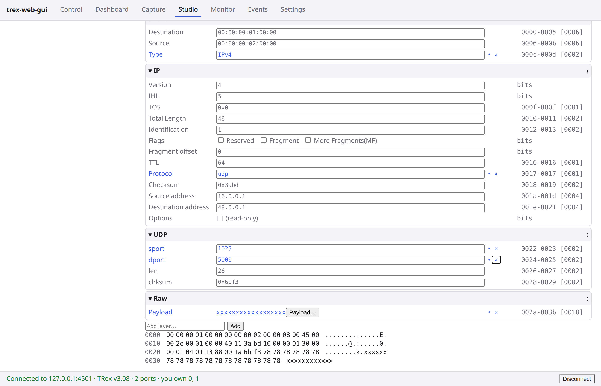

10. **Set the rate.** Open the stream's **Properties** tab, type `1000` into **Rate** (a bare number is pps; the
    reading beside it says `= 1,000 pps`) and press **Save**. The stream table's **Rate** column then reads `1.00 kpps` (the shot is taken before Save: the
    field is marked edited and the table still reads `1 pps`).

    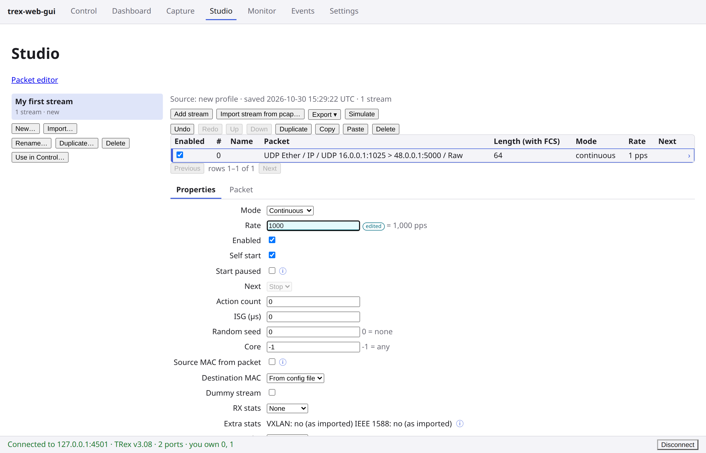

11. **Send it to port 0.** Press **Use in Control…**, leave **Port** at `Port 0` and press **Open Traffic tab**. The
    dialog names the rate Port 0's form still holds (`Port 0's rate stays 1 kpps: …`); the handoff does not change it.

    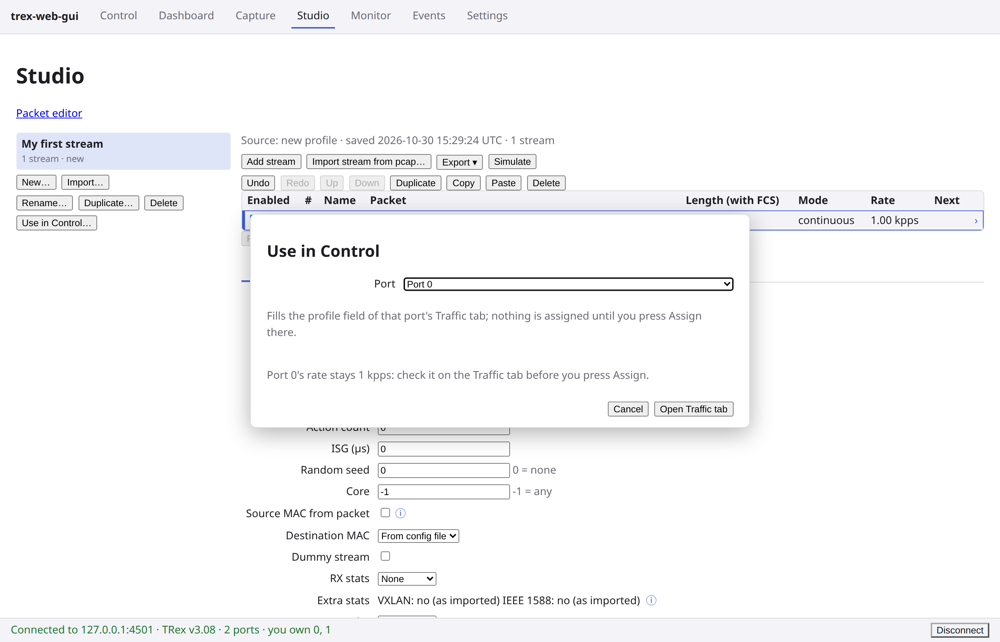

    Control opens on Port 0's **Traffic** tab with the profile already inspected (no **Inspect** needed); its path is
    the library's file under the backend's data directory (a scratch directory in the shot). Part 1 left
    its rate in the form (the line beside **Start** reads `Start at 1 kpps, no limit.`): replace what **Multiplier**
    holds with `1`, a bare number, which is a factor (`= ×1 the profile's rates`), so the stream runs at its own
    1000 pps. Press **Assign**, then **Start**.

    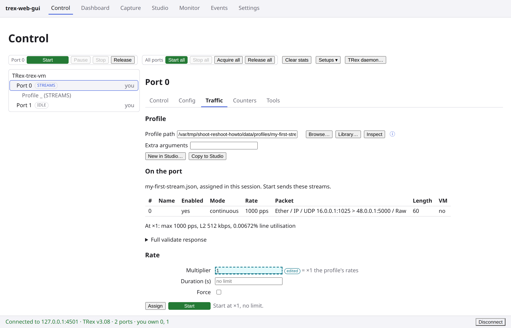

12. **The same two checks.** The **State** chip on Port 0's **Control** tab reads `TX`; the Dashboard's **Tx pps** on
    Port 0 and **Rx pps** on Port 1 read about 1000 pps.

    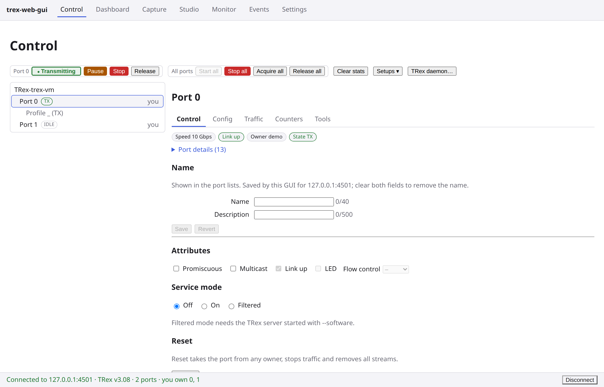

    

    Back in **Control** press **Stop**, then **Release all** to give the ports back.

Next: the [GUI guide](gui-guide.md) describes every page.
